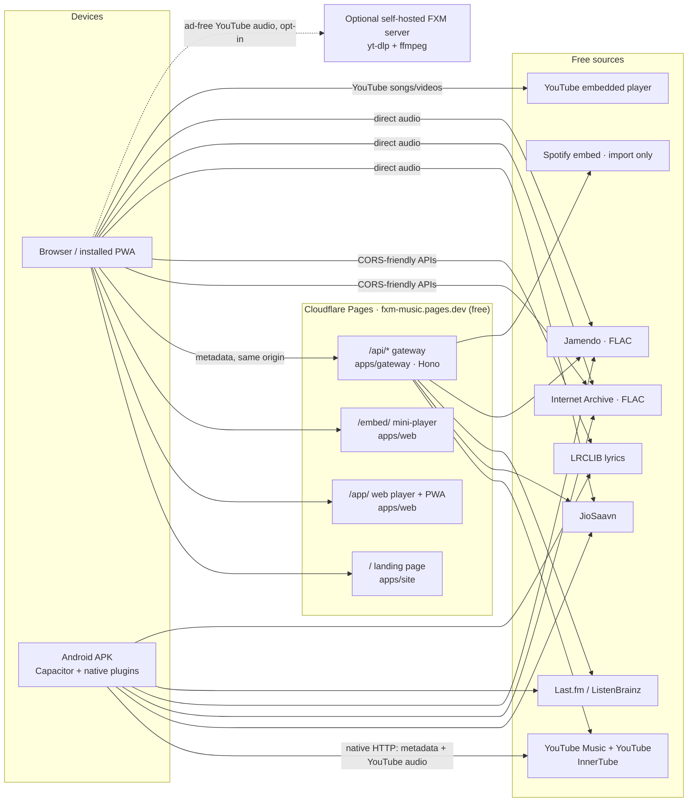
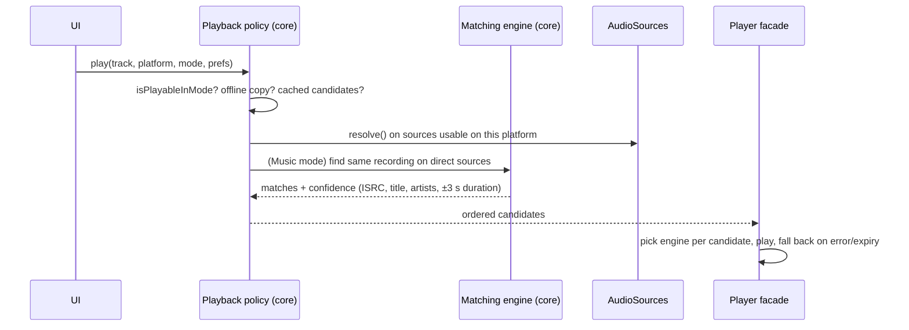

# FXM Architecture

FXM (Free Cross-platform Media) is a free, open-source music player. You can search and stream practically any song, download music in several formats (real lossless FLAC where the source has it), and get a personal home feed in the style of Spotify. It needs no accounts and no paid APIs.

This document explains **how** FXM is built and **why**. The build order is in [PLAN.md](PLAN.md), and the branching and parallel-agent workflow is in [WORKFLOW.md](WORKFLOW.md).

---

## 1. Deliverables

One TypeScript codebase produces four things, served from one free domain:

| Deliverable | What it is | Where |
|---|---|---|
| **Web page** | Public landing site: features, screenshots, "Open player", "Install app", "Download APK" | `https://fxm-music.pages.dev/` |
| **Web applet** | The full player as an installable PWA. It opens in its own window without browser chrome, like Spotify's "Install app", and plays downloaded music offline | `https://fxm-music.pages.dev/app/` |
| **Embeddable mini-player** | An `<iframe>` player for a track, album or playlist that anyone can paste into a website | `https://fxm-music.pages.dev/embed/…` |
| **Android APK** | The same UI packaged with Capacitor. It adds native background playback, ad-free YouTube audio resolved on the phone, and device music | GitHub Releases |

**Hosting:** Cloudflare Pages (free plan) gives `<project>.pages.dev` with no domain purchase. `fxm.pages.dev` is taken, so the project name is **`fxm-music`**, with `fxmplayer` as the fallback. Static files are free and unlimited. The small `/api` gateway uses Pages Functions within the free 100k requests/day.

### Non-goals (for now)

- A native iOS app (the PWA works in iOS Safari with Apple's limits)
- Ripping DRM-protected services (Spotify audio, Tidal, Qobuz, Apple Music, Deezer)
- Hosting or relaying audio on FXM infrastructure
- User accounts or a server-side database

---

## 2. What we take from Bloomee and Spotube

| | Bloomee | Spotube | FXM |
|---|---|---|---|
| Stack | Flutter + Rust plugin runtime | Flutter | TypeScript (React, Capacitor, Hono) |
| Metadata | Plugins (`.bex`) | Plugins since 5.0 (MusicBrainz, ListenBrainz) | `MetadataProvider` interface |
| Audio | Plugins; "Smart Replace" finds a working stream when one dies | Audio-source plugins since 5.1 (YouTube, Piped, NewPipe) | `AudioSource` interface + **matching engine** |
| Recommendations | Last.fm + plugins | Via metadata plugins | YouTube Music radio + Last.fm + ListenBrainz + on-device ranking |
| Extras | Synced lyrics, EQ, crossfade, scrobbling | Synced lyrics, scrobbling | Same, phased in |

We copy the idea of **separating "what to play" from "where the audio comes from"**. A song can be found on YouTube Music, imported from Spotify, or recommended by Last.fm. FXM then plays it through the best pipe available on the current platform.

We fix one common mistake: **mixing up songs and videos** (see §4).

---

## 3. External constraints (checked October 2026)

- **YouTube is the only free "any song" catalog.** That makes YouTube Music and YouTube FXM's primary catalog. JioSaavn, Internet Archive and Jamendo are secondary sources, valued for quality (320 kbps, FLAC) and ad-free web playback.
- **YouTube is hostile to third-party clients.** It enforces PO (proof-of-origin) tokens and is moving playback to the SABR protocol. Stream URLs are bound to the IP that requested them. → Resolve YouTube audio **on the device that plays it** (Android) or on the user's own server, never on a shared datacenter edge.
- **YouTube's embedded player is the only legitimate way to play YouTube inside a plain website.** Its [developer policies](https://developers.google.com/youtube/terms/developer-policies) forbid separating audio from video (III.I.7), playing from a background player that isn't shown on the page (III.I.9), and blocking YouTube's ads (III.I.5). → On the web, the embedded player is visible as the artwork/video panel, and FXM offers ad-free alternatives (§9).
- **Spotify Web API is closed for recommendations.** `/recommendations`, related artists and audio features have been gone for new apps since Nov 2024. Since **March 2026**, Development Mode needs a Premium-paying owner and allows 5 users. It has lost browse and artist top tracks, and only returns items for playlists the user owns. → Spotify is used **only to import** public playlists and albums by URL.
- **Browsers enforce CORS.** YouTube Music InnerTube and JioSaavn send no CORS headers. Internet Archive and LRCLIB send `Access-Control-Allow-Origin: *`. → A same-origin gateway handles metadata calls for the web build. Playing audio via `<audio src>` needs no CORS.
- **YouTube has no lossless audio.** Its best is Opus ~160 kbps or AAC. JioSaavn's best is AAC 320 kbps. **Real FLAC** comes from Internet Archive, Jamendo (`audioformat=flac`), the user's own files, or future plugins. → Quality tiers are explicit, and a FLAC made from a lossy source is labelled *transcoded*.
- **ffmpeg-kit (the usual Android ffmpeg) is retired.** → Transcode with **ffmpeg.wasm** in both the browser and the Android WebView. The optional self-hosted server uses native ffmpeg.

---

## 4. Catalog modes: Music vs Music + Video

YouTube mixes two very different things: catalog **songs** and **videos**. Open-source players commonly get this wrong in one of two ways:

1. They search regular YouTube for a song and play the first hit. That can be a lyric video, a music video with a skit intro, a live or sped-up version, or the wrong song entirely.
2. They only search YouTube Music, so covers, live sets, remixes and rare uploads that exist only as videos can't be played.

FXM makes the choice explicit with a global **mode** (Settings, plus a quick toggle in the search bar):

| | **Music mode** (default) | **Music + Video mode** |
|---|---|---|
| Searchable and playable | YouTube Music catalog **songs** (official album audio) + JioSaavn / Archive / Jamendo / local tracks | Everything in Music mode **plus** official music videos and any YouTube video (covers, live, remixes, uploads) |
| An official music video shows up in a playlist, radio or link | Swapped to its **song counterpart** (YouTube Music links the two); hidden if there is none | Plays as the video |
| Radio, autoplay, recommendations | Songs only | Songs and videos |
| Imports (Spotify, CSV) | Matched to catalog songs only | Songs first, videos as fallback |
| Labels on every result | Song | Song · Official video · Video |

**Classification** uses YouTube Music's `musicVideoType`:

| `musicVideoType` | FXM kind |
|---|---|
| `ATV` | `song` |
| `OMV` / `OFFICIAL_SOURCE_MUSIC` | `music-video` |
| `UGC` or missing | `video` |
| podcast types | `episode` (hidden for now) |

Results from regular YouTube search are always `video`. The rules live in one pure function in `packages/core` (`isPlayableInMode`, `applyModeFilter`). Search, radio, recommendations, imports and the queue all call it, so the mode can't be bypassed.

---

## 5. System overview



The gateway **never relays audio bytes**, for three reasons: free-plan limits and terms, YouTube's IP-bound URLs, and bot detection on datacenter IPs.

---

## 6. Repository layout

```
apps/
  web/        React + Vite: the player (/app) and the embed entry (/embed)
  site/       Astro static landing page (/)
  gateway/    Hono app deployed as Cloudflare Pages Functions (/api)
  mobile/     Capacitor Android project + Kotlin plugins (player, downloads)
  server/     Optional self-hosted Node server (yt-dlp in uv .venv, ffmpeg)
packages/
  core/       Domain types, interfaces, mode policy, queue, matching engine,
              playback policy, recommendation engine. Pure TS, no DOM/Node APIs
  sources/    One folder per provider: youtube, jiosaavn, archive, jamendo,
              lrclib, lastfm, listenbrainz, spotify-import, piped, remote
  player/     Player facade + engines (direct audio, YouTube embed, native bridge)
docs/         Architecture, plan, workflow, development guide
scripts/      Toolchain bootstrap (everything installs into .tools/)
```

`make build` composes one `dist/`: the site at `/`, the app at `/app/`, the embed at `/embed/`, and the gateway as the Functions bundle. One `wrangler pages deploy` publishes everything.

---

## 7. Core concepts

### 7.1 Entities and IDs

IDs are source-qualified: `<source>:<kind>:<nativeId>`, for example `ytm:track:dQw4w9WgXcQ` or `saavn:album:abc123`.

A `Track` carries:

- normalized metadata: title, artists, album, duration, artwork, explicit flag, ISRC when known
- `kind`: `song | music-video | video | episode`
- a `counterpartId` for song↔video pairs
- the IDs of the same recording in other sources, once matched

### 7.2 Provider interfaces (`packages/core`)

```ts
interface MetadataProvider {            // "what exists"
  id: SourceId
  capabilities: ReadonlySet<'search' | 'album' | 'artist' | 'playlist' | 'radio' | 'charts'>
  search(query: string, opts: SearchOptions): Promise<SearchResults>   // opts.mode filters kinds
  getAlbum(id: string): Promise<Album>
  getArtist(id: string): Promise<Artist>
  getPlaylist(id: string): Promise<Playlist>
  getRadio?(seed: Track, mode: CatalogMode): Promise<Track[]>
}

interface AudioSource {                 // "where the audio comes from"
  id: SourceId
  resolve(track: Track, prefs: QualityPrefs): Promise<StreamCandidate[]>
}

interface StreamCandidate {
  delivery: 'direct' | 'youtube-embed'  // a URL for an audio element, or a video ID for the official player
  url?: string
  videoId?: string
  codec?: 'flac' | 'alac' | 'pcm' | 'opus' | 'aac' | 'vorbis' | 'mp3'
  tier: 'lossless' | 'high' | 'normal' | 'low' | 'unknown'
  bitrateKbps?: number; sampleRateHz?: number; bitDepth?: number
  expiresAt?: number                    // signed URLs expire
  adFree: boolean
  playableOn: ReadonlyArray<'web' | 'android' | 'server'>
}
```

`LyricsProvider` and `RecommendationProvider` follow the same pattern.

### 7.3 Runtime-agnostic providers

Providers use only `fetch` and web-standard APIs, so the **same code runs in three places**:

- **Cloudflare Worker (gateway).** The web build calls typed endpoints such as `GET /api/v1/youtube/search?q=…&mode=music`. The gateway runs the provider and returns normalized JSON.
- **Android WebView.** Providers run locally with a native-HTTP `fetch` (no CORS, the phone's own IP).
- **Node (optional server, tests).**

On the web, the app uses a `RemoteProvider` that implements the same interface over HTTP, so app code never knows which mode it runs in.

### 7.4 Quality tiers

| Tier | Meaning | Typical sources |
|---|---|---|
| `lossless` | FLAC / ALAC / WAV **from the source** | Internet Archive, Jamendo, local files |
| `high` | AAC ≥ 256, Opus ≥ 128, MP3 320 | JioSaavn 320, YouTube Opus (Android/server) |
| `normal` | ~128–160 kbps | JioSaavn 160, YouTube AAC |
| `low` | ≤ 96 kbps (data saver) | JioSaavn 96, Jamendo mp31 |
| `unknown` | Quality decided by YouTube's player | YouTube embedded player |

---

## 8. Platform capability matrix

| Capability | Web / PWA | Android APK | + self-hosted server |
|---|---|---|---|
| Search YouTube Music & YouTube (both modes) | ✅ via gateway | ✅ on device | ✅ |
| **Play any YouTube song/video** | ✅ official embedded player (visible, YouTube ads possible) | ✅ ad-free audio resolved on device | ✅ ad-free audio (yt-dlp) |
| Ad-free web playback of YouTube songs | ✅ when a high-confidence match exists on JioSaavn/Archive/Jamendo (Music mode) | n/a | ✅ always |
| JioSaavn audio (≤ 320 AAC) | ✅ direct from CDN | ✅ | ✅ |
| Internet Archive / Jamendo FLAC | ✅ | ✅ | ✅ |
| Background playback | ✅ tab or PWA window (direct audio); embedded player may pause on phones | ✅ Media3 foreground service | — |
| Downloads | ✅ OPFS + save file (direct sources) | ✅ incl. YouTube | ✅ incl. YouTube, server-side transcode |
| Transcode (FLAC, MP3, Opus…) | ✅ ffmpeg.wasm | ✅ ffmpeg.wasm in WebView | ✅ native ffmpeg |
| Local music files | ✅ Chromium folder access; file picker elsewhere | ✅ MediaStore scan | — |
| Equalizer | ⚠️ only CORS-enabled or downloaded audio (Web Audio rule) | ✅ ExoPlayer effects | — |

---

## 9. Playback

### 9.1 Engines (`packages/player`)

Every engine implements one interface: `load(candidate)`, `play`, `pause`, `seek`, `setVolume`, plus events (`timeupdate`, `ended`, `error`, `stalled`).

| Engine | Platform | Plays | Notes |
|---|---|---|---|
| **Direct audio** (`HTMLAudioElement`) | web | JioSaavn, Archive, Jamendo, FXM server, Piped, offline files | Audio-only, ad-free, background-friendly. A second element preloads the next track for near-gapless playback |
| **YouTube embedded player** (IFrame API, `youtube-nocookie.com`) | web | YouTube songs and videos with no direct stream | See the constraints after this table |
| **Native** (Media3 ExoPlayer + MediaSessionService) | Android | Everything, including YouTube audio resolved on the device | Ad-free, audio-only, background, notification and lock-screen controls, audio focus, gapless, FLAC |

Constraints on the **YouTube embedded player**:

- It is always shown: in the now-playing artwork/video area, or as a floating mini card at least 200×200 when that view is closed.
- It is never hidden or run in the background, and its ads are never blocked.
- Some videos disable embedding (errors 101/150), and FXM then falls back to the next candidate.
- Phones may pause it when the screen locks.
- Lock-screen controls may belong to the YouTube frame.
- YouTube refuses embeds without a referrer, so the site keeps `Referrer-Policy: strict-origin-when-cross-origin`.

### 9.2 Playback policy: which pipe plays a track (`packages/core`)

The first candidate that works wins, and an error falls through to the next.

| Platform | Order |
|---|---|
| **Web** | Offline copy → FXM server (if connected) → ad-free match (Music mode only, high-confidence, setting on by default) → Piped instance (if configured) → YouTube embedded player |
| **Android** | Offline copy → YouTube audio resolved on device → direct-source match → FXM server / Piped |

- **Video mode items always play the exact video.** Covers, live versions and uploads are unique, so there is never an "equivalent" substitution.
- Now playing always shows the pipe ("via JioSaavn · AAC 320", "via YouTube player") and offers a **source switcher**.
- Queue logic (shuffle, repeat, history, autoplay extension) lives in `core` and is shared by all engines. The player facade switches engines between tracks.

### 9.3 Track resolution



Matches are cached in IndexedDB so the second play is instant. This also gives Bloomee-style "Smart Replace" when a stream dies.

---

## 10. Gateway (`/api`)

- **Typed endpoints, not an open proxy.** Each route runs specific provider code with validated parameters.
- **Edge cache** (Cache API): search 10 min, album/artist/playlist 6 h, charts 1 h. This stretches the free 100k req/day.
- **Secrets** (`LASTFM_API_KEY`, `JAMENDO_CLIENT_ID`) are Pages secrets. Locally they live in `.dev.vars` (gitignored).
- **Rate limiting** per IP. Returns `429` with `Retry-After`, and the client backs off.
- Versioned under `/api/v1/` so the APK and the web app can evolve independently.

---

## 11. Storage (no server database)

| Data | Web | Android |
|---|---|---|
| Library (likes, playlists, follows), history, listening signals, match cache, settings (incl. mode) | IndexedDB (Dexie) | Same (WebView IndexedDB) |
| Downloaded audio | OPFS + `navigator.storage.persist()` | App files; optional export to `Music/FXM` via MediaStore |
| Backup | JSON export/import (later: optional GitHub Gist sync) | Same |

---

## 12. Recommendations ("Spotify-style", on-device)

All personal data stays on the device. External services only receive anonymous seed queries such as "similar to track X". Everything respects the current mode.

1. **Signals:** every play logs `playedMs`, completion %, skip (< 30 s or < 25 %), like/unlike, playlist add and context.
2. **Affinity:** time-decayed scores (half-life about 14 days) per track, artist and tag. Likes ×3, completions +1, skips −1.
3. **Candidates:**
   - YouTube Music radio (`RDAMVM…`), which is YouTube's own recommender
   - Last.fm `track.getSimilar`, `artist.getSimilar`, `tag.getTopTracks`
   - ListenBrainz similar artists / LB Radio
   - Top songs of followed and highly ranked artists
4. **Score:** `affinity + similarity + popularity + novelty − skip penalty − recently-played penalty`.
5. **Diversity:** MMR re-ranking with a per-artist cap.
6. **Home shelves:**
   - **Quick picks**
   - **Daily Mix 1–6** (artist clusters)
   - **Discover** (stable per ISO week)
   - **Because you listened to X**
   - **Rediscover**
   - **On repeat**
7. **Endless autoplay** from the last 5 plays, retuned live by likes and skips.
8. **Cold start:** onboarding picks 3+ artists and genres from regional charts.

---

## 13. Downloads and formats

| Output | Lossless? | Notes |
|---|---|---|
| **Original** (default) | as source | No re-encode, so no quality loss |
| FLAC, ALAC (.m4a), WAV | ✅ only if the source is lossless | From a lossy source the file is tagged and labelled *transcoded* |
| Opus, AAC (.m4a), MP3 320 | lossy | For compatibility and size |

Tags (title, artist, album, track number, ISRC, lyrics) and cover art are embedded. ffmpeg.wasm loads lazily in a Web Worker (single-threaded core, so no COOP/COEP headers are needed).

On the web, YouTube downloads need a connected FXM server, because the embedded player exposes no file. On Android they work natively.

---

## 14. Imports

- **Spotify:** paste a public playlist, album or track URL. The gateway reads the public embed page (no API key). The matching engine finds the songs, respecting the mode, and unmatched tracks are listed for manual search. Fallback: CSV (Exportify-style columns).
- **YouTube Music / YouTube playlists** by URL.
- **M3U / CSV / FXM JSON backups.**

---

## 15. Security, privacy, licensing

- No accounts, analytics or tracking. Scrobbling is opt-in.
- Secrets never ship in the client bundle.
- **License:** Apache-2.0. Dependencies must be compatible: MIT, BSD, Apache, ISC, MPL. `youtubei.js` (MIT) is the YouTube client. **NewPipeExtractor is GPL-3.0**, so using it would make the APK GPL-licensed. It is only a possible future option.

---

## 16. Risks and mitigations

| Risk | Impact | Mitigation |
|---|---|---|
| YouTube changes (PO tokens, SABR, bot checks) | Android/server YouTube audio breaks | Multiple pipes per track. Keep `youtubei.js` current. yt-dlp on the server. Embedded player as the web fallback |
| Embedded player: ads, no-embed videos, phone background pauses | Weaker web experience for YouTube items | Ad-free matches, FXM server, Piped. Clear labels. The APK is the full experience |
| Gateway rate-limited by YouTube/JioSaavn | Web search fails | Edge cache, backoff, Android goes direct, user server |
| Free-tier limits (100k Functions req/day) | `/api` 429s at peak | Caching; static assets are free; CORS-friendly sources skip the gateway |
| Spotify embed format changes | Import breaks | CSV fallback; isolated parser with fixtures |
| Terms of service of the sources | Takedowns of the public instance | FXM is a client like NewPipe, Spotube and Bloomee. It hosts no media, circumvents no DRM, and is self-hostable. Disclaimer on the site |
| Browser storage eviction | Lost offline downloads | Persistent storage request, usage UI, re-download |
| Web Audio + CORS | EQ silent on cross-origin streams | EQ on CORS/downloaded audio only on web; full EQ on Android |

---

## 17. Decision log

| # | Decision | Why |
|---|---|---|
| D1 | TypeScript everywhere (React + Vite, Capacitor, Hono) | One language across web, APK, gateway and server; first-class web/PWA. Chosen by the project owner |
| D2 | Cloudflare Pages + Pages Functions on `fxm-music.pages.dev` | Free, no domain purchase, static hosting and API on one origin |
| D3 | Gateway relays metadata only, never audio | Free-plan limits and terms, YouTube IP-bound URLs, bot detection |
| D4 | Metadata providers separate from audio sources, joined by a matching engine | Spotube/Bloomee lesson: resilience and best pipe per platform |
| D5 | Recommendations computed on device | Privacy, zero server cost, Spotify API closed |
| D6 | `youtubei.js` (MIT) over NewPipeExtractor (GPL-3.0) | Keeps the project Apache-2.0 |
| D7 | pnpm (pinned standalone binary), Biome, Vitest, uv for Python | Fast, few dependencies, reproducible. Corepack can't run pnpm 12 and leaves Node from v25 |
| D8 | All toolchains inside the repo (`.tools/`, `.venv/`, `node_modules/`), removed by `make nuke` | Owner's requirement: nothing global, everything deletable |
| D9 | Two catalog modes, Music vs Music + Video, enforced by one core policy | Owner's requirement; avoids the songs-vs-videos mix-up common in open-source players |
| D10 | Web plays YouTube through the official, visible embedded player; ad-free pipes are preferred when available | The only free, policy-compliant way to play any YouTube song in a plain website |
| D11 | `main` / `develop` / one feature branch per stage; parallel agents use git worktrees sharing one `.tools/` | Owner's requirement: multiple agents working in parallel without collisions |
