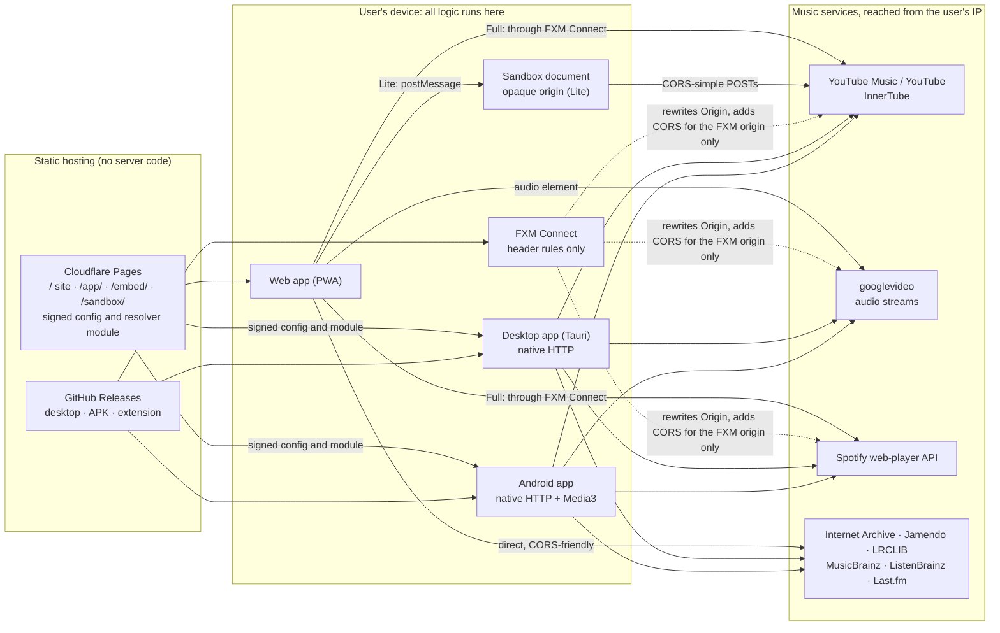

# FXM Architecture

FXM (Free Cross-platform Media) is a free, open-source music player for the web, desktop and Android. It lets you:

- search and play practically any song (§10 lists the exceptions);
- download any track in the format you want, with real lossless FLAC where the source has it;
- get a personal home feed with Spotify-quality recommendations.

**FXM has no servers.** Everything runs on the user's own device.

This document explains how FXM is built and why. The build order is in [PLAN.md](PLAN.md). Branching, worktrees and the agent workflow are in [WORKFLOW.md](WORKFLOW.md).

**Evidence.** Revision 3 (2026-10-25) rests on the [user-side research memo](research/2026-10-25-userside-memo.md), the [review of its first draft](research/2026-10-25-userside-memo-critique.json) and the owner's decisions on it, which [PLAN.md](PLAN.md) lists. Facts marked *measured* come from live experiments on 2026-10-25 from one residential connection (in India, by YouTube's visitorData). YouTube runs per-session experiments, so every YouTube measurement is a snapshot. YouTube and Spotify facts are re-checked whenever something breaks.

**The 64 KB rule.** The research never fetched more than the first 64 KB of a real YouTube stream, so no platform has yet played a full-length YouTube track end to end. That full files are available rests on HEAD and range probes. Every platform stage therefore has a full-track "done when".

---

## 1. Deliverables

| Deliverable | What it is | Where |
|---|---|---|
| **Web page** | Landing site: features, how it works, downloads | `https://fxmusic.pages.dev/` |
| **Web app (PWA)** | The full player, installable from the browser as its own window. With FXM Connect it reaches YouTube, Spotify and Last.fm (the Full tier). Without the extension it uses the experimental Lite tier for YouTube Music where the browser allows it, plus free sources (§8) | `https://fxmusic.pages.dev/app/` |
| **FXM Connect** | A tiny companion browser extension for Chrome, Edge, Brave and Firefox. It lets the web app reach music services from the user's own browser. It contains no music-service logic | GitHub Releases (Chromium zip), Firefox Add-ons; Edge Add-ons if accepted |
| **Desktop app** | The web app packaged with Tauri for macOS, Windows and Linux. Full features, no extension needed. This is FXM's installable "applet", like Spotify's desktop app, at about 10 MB | GitHub Releases |
| **Android app** | The web app packaged with Capacitor, plus native networking and a native Media3 player for background playback | GitHub Releases (APK) |
| **Embeddable mini-player** | An `<iframe>` player for a track, album or playlist | `https://fxmusic.pages.dev/embed/…` |

**Hosting is static files only, on one host.** Cloudflare Pages (free, `fxmusic.pages.dev`; the names `fxm` and `fxm-music` were taken, see D24) serves the site, the web app, the embed, the sandbox documents (`/sandbox/`, §8), and the signed YouTube config and resolver module that desktop and Android load (§10). Binaries and extension packages live on GitHub Releases. There are no Pages Functions, no API gateway, no relay, no database and no mirror. The owner runs nothing.

FXM is built mainly for personal use by its owner and by anyone who runs it on their own devices.

### Non-goals

- **Anything that needs Apple's developer program.** On iPhone and iPad, FXM is browser-only (an owner decision, 2026-10-25): no native iOS app, no TestFlight or sideloaded builds, no Safari extension on iOS or macOS, and no notarization. Every channel that puts an app on other people's iPhones needs the program (USD 99 a year): the App Store, TestFlight, ad hoc builds, and the EU's alternative marketplaces, which also need Apple's notarization (checked 2026-10-25). App Review guideline 5.2.3 names YouTube, so the App Store would likely refuse FXM anyway. Without the program, a build installed from Xcode with a free Apple ID works on up to 3 devices and expires after 7 days. In Safari, the web app plays free sources, plus the experimental Lite tier where it works (untested on Safari and iOS). The macOS desktop app is still built: it needs no program, ships ad-hoc signed, and opens after a one-time "Open Anyway" (§16).
- **Spotify audio or any DRM-protected stream.** Spotify supplies metadata and recommendations only.
- **Any server run by the project.**

---

## 2. What we take from Bloomee and Spotube

State as of October 2026:

| | Bloomee 3.1 | Spotube | FXM |
|---|---|---|---|
| Stack | Flutter, with Rust compiled to WebAssembly (WASM) for plugins | Flutter (stable 5.1.2); Kotlin Multiplatform rewrite (nightly) | TypeScript: React, Tauri, Capacitor |
| YouTube | Community plugins resolve on the device with the ANDROID client, then fallbacks. No proof-of-origin (PO) tokens and no SABR, so it plays the muxed 360p stream (itag 18) today; its TV fallback fails even with a `signatureTimestamp` | NewPipe (Android/desktop) or yt-dlp. Stable has broken repeatedly since May 2026; nightly uses NewPipe's VISIONOS client, and the stable fix (PR #3150) is unmerged | youtubei.js: VISIONOS first, then itag 18. Deciphered, PO-token and SABR rungs are experimental fallbacks, off by default |
| How YouTube breakages ship | Plugin releases, no app release needed. Auto-update was broken from March 2026 to 2026-05-29, with no rollback and no signature checks | App releases (slow) | A redeploy of the static web bundle. Desktop and Android load a signed config and resolver module from it |
| Metadata | YouTube Music | Spotify, through the separately maintained sonic-liberation plugin. Spotify's 2025 cease-and-desist removed the built-in integration | YouTube Music plus a built-in Spotify provider that can be switched off |
| Matching | Weighted fuzzy "Smart Replace", accepting candidates at 0.45 or above | Nightly tries ISRC, then YouTube Music songs, then videos, and stops at 0.6 | An ISRC gate that needs every check, plus a calibrated scorer with re-recording and classical guards. Auto-play is a setting that turns on only if a held-out evaluation passes |
| Radio | YouTube Music `next` with `RDAMVM<videoId>` (50 songs per page) | Spotify radio through the plugin | Both, blended with on-device ranking |

**Lessons we adopt:**

1. Resolve and play on the same device, so the stream URL matches that device's IP address.
2. Keep service-specific logic in a module that can be updated without an app release. Sign it, and keep a bundled fallback.
3. Classify songs and videos. Bloomee doesn't, and stable Spotube plays the first YouTube hit. FXM's two catalog modes fix this common mix-up.

---

## 3. External constraints (measured October 2026)

### YouTube

- **YouTube's internal API (InnerTube) refuses named foreign origins, but answers opaque ones.**
  - `www.youtube.com`, `music.youtube.com` and `youtubei.googleapis.com` answer requests from any other named site with HTTP 403 and no CORS headers. That includes `chrome-extension://` origins.
  - They answer 200 when the Origin is YouTube's own or absent.
  - They answer CORS-simple POSTs sent with `Origin: null` (an opaque origin, such as a sandboxed document) with 200 and `Access-Control-Allow-Origin: null`, on `/search`, `/next`, `/browse` and `/player` (five runs, 2026-10-25). Preflights from `null` still get 403. In browsers only `/search` and `/player` were run, from a sandboxed iframe in Chrome and Edge 156 and Firefox 158. One Python probe got 403 from `music.youtube.com` with `Origin: null`, unexplained. Google documents none of this.
  - So a plain page can search YouTube and resolve streams only from a sandboxed document with CORS-simple requests: the experimental Lite tier (§8). Everything else needs FXM Connect or a native app.
- **Stream URLs are bound to the requesting IP and expire.** The IP (`ip=`) is signed into each URL, and URLs expire about 6 hours after issue (`expire` = issue time + 21,600 s). A second-IP test confirmed the binding: another machine's URL got 403 where the local one got 206 (measured). Resolution must happen on the device that plays.
- **The stream server (googlevideo) serves media to any page, but not data.**
  - Media responses send `Cross-Origin-Resource-Policy: cross-origin`. The server ignores User-Agent, Referer and Origin on media requests, and serves requests with no Referer. So `<audio src>` plays a URL resolved on the same IP, if that URL is served in full (below).
  - It sends no `Access-Control-Allow-Origin` to other sites, or to `null`. So `fetch()` (probes, downloads), MediaSource and Web Audio need FXM Connect or a native app. Web Audio outputs silence for cross-origin media without CORS.
  - Browsers ask for the whole file on the first request: Chromium (and WebView2) sends `bytes=0-`; WebKit sends WebM with no Range, and AAC as `bytes=0-1` then the rest. A capped URL therefore fails at once.
  - Requests from a page carry `Referer: https://fxmusic.pages.dev/` unless the page sets a no-referrer policy (measured), which would let YouTube single out FXM traffic.
- **Client landscape** (youtubei.js 18.3.0, residential IP, measured 2026-10-25):

  | Client (version) | What `/player` returns | Full-length without a PO token? |
  |---|---|---|
  | VISIONOS 1.02 | Direct Opus (249–251) and AAC (139, 140), plus HLS. Needs server-issued visitorData | Yes: 200 with no Range, 206 at the end of the file |
  | ANDROID 21.26.364 | Adaptive audio is SABR-only; muxed itag 18 (360p H.264 plus AAC) is direct | itag 18 only, served to the last byte |
  | ANDROID_VR, IOS | Direct URLs on some versions (SABR only, or no URLs, on others) | No: 403 after roughly 0.4–2 MiB, and on `bytes=0-` |
  | MWEB, WEB_REMIX | Ciphered URLs (`signatureCipher` with `n`) that youtubei.js can decipher | No: 403 at 2 MiB without a PO token |
  | WEB | SABR only, YouTube's newer streaming protocol | — |
  | tv_samsung-style TVHTML5 | Ciphered audio, with device fields and `signatureTimestamp` | Untested end to end; needs player JS |

  - So only VISIONOS serves full files without tokens or deciphering today. NewPipeExtractor has used it alone since 2026-08-06, and yt-dlp 2026.10.21 uses it as its only default client that needs no JavaScript runtime.
  - **VISIONOS caveats:** "made for kids" videos are unavailable; restricted IPs hit bot checks; locally generated sessions got "Sign in to confirm you're not a bot" in 3 of 4 tries, while server-issued visitorData worked 4 of 4.
  - MIT-licensed libraries cover the hard cases:
    - **youtubei.js:** deciphering.
    - **bgutils-js:** BotGuard and web PO tokens. Google's BotGuard endpoints allow cross-site requests, and bgutils-js 4.0.3 minted tokens on a third-party origin. Whether googlevideo accepts them is untested.
    - **googlevideo:** SABR playback through MediaSource.
- **Guest rate limits.** yt-dlp cites about 300 videos, or about 1,000 webpage and player requests, per hour per guest session (June 2025). Hitting the limit brings `LOGIN_REQUIRED` for VISIONOS on that IP.
- **Community YouTube proxies are mostly dead.**
  - Piped: 27 of 29 known API hosts were down, and none returned audio-only streams.
  - Invidious: 1 of 4 official instances exposes the API with CORS, intermittently. FXM can use an instance the user enters (opt-in).
  - Hyperpipe: archived in 2025.
- **YouTube has no lossless audio.** Its best free audio is Opus 251 at about 130–155 kbps peak (measured 155, 137 and 107 kbps for three videos) or AAC 140 at about 128–131 kbps. Real FLAC comes from Internet Archive, Jamendo and local files.
- **Legal climate.** In 2026, US district courts let §1201 claims over YouTube's "rolling cipher" proceed (N.D. Cal. 2026-01-23, S.D.N.Y. 2026-04-15, D. Mass. 2026-08-18), Germany's youtube-dl ruling became final, and IFPI asked the EU to list yt-dlp (2026-09-29). Nothing in this document is legal advice.

### Spotify

- **The internal web-player API works without login** (measured 2026-10-25). An anonymous token from `open.spotify.com/api/token` gave access to:
  - search and tracks;
  - artist overviews (10 top tracks, 20 related artists, followers, monthly listeners);
  - 40 related artists;
  - playlists;
  - track and artist radio (50-track playlists owned by Spotify);
  - a generic home feed (five sections, localized to the market).

  Albums were not tested anonymously. The token is protected by a time-based one-time code (TOTP).
- **CORS on the Spotify hosts:**
  - `/api/token` and `/api/server-time` send no CORS headers for any origin, `null` included. So a plain page (Free only or Lite) can't use Spotify.
  - The GraphQL host (`api-partner.spotify.com/pathfinder/v2/query`) and the spclient hosts echo back any Origin, including `null`.
  - clienttoken allows only `open.spotify.com`. FXM doesn't need it today.
- **Browser User-Agents only.** Pathfinder answers non-browser User-Agents (curl, okhttp, Dalvik, python-requests, custom app UAs, `tauri-plugin-http/2.8.3`) with `403 Client/request not allowed`.
- **ISRCs are a separate call.** They are not in GraphQL responses, but `spclient …/metadata/4/track/<gid>` returns them, with the label and release date (15 of 15 and 8 of 8 tracks; responses are cacheable for about 21.7 h).
- **`api.spotify.com/v1` is unusable** with web-player tokens: it returns 429 even after `Retry-After`.
- **Persisted-query hashes.** Only five hashes were found verbatim in Spotify's main web-player bundle on 2026-10-25, all for library or curation operations. The read operations' hashes are probably in lazy-loaded chunks; 1.5 records each one from there in its clean-room log.
- **The TOTP secret.** The ecosystem relies on one pseudonymous community gist with automated daily commits; it has served version 61 since at least 2026-09-26. A similar repository vanished after a Spotify letter in October 2025. Gist raw files send `Access-Control-Allow-Origin: *`, also for `null`.
- **Terms and enforcement.** The token endpoint itself states that this use is not permitted by Spotify's terms, and Spotify's User Guidelines (2026-09-04) forbid circumvention and automated access. Since May 2025 Spotify has acted four times against similar projects: Spotube (2025-05-02), the spotify-secrets repository (2025-10-10), the Echo player's Spotify extension (2026-10-15, demanding that its developer "forever desist" from reverse engineering any Spotify software) and SpotiFLAC (2026-10-20). Enforcement is selective and targets whoever publishes the code. The owner reconfirmed the built-in integration after seeing this record (Decision 1, option A, 2026-10-25) and accepts the risk for a mostly-personal-use project. FXM keeps the integration switchable.
- **The official Web API can't do this.** Recommendations and related artists have been closed to new apps since November 2024. Since February/March 2026, Development Mode needs a Premium owner and allows only 5 users.

### Platforms and tools

- **Browser extension stores.**
  - **Chrome Web Store:** refuses extensions that facilitate unauthorized streaming or downloading, and lists YouTube downloads as a common rejection reason (2026-07-20). FXM doesn't submit there by default. Its unpacked zip stays enabled only while Developer mode is on (since Chrome 134), updates by hand, and may be blocked in managed browsers.
  - **Edge Add-ons:** the same written rule, but laxer in practice: Video DownloadHelper's Edge build advertises YouTube downloads and has a Featured badge (2026-10-25).
  - **Firefox Add-ons (AMO):** hosts YouTube downloaders. Its policies apply however an add-on is distributed, self-distributed add-ons still need AMO signing, and Mozilla can block an add-on for every user with no override.
  - **Safari:** on iOS, extensions ship inside an app, so they need Apple's developer program like any iOS app (§1). On macOS, extensions signed with a Developer ID and notarized can be distributed outside the App Store since Safari 18.4 (USD 99 a year).
  - Manifest V3 forbids remote code and `eval` in extensions.
- **Desktop webviews.** Tauri was verified component by component on macOS 15.5, not end to end:
  - **In the Tauri app:** the HTTP plugin's header behaviour, and InnerTube search and `/player` returning 200. No stream was resolved through it, because a locally generated session got `LOGIN_REQUIRED`.
  - **In a Swift WKWebView harness serving `tauri://localhost`:** Opus/WebM and AAC decoding, the first 64 KB of a VISIONOS URL playing, Now Playing, media keys, and about 7 minutes of hidden playback of local files. Capped URLs raised a media error within about 300 ms.
  - **Not run:** WebView2 (Windows), WebKitGTK (Linux) and any full-length YouTube track.
  - Unless it is built with `unsafe-headers`, the HTTP plugin forces the webview's Origin (`tauri://localhost` on macOS and Linux, `http(s)://tauri.localhost` on Windows and Android, the dev-server origin under `tauri dev`), and InnerTube answers all of them with 403. Headers must go in `init.headers`, because the webview strips forbidden headers set on a `Request`.
  - Safari's Opus-in-WebM support needs macOS 15.4 or later, so older Macs play AAC.
- **Android.**
  - Capacitor 8.5.3's global CapacitorHttp fetch patch drops the Origin, Cookie and Referer headers, turns binary bodies into text or `{}`, and buffers non-GET responses.
  - Capacitor also installs a process-wide cookie handler backed by the WebView's cookie jar, so every `HttpURLConnection` request, `CapacitorHttp.request` included, sends and stores WebView cookies. FXM therefore uses its own OkHttp plugin with its own cookie jar.
  - Android 14 and later freeze cached apps. Whether a `mediaPlayback` foreground service keeps FXM's JavaScript re-resolution alive is an inference that 6.3 tests.
  - **Developer verification** has been live since 2026-09-30 for apps from 7 participating stores in Brazil, Indonesia, Singapore and Thailand. Sideloading is unaffected until the 2027 global rollout (no month given). After it, installing an unregistered app needs an "advanced flow": developer mode, a one-time 24 h wait, and "Install anyway" on every install; updates fail when the flow is off. ADB stays exempt for now. Registration costs USD 25 once, plus government ID and proof of address; Limited Distribution is free for up to 20 devices.
- **Conversion.** ffmpeg-kit is retired, so conversion uses ffmpeg.wasm everywhere. The stock `@ffmpeg/core` 0.12.10 is GPL-2.0-or-later and its wasm file is 32,232,419 bytes (about 30.7 MiB), so FXM needs its own LGPL, audio-only build (§14).
- **Cloudflare Pages** (docs updated 2026-08-25 and 2026-09-05). `_headers` allows up to 100 rules and 2,000 characters per line. A request inherits the headers of every matching rule, and a header applied twice is joined with commas. Each file may be up to 25 MiB, and a free site may have 20,000 files. Cloudflare may remove content without notice (terms updated 2026-09-28).

---

## 4. Catalog modes: Music vs Music + Video

A global setting, with a quick toggle in the search bar:

| | **Music** (default) | **Music + Video** |
|---|---|---|
| Playable | Songs from any source: YouTube Music songs (`ATV`), Spotify-catalog tracks matched to songs, and free, lossless and local tracks (confirmed by the owner, 2026-10-25) | Everything in Music, plus official music videos and any YouTube video, **played as music** (audio only) |
| An official music video shows up | Replaced by its song: first YouTube's own link on the album page, then the matching engine's video-to-song rule (§12). Hidden if neither works | Plays as audio |
| Ordinary uploads (covers, live sets, remixes) | Hidden, and never a match candidate | Play as audio. As a match candidate, at most Suggest |
| A track from another catalog (Spotify, an import) | Matched to a song. Plays by itself only in the Auto band (§12) | A song first; video candidates at most Suggest |
| Radio, autoplay, recommendations | Songs only. Radio is seeded with the song and still filtered to songs: a song seed returned 50 of 50 songs, while video seeds returned video radio (measured) | Songs and videos |
| Albums | Track lists and playback come from the album's audio playlist (`OLAK5uy_…`). Anonymous `next` over it returns the official videos instead (measured 14 of 14 and 18 of 18) | The same |
| Imports | Matched to songs only; unmatched or Suggest rows go to a review list | Songs first, labelled videos as fallback |
| Labels | Song | Song · Official video · Video |

**Classification** uses YouTube Music's `musicVideoType`:

| `musicVideoType` | FXM kind |
|---|---|
| `ATV` | `song` |
| `OMV` / `OFFICIAL_SOURCE_MUSIC` | `music-video` |
| `UGC` or missing | `video` |
| podcast types | `episode` (hidden) |

Regular YouTube search results are always videos. One pure function in `packages/core` (`modePolicy`) enforces the mode for search, radio, recommendations, imports, the queue, the embed and the Lite tier. It also accepts a song-for-video link (1.1b), so an official video whose song is known plays as that song.

**Song↔video links.** YouTube Music's links between a song and its video are missing from `/next` and search in anonymous sessions. Album pages carry them: the "View song credits" item holds `MPTC` plus the song's ID, aligned by position with the album's audio playlist (40 of 40 rows across 6 releases, measured).

**Queue rules:**

- Items that can't play in the current mode are skipped, not deleted. Switching modes re-evaluates the queue.
- Suggest-band matches never play unattended: a queue skips them and marks them "needs review". A one-tap batch review lists them with their best guesses, and a "Play best guesses" setting (off by default) lets them play.

**Other sources in the modes:**

- **Last.fm station items** carry YouTube IDs. In Music mode each ID is classified before it is queued, at the cost of one InnerTube call from the request budget: a song plays, an official video goes through the video-to-song rule, and anything else is skipped. When the budget is short, station items serve only as artist-and-title seeds for a song search. In Music + Video, IDs play directly.
- **SponsorBlock (Music + Video only, opt-in; stage 8.7).** Skips `music_offtopic` segments on video items. It uses the hash-prefix endpoint (`/api/skipSegments/<first 4 hex characters of sha256(videoID)>`), so SponsorBlock can't tell which video plays. Its data is CC BY-NC-SA 4.0 and is attributed in Settings and About. The first Music + Video session offers it, and Settings and the privacy page name the service.

---

## 5. System overview



---

## 6. Repository layout

```
apps/
  web/        React + Vite: the player (/app), the embed entry (/embed), the sandbox documents (/sandbox)
  site/       Astro static landing page (/)
  extension/  FXM Connect (Manifest V3, Chromium + Firefox): header rules, presence marker, Spotify session bridge
  desktop/    Tauri 2 shell around the web build (Rust in src-tauri)
  mobile/     Capacitor Android project + Kotlin plugins (OkHttp fetch, Media3 player, downloads, evaluator)
packages/
  core/       Domain types, provider interfaces, mode and quality policy, queue, matching,
              playback policy, recommendation engine. Pure TypeScript, no DOM or Node APIs
  platform/   Platform adapters: network transports (browser direct, through FXM Connect or the Lite
              sandbox, Tauri, Capacitor, Node), capability detection, the request budget, the isolated
              evaluator, signed updates, storage and download sinks
  sources/    One folder per provider: youtube, spotify, archive, jamendo, lrclib, lastfm,
              listenbrainz, musicbrainz
  player/     Player facade and engines (direct audio, MediaSource, native bridge), offline store,
              conversion worker
  downloads/  Download manager (4.1): a resumable queue, the storage and record interfaces each
              platform implements, and the offline store the playback policy plays downloads from
docs/         Architecture, plan, workflow, development guide; research/ holds the decision memos
scripts/      Toolchain bootstrap (everything installs into .tools/)
```

---

## 7. Core concepts

### 7.1 IDs and entities

- **IDs** are source-qualified: `<source>:<kind>:<nativeId>`, for example `ytm:track:dQw4w9WgXcQ` or `spotify:track:3n3Ppam7vgaVa1iaRUc9Lp`.
- **Sources:**
  - `ytm`: YouTube Music
  - `yt`: plain YouTube
  - `spotify`
  - `archive`
  - `jamendo`
  - `local`

  Plugin sources (8.3) add IDs of the form `plugin.<name>`. 1.1b dropped the `jiosaavn` ID that 1.1 still had.
- **A `Track` carries:**
  - normalized metadata;
  - its `kind` (`song | music-video | video | episode`);
  - its ISRC when known;
  - `songId`: for an official video, its song, when the source links it (§4);
  - `externalIds`: the same recording in other sources, once matched.

### 7.2 Provider interfaces (`packages/core`)

```ts
interface MetadataProvider {         // "what exists": search, albums, artists, playlists
  id: SourceId
  search(query: string, opts: SearchOptions, ctx: ProviderContext): Promise<SearchResults>
  getTrack(id, ctx); getAlbum(id, ctx); getArtist(id, ctx); getPlaylist(id, ctx)
  getRelatedArtists?(id, ctx)
}

interface RecommendationProvider {   // radio and home feeds
  id: SourceId
  radio(seed: Track | ArtistRef, ctx): Promise<Track[]>
  home?(ctx): Promise<Shelf[]>
}

interface AudioSource {              // two phases, as Spotube converged on
  id: SourceId
  match(track: Track, ctx): Promise<AudioCandidate[]>     // ranked, with confidence + evidence
  resolve(c: AudioCandidate, ctx, prefs): Promise<StreamOption[]>
}

interface AudioCandidate {           // one place a track's audio may be found
  source: SourceId; ref: string; kind: TrackKind
  title: string; artists: string[]; durationMs?: number
  confidence: number                 // 0 to 1
  evidence: string[]                 // e.g. 'isrc', 'title 0.97'
  signals?: {                        // 1.1b: facts for the matcher's guards; it fills in missing ones
    isrcVerified: boolean; releaseId?: string; releaseYear?: number
    label?: string; sourceAlbumMatch: boolean
  }
}

interface ProviderContext {
  fetch: Fetch                       // injected per platform (section 8)
  platform: 'web' | 'desktop' | 'android'
  capabilities: NetworkCapabilities
  mode: 'music' | 'all'
  locale?: string; region?: string
  signal?: AbortSignal
}

interface NetworkCapabilities {      // 1.1b
  youtube: 'none' | 'simple' | 'full'               // simple: CORS-simple InnerTube calls only (Lite)
  spotify: 'unreachable' | 'anonymous' | 'account'  // reachability; the on/off switch is a setting
  mediaBytes: boolean                // can read googlevideo bytes (probes, downloads, EQ); only with 'full'
  fileSystem: boolean                // can write files outside browser storage
}
```

1.1 merged with boolean `youtube` and `spotify` capabilities and without `signals`; 1.1b made the changes shown (merged 2026-10-25). The code is the reference: [packages/core/README.md](../packages/core/README.md).

`StreamOption` records:

- `codec` and `container`;
- `bitrateKbps` and `tier`;
- `protocol`: progressive, HLS, DASH or SABR;
- `expiresAt`;
- `ipBound`;
- `fullLength`: `verified` (the end-of-file probe passed), `unverified` (Lite, where bytes are unreadable) or `capped`;
- `media`: `audio`, or `muxed-video` for itag 18;
- any request headers the player must send.

Providers use only the injected `fetch` and web-standard APIs, so the same code runs in a browser tab, a Tauri webview, an Android WebView and Node (for tests).

### 7.3 Quality tiers

| Tier | Meaning | Typical sources |
|---|---|---|
| `lossless` | FLAC, ALAC or WAV **from the source** | Internet Archive, Jamendo, local files |
| `high` | Opus 120 kbps or more, AAC 120 kbps or more, MP3 256 kbps or more | YouTube Opus 251 (about 130–155 kbps peak) and AAC 140 (about 128–131 kbps) |
| `normal` | Below high, above low | Lower YouTube itags, MP3 128–255 kbps |
| `low` | Data-saver bitrates | Opus under 64 kbps, AAC under 96 kbps |

YouTube audio is never lossless, and a FLAC made from it is labelled as converted. itag 18 is labelled "AAC from 360p video" (its bitrate wasn't measured). There is no fake 256 kbps tier.

### 7.4 Playback priority

For one track, the playback policy (2.3) tries, in order:

1. An offline copy (a download or a local file).
2. The item's own source: a YouTube Music song through the ladder (§10), or an Internet Archive or Jamendo item.
3. An imported or Spotify-catalog track: its matched song through the ladder (Auto, or Suggest after the user acts).
4. With "prefer lossless" on, an ISRC-verified or Auto match on Internet Archive or Jamendo comes before the YouTube song (rare for mainstream music).
5. Within YouTube: VISIONOS, any enabled experimental rungs, then itag 18.
6. An Invidious instance the user entered (opt-in).
7. "Unavailable", with alternatives and a manual search.

---

## 8. Platforms and network transports

`packages/platform` gives every provider the right `fetch` and reports what the current platform can do.

### Tiers

| | Free only (any browser) | Lite (no install, experimental) | Full (FXM Connect, desktop app or APK) |
|---|---|---|---|
| Library, playlists, history, backups, local files, lyrics | Yes | Yes | Yes |
| Internet Archive, Jamendo (FLAC where offered) | Yes | Yes | Yes |
| YouTube Music search, albums, artists, radio | No | Yes, anonymous | Yes |
| Ad-free YouTube audio | No (only through an opt-in Invidious instance) | VISIONOS, then itag 18, played with `<audio src>`; no byte probe | All rungs |
| Spotify | No | No | Yes (switchable) |
| Downloading or EQ on YouTube audio | No | No (bytes unreadable) | Yes |
| Last.fm stations; deciphered and PO-token rungs | No | No | Yes |

A browser without FXM Connect gets Lite when the sandbox self-test passes, and Free only otherwise or while Lite's kill switch is on. For visitors on an iPhone, on Chrome for Android or in an embed on another site, Lite is the only ad-free path without an install.

Lite has been verified only in parts (2026-10-25): in a sandboxed iframe, `/search` and `/player` in Chrome, Edge and Firefox; playback within the 64 KB cap, where VISIONOS played 0.66 s in Edge, Chrome played an IOS URL (a capped client) and Firefox reached metadata only. Safari, iOS and Android browsers are untested.

**Detection at start** (`detectCapabilities()`):

1. Honour the remote kill switches.
2. Look for FXM Connect (marker plus ping). If Connect was seen on this device before and is now missing, tell the user it is off or was disabled by the browser, and point to the desktop app or the APK.
3. Otherwise, run a one-request sandbox self-test for Lite.

Visitors on Chrome for Android or an iPhone can't install extensions; Firefox for Android can. They get Lite where it works, and otherwise the APK or free sources.

### Transports

| Transport | Used on | How |
|---|---|---|
| Browser direct | Web, always | Global `fetch` for CORS-friendly hosts only (table below) |
| Browser + sandbox (Lite) | Web without the extension, once the self-test passes | CORS-simple InnerTube POSTs from `/sandbox/innertube.html`, an opaque-origin document with an allowlist of hosts and paths. GET-only fetches to user-configured hosts (an Invidious instance, the Spotify secret source) from `/sandbox/userhost.html` |
| Browser + FXM Connect | Web with the extension | Global `fetch` with `credentials: 'omit'`. The extension's rules let the FXM origin reach YouTube, googlevideo, Spotify and Last.fm. The logged-in Spotify token comes through the extension's session bridge |
| Desktop | Tauri | `@tauri-apps/plugin-http` with a per-host header policy (below). User-entered hosts go through a Rust command that checks the user-approved list, because plugin-http scopes can't change at runtime |
| Android | Capacitor | An OkHttp plugin with its own cookie jar, shared with Media3. Never the global CapacitorHttp patch or `CapacitorHttp.request` |
| Node | Tests, tooling | Global `fetch` |

**Rules for every transport:**

- **One InnerTube request shape (D20).** A `POST` whose JSON body is sent as a `text/plain` string, with no `Content-Type: application/json` and no `X-Goog-*` or `X-YouTube-*` headers. Client fields and `visitorData` go in `context.client`, and `prettyPrint=false` goes in the URL. Lite requires this shape, because preflights from `null` get 403. FXM Connect doesn't, but one shape keeps the provider code and fixtures the same on every tier. The YouTube provider's youtubei.js wrapper builds it (1.3), and every transport checks it again (1.2).
- **Never send a webview origin to YouTube.**
- **`credentials: 'omit'` everywhere.** FXM Connect's rules also strip cookies.
- **Isolate cookies on Android:** only the OkHttp plugin's own cookie jar.
- **One request budget** for every InnerTube call (below).

The desktop header policy:

- Never send a webview origin (`tauri://localhost`, `http(s)://tauri.localhost`, a dev-server origin) to YouTube.
- InnerTube gets `Origin: ''`, which removes the header, or `https://www.youtube.com`.
- Android and iOS-client player calls get no Origin.
- Spotify gets `https://open.spotify.com` and a browser User-Agent.
- Headers go only in `init.headers`.

### Request budget

One budget per device covers every InnerTube call: playback, search, matching and imports (1.2).

- **The cap:** at most 600 calls an hour, half of yt-dlp's guest figure (an inference).
- **Priority:** the current track, then prefetch, then interactive search and browse, then bulk work (imports, re-matching, the 1.12 recorder).
- **Bulk spacing:** bulk calls at least 5 s apart, and only while at least 100 calls of the hour remain for interactive use.
- **Bot checks:** at the first `LOGIN_REQUIRED` or 429, pause bulk work for 30 minutes, doubling up to 4 hours, while playback continues. Imports save their progress and resume.
- **Shared IPs:** carrier-grade NAT addresses, common on Indian mobile networks, can be flagged by other people's traffic, which the budget can't see. So the first bot check counts as "flagged".
- **Playlists:** never resolved eagerly. An import paced at one request per second would make 3,600 calls an hour and break the user's own playback.

### Capability matrix

The UI adapts to what each platform can do:

| Capability | Web: Free only | Web: Lite | Web + FXM Connect | Desktop | Android |
|---|---|---|---|---|---|
| YouTube Music / YouTube search and radio | — (install prompt) | ✅ experimental | ✅ | ✅ | ✅ |
| Ad-free YouTube playback | — | ✅ `<audio src>`: VISIONOS, then itag 18 | ✅ `<audio src>` | ✅ `<audio src>` | ✅ Media3 |
| Spotify metadata and radio (switchable) | — | — | ✅ | ✅ | ✅ |
| Spotify account sync | — | — | ✅ using the browser's own Spotify login | ✅ login window | ✅ login WebView |
| Free sources, lyrics, MusicBrainz, ListenBrainz | ✅ | ✅ | ✅ | ✅ | ✅ |
| Last.fm stations | — | — | ✅ | ✅ | ✅ |
| Downloads | Free sources only | Free sources only | ✅ every track | ✅ every track, to disk | ✅ every track |
| Background playback | ✅ tab or PWA window | ✅ | ✅ | ✅ tray, hidden window | ✅ foreground service |
| Equalizer | Free sources | Free sources | ✅ (bytes through Connect + MediaSource, unless the stream was redirected) | Later (MediaSource or a local stream) | ✅ ExoPlayer effects |
| Local music files | ✅ (folder access in Chromium, file picker elsewhere) | ✅ | ✅ | ✅ | ✅ MediaStore |

### Services, CORS and keys (measured 2026-10-25)

| Service | CORS for the FXM origin | Key | Role | Path |
|---|---|---|---|---|
| YouTube InnerTube | 403 for named foreign and extension origins; `ACAO: null` for CORS-simple POSTs from an opaque origin | None | Metadata, radio, stream URLs | FXM Connect, the Lite sandbox, native |
| googlevideo | No ACAO; `CORP: cross-origin` | None | Audio | `<audio src>`; bytes through Connect or native |
| Spotify token, server-time | No ACAO for any origin | TOTP secret | Tokens | Connect or native |
| Spotify pathfinder, spclient | Echo any Origin | Token | Metadata, radio, ISRC | Connect; native with a browser User-Agent |
| GitHub gist raw files | `*` (also for `null`) | — | The Spotify secret source | `userhost.html` on the web; native elsewhere |
| Internet Archive | `*` | None | Free and lossless audio | Direct |
| Jamendo | `*` | Public `client_id`; the non-commercial tier allows 35,000 API requests a month, shared by everyone using one ID | Free audio, FLAC where offered | Direct; only for explicit searches or "prefer lossless"; cached |
| LRCLIB | `*` | None | Lyrics | Direct |
| MusicBrainz | `*` (also on 503 responses) | None. Browsers send their own User-Agent; desktop and Android send a descriptive one | ISRCs (exact via URL relationships, fuzzy as a hint), metadata | Direct, at most 1 request per second |
| Cover Art Archive | `*` | None | Artwork gaps (3.2) | Direct |
| ListenBrainz | `*` | User token for LB Radio and scrobbling | Similar artists, scrobbling | Direct |
| Last.fm API | `*` | API key; shared secret for scrobbling | Similar artists, scrobbling | Direct |
| Last.fm station JSON | None | None | Personal stations with YouTube IDs | Connect or native |
| iTunes Search | `*` | None | Artwork gaps (3.2) | Direct |
| SponsorBlock | `*` (hash-prefix endpoint) | None | Opt-in skipping of the non-music parts of videos (8.7) | Direct |
| Invidious | 1 of 4 official instances, intermittently | — | An opt-in user instance (proxied audio) | `userhost.html` on the web; native elsewhere |

Not used: the YouTube Data API v3 (100 searches a day per key), Piped (dead) and JioSaavn (thin catalog, dropped in revision 2). The Deezer API (no CORS, JSONP only) could cross-check ISRCs on desktop and Android later; no stage plans it.

The site's privacy page names every service the apps contact, and the web app's CSP allows only the hosts of services that shipped stages use ([PLAN.md, Definition of done](PLAN.md#definition-of-done-every-stage)).

**API keys in clients.** FXM ships only identifiers meant to be public (the Jamendo `client_id`, a Last.fm API key), each overridable in Settings, and checks before shipping whether their terms allow one key shared by every user. It never ships secrets: the user supplies the Last.fm shared secret that signs scrobbles.

---

## 9. FXM Connect (companion extension)

- **Manifest V3, Chromium (120+) and Firefox (140+).** Permissions are `declarativeNetRequest` and `storage`. Host permissions cover only the FXM origin (exactly, so preview sub-domains are excluded), YouTube's API hosts, `*.googlevideo.com`, the Spotify hosts (`open.spotify.com`, `clienttoken`, `api-partner`, `spclient.wg`) and `www.last.fm`. There is no `<all_urls>`, `cookies`, `tabs`, `scripting` or `webRequest` permission.
- **Static declarativeNetRequest rules.** Every rule is scoped to the FXM origin (`initiatorDomains`) and sets `Access-Control-Allow-Origin` to that exact origin. None sets `*` or `Allow-Credentials`, and every rule strips `Cookie`, `Set-Cookie` and `Access-Control-Allow-Credentials`.

  | Rule | Hosts | Request change | Response change |
  |---|---|---|---|
  | YouTube API | www/music.youtube.com, youtubei.googleapis.com | Origin and Referer set to the host's own YouTube origin on every request. Preflights get the *other* YouTube origin, because InnerTube answers same-host preflights with 400 | ACAO, allowed methods and InnerTube headers, `Max-Age: 600` |
  | Stream bytes | googlevideo | A YouTube Origin on preflights only | ACAO, with the range headers exposed, for probes, downloads and MediaSource |
  | Spotify token | open.spotify.com (`/api/token`, `/api/server-time`), clienttoken | Origin and Referer set to `https://open.spotify.com` | ACAO, allowed methods and Spotify headers |
  | Spotify API | pathfinder, spclient | None | ACAO, allowed methods and Spotify headers |
  | Last.fm | Station JSON | None | ACAO |

- **googlevideo redirects stay unreadable.** After a 302 to another googlevideo host, the browser sends `Origin: null` and accepts only `Access-Control-Allow-Origin: null`, which no static rule can send without breaking the requests that weren't redirected. `fetch`, MediaSource, download and `crossorigin` reads of such a URL fail. FXM then re-resolves, or falls back to a plain `<audio src>`, which follows redirects without CORS.
- **Presence handshake.** A content script marks the page (`data-fxm-connect`) and answers a ping with its version and features.
- **Spotify session bridge (opt-in in the extension's options, off by default).** The background script fetches `/api/token` with the user's own `open.spotify.com` cookies, using a strict parameter allow-list. It returns only the status and the token JSON, and never reads or stores cookies. It also relays `/api/server-time` without credentials, serves about ten requests a minute, and refuses private windows and Firefox container tabs. The toggle lives in the extension's own IndexedDB, out of content scripts' reach.
- **No music-service logic and no remote code.** All logic lives in the web app, so a YouTube breakage is fixed by redeploying the static site. A strict extension CSP lets the extension's own pages connect only to `open.spotify.com`.
- **Lite and Connect don't interfere.** The sandbox documents are opaque, so Connect's rules, which are scoped to the FXM origin, never match their requests.
- **One origin.** Connect serves only `https://fxmusic.pages.dev` (plus localhost in dev builds). Serving another origin would take a new extension release, and unpacked Chromium installs update by hand.
- **Store risk.** Mozilla can block an add-on for every user. Onboarding detects a Connect that was seen before and is now missing (§8).

The permissions, privacy notes and page protocol are in [apps/extension/README.md](../apps/extension/README.md).

---

## 10. YouTube

### Metadata

`packages/sources/youtube` is built on youtubei.js, in the CORS-simple request shape:

- **Sessions:** server-issued visitorData only, from `sw.js_data` where it is readable (FXM Connect, native) or from `responseContext.visitorData` of a first InnerTube call (Lite). Never locally generated sessions.
- **YouTube Music search:** songs, videos, albums, artists and playlists, plus suggestions. `hl` and `gl` follow the user's locale.
- **Browse:** albums, artists, playlists, home and charts. In Music mode, album track lists come from the album's audio playlist (`OLAK5uy_…`).
- **Song-for-video links** from album pages (`MPTC`, §4).
- **Radio:** `next` with `RDAMVM<videoId>`, which returns 50 items per page with a continuation.
- **Regular YouTube search:** for Music + Video mode.
- **Classification:** each item is classified by `musicVideoType`.
- **Bylines:** parsed by the page type of each run, to avoid Bloomee's artist/album/year mix-up.

### Stream resolution

The first rung that yields a playable URL wins:

| Rung | Method | Lite | FXM Connect | Desktop | Android | As shipped |
|---|---|---|---|---|---|---|
| 1 | VISIONOS, direct (1.4) | Yes | Yes | Yes | Yes | On |
| 2 | tv_samsung TVHTML5, with signature and `n` deciphering in the isolated evaluator (1.11) | No (player JS unreadable) | Yes | Yes | Yes | Off until its live test passes |
| 3 | MWEB or WEB_REMIX with a web PO token (bgutils-js) and deciphering (1.11) | No | Yes | Yes | Yes (separate evaluator WebView) | Off |
| 4 | WEB over SABR (googlevideo plus MediaSource) with a web PO token (1.11) | No | Yes | Yes | No | Off |
| 5 | ANDROID muxed itag 18 (1.4) | Yes | Yes | Yes | Yes | On |
| 6 | A matched non-YouTube source (Internet Archive, Jamendo) | Yes | Yes | Yes | Yes | On |
| 7 | An Invidious instance the user entered | Yes (`userhost.html`) | Yes | Yes | Yes | Opt-in |

ANDROID_VR and IOS stay in the config but are off, because their URLs are capped.

**Rules on every rung:**

- **visitorData.** Always server-issued (above).
- **Bot checks.** On `LOGIN_REQUIRED`, refresh visitorData once, then move down the ladder, and report it to the request budget, which pauses bulk work.
- **Wrong video.** Reject any response whose `videoId` differs from the requested one.
- **Probe before playing, where bytes are readable** (FXM Connect, desktop, Android): fetch the last 64 KB of the file with a ranged GET. This replaces revision 2's probe past 1 MiB, because the cut-off varies between about 0.4 and 2 MiB. Recovery keyed on HTTP 401, 403 and 410 applies only on these platforms.
- **In Lite, the first media request is the probe.** Neither the page nor the sandbox can read a googlevideo response, and `<audio src>` reports only a media error or a stall, never a status code. So Lite plays the VISIONOS URL directly. A media error, or a stall before the first `playing` event, counts as a failed probe; capped URLs failed within about 70–300 ms. The player then tries itag 18, then re-resolves. The same fallback covers a Connect probe that fails CORS after a googlevideo redirect.
- **Unavailable states, not silent failures.** Each gets a labelled state:
  - age-restricted videos, which generally need a signed-in client;
  - "made for kids" videos, which VISIONOS can't play (whether itag 18 can is untested, and 1.4 tests it before FXM relies on it);
  - livestreams and premieres, which have no fixed file and are often HLS-only.

  Only opt-in rungs may try them: tv_samsung once its test passes, and the user's own Invidious instance. "Practically any song" excludes these.
- **Memory.** Remember the last working rung per platform. The remote config can reorder or disable rungs.

**PO tokens and SABR.** Google's BotGuard endpoints are CORS-open, and bgutils-js minted web PO tokens on a third-party origin in Chrome and Firefox. Whether googlevideo accepts them is untested. These tokens help only the web clients. On the web, SABR also needs FXM Connect's googlevideo preflight rule.

**The isolated evaluator (1.11).** Deciphering and BotGuard run in a document that can't touch FXM's data: `/sandbox/eval.html` on the web (an opaque origin with its own CSP, the only one with `'unsafe-eval'`), a second hidden webview on desktop, and a separate WebView on Android. The parent relays BotGuard's network calls. The main web app's CSP never gains `'unsafe-eval'`, and the desktop app's doesn't have it either. 1.11 may add it to the desktop or Android app only as a recorded fallback, if the separate webview can't work there.

**Legal nuance (inference).** Rungs 1 and 5 involve no signature or `n` deciphering and no attestation; rungs 2–4 do. The 2026 US and German cases turn on the rolling cipher, but the District of Massachusetts also called YouTube's player "a single authorized means to obtain access" (2026-08-18). The difference reduces exposure without removing it, so rungs 2–4 stay off by default.

### Updates without servers

Client names, versions, user agents, search parameters, rung order and flags, and kill switches live in a versioned JSON config. Some fixes need code (adding VISIONOS needed youtubei.js 18.0.0, and stable Spotube stayed broken for months waiting for an app release), so desktop and Android also load the YouTube glue as a module (1.13):

- **Web app:** the config and code ship with the static bundle, so a fix is a redeploy.
- **Desktop and Android:** on start they fetch the signed config and the signed resolver module from the static site, and fall back to the copies they ship with.
  - Both are signed with ed25519 (for example minisign). Each build carries the public key and rejects unsigned versions, and versions older than the one it has.
  - The module loads from a verified `blob:` URL. The platform host allowlists still apply, so a module can't reach new hosts.
  - The signing key is never available to the deploy job: the owner signs locally, or CI signs in a GitHub environment that needs the owner's approval. A leaked Cloudflare token or a hijacked site then can't push code that installed apps accept.
  - F-Droid builds load the module only after an explicit opt-in that says it bypasses F-Droid's checks, and turn off FXM's own update check.
- **Libraries** (youtubei.js 18.3.0, googlevideo 5.0.1, bgutils-js 4.0.3) ship by redeploy on the web, and inside the module where possible on desktop and Android. Otherwise they need app updates, which the desktop updater and the Android update check deliver.
- **Early warnings:** commits to yt-dlp and NewPipeExtractor, youtubei.js releases, bloom-factory releases.

**Self-test.** Users can run "resolve and play one song" from Settings > Diagnostics (2.7). CI's `FXM_LIVE=1` runs are advisory: GitHub-hosted runners use datacenter IPs that hit bot checks, so a failure there proves little and a pass even less. The real smoke test runs on a residential connection, on a schedule on the owner's own machine (not a server) and before each release.

### Playback and URL lifecycle

- **Players:** `<audio src>` on web and desktop, only for URLs served in full; Media3 on Android, which receives a queue of already-resolved items.
- **Format:** prefer Opus 251 when `canPlayType('audio/webm; codecs="opus"')` says "probably", otherwise AAC 140. Older Macs usually get AAC.
- **Caching:** cache a URL per `videoId` and per network until 10 minutes before it expires. Never persist an expired URL. Flush the cache on `online`, `offline` and connection-change events (the Network Information API exists only in Chromium; desktop and Android use native network callbacks). A 403 on a cached URL is probably an IP change, so it drops every cached URL. The desktop app, which often plays for hours in the background, resolves a URL again once it is about 5 hours old, an hour before it expires (7.3).
- **Recovery:** re-resolve on 401, 403 or 410 where the status is readable, and on a stall or a first-request media error everywhere, then resume at the same position. On a 403, re-resolve once before changing rung: a forum report blames such 403s on dual-stack networks using different IP families (untested).
- **Prefetch:** resolve the next 2–3 tracks ahead, and share in-flight resolutions.
- **Retries:** 3 retries with backoff, then a circuit breaker after 4 consecutive failed tracks. Remember which rung worked recently.
- **Request budget:** about 1–4 InnerTube calls per play, from the shared budget (§8). Never resolve whole playlists eagerly.

---

## 11. Spotify (built in, switchable)

Spotify stays built into FXM (Decision 1, option A, 2026-10-25).

### Settings

Settings → Spotify offers:

- **On/Off.** On by default whenever the platform can reach Spotify. The switch is a setting; `capabilities.spotify` only says whether Spotify is reachable (`unreachable`, `anonymous` or `account`).
- **Connect your account.** Opt-in. Opens Spotify's login and syncs the personalized home, liked songs and playlists, read-only. The opt-in says that Spotify's User Guidelines forbid automated access, with suspension as the remedy, and that there is no public report of an account actioned for metadata use.
- **Disconnect.** Clears the tokens.
- **Secret source.** The default, another URL, or pasted JSON (below).

### Where it runs

| Platform | Anonymous token | Account token (opt-in) | Where tokens live |
|---|---|---|---|
| Web, no extension (Free only, Lite) | Impossible: `/api/token` and `/api/server-time` send no CORS headers for any origin | Impossible | — |
| Web + FXM Connect | Connect's Spotify rules: the token endpoints get Spotify's Origin, and pathfinder and spclient echo any Origin | Connect's opt-in session bridge, using the browser's existing `open.spotify.com` login | Page memory |
| Desktop | `plugin-http` with a browser User-Agent (Spotify accepts the Tauri origin) | A login window. A Rust command reads `sp_dc` from the OS keychain and returns only the token, so Spotify needs no `unsafe-headers` | Rust memory and the OS keychain |
| Android | The OkHttp plugin with a browser User-Agent | A login WebView. The cookie is sent only on the token call, through the OkHttp plugin, whose cookie jar is separate from the WebView's | App-private storage |

FXM never handles the password, and cookies never reach page JavaScript.

Whether the bridge receives `open.spotify.com` cookies when the browser blocks third-party cookies: in Chromium it does, whatever the cookie's `SameSite` (stage 3.5's browser test against a local mock, Chromium 156, 2026-10-26), because Chromium doesn't count an extension's request to a host it has permission for as a third-party one. Firefox is the owner's manual test with a real account (`apps/web/src/features/spotify-account/README.md`); Safari, which omits SameSite cookies on such requests (WebKit bug 260676), stays untested. Google sign-in doesn't work inside embedded WebViews.

### Anonymous token

`GET open.spotify.com/api/token?reason=init&productType=web-player&totp=…&totpServer=…&totpVer=…`

- **TOTP:** RFC 6238 (HMAC-SHA1, 6 digits, 30 s), computed with WebCrypto from `open.spotify.com/api/server-time`, falling back to the local clock.
- **Secret and version:** fetched at runtime from a configurable source and cached on the device. The default is the community source the Spotube plugin uses; Settings accepts another URL or the pasted JSON. The web fetches it through `userhost.html`, so its host isn't in the app's CSP. The secret is **never committed**, bundled or mirrored.
- **When minting fails:** re-fetch the secret once, then pause Spotify and say so ("Spotify is paused: its secret stopped working"), with a way to enter a new source.
- **Token handling:** tokens live in memory only and are never logged. One refresh at a time, triggered lazily when the next request finds less than 60 s left; the plugin's background refresh loop caused its issues #16 and #74.
- Three mints from one machine within about 30 minutes returned the same anonymous token, so Spotify probably caches them, and they may share a rate budget (inference).

### API calls

All GraphQL calls are `POST api-partner.spotify.com/pathfinder/v2/query` with `{operationName, variables, extensions.persistedQuery.sha256Hash}`. Requests send `Authorization`, `Content-Type` and `Accept`, plus a browser User-Agent from native code. No `client-token`, `App-Platform` or `Spotify-App-Version` header is needed today.

| Need | Operation or endpoint | Anonymous? |
|---|---|---|
| Search | `searchDesktop` and the typed search operations | Yes |
| Track | `getTrack` (no ISRC; play counts can exceed 2^31, so store them as JS numbers) | Yes |
| Album | `getAlbum` | Not tested yet (1.5) |
| Artist | `queryArtistOverview` | Yes |
| Related artists | `queryArtistRelated` (40 artists) | Yes |
| Playlist | `fetchPlaylist`, with offset 0 and limit 50 | Yes |
| Radio | `spclient …/inspiredby-mix/v2/seed_to_playlist/<uri>`, then `fetchPlaylist` | Yes, for track and artist seeds |
| ISRC, label, release date | `spclient …/metadata/4/track/<gid>?market=from_token` | Yes |
| Home | `home` and `homeSection` | Generic only; personalized needs an account |
| Library | `libraryV3`, `fetchLibraryTracks` | No (account); read-only |

Operation hashes live in the provider's versioned config. Each one is first found in Spotify's own web-player files and logged with the chunk filename and fetch date (1.5). An HTTP 412 ("Invalid query hash") disables that operation instead of retrying in a loop.

**Don't use:** `api.spotify.com/v1` (429 for web-player tokens); the MIT `spotify-gql-client` as is (stale, and built on `/v1`); `clienttoken` (not needed today); any write mutation.

### Behaviour

- **Clean-room implementation.** The code is written from protocol facts recorded from Spotify's own web player: endpoints, operation names, hashes and field paths. Nobody opens the AGPL plugin's source while implementing, and no code or fixtures are copied from it: AGPL §5(c) would cover the whole distributed bundle.
- **Read-only.** FXM reads the library but never writes to Spotify. Revision 3 removed the write-back stage.
- **Failure handling:**
  - 401: refresh once and retry.
  - `403 Client/request not allowed`: a User-Agent bug; report it, don't retry.
  - 412: disable that operation until the provider updates.
  - 429 or 5xx: honour `Retry-After`, back off exponentially with jitter, then pause the provider for some minutes after repeated failures.
  - GraphQL `errors` and `NotFound`: typed `FxmError`s.
  - Anything else: Spotify degrades, and FXM keeps working with YouTube Music radio, Last.fm and ListenBrainz.
- **Rate limits:** Spotify documents none, and low-volume tests saw none. ISRCs are looked up only for tracks being played, prefetched or imported, and imports pace Spotify calls at about one per second.
- **Caching:**

  | Data | Cache time |
  |---|---|
  | Search | 10 min |
  | Entities | Hours |
  | `metadata/4` (ISRC, label, release date) | About 20 h |
  | Home | 30 min |
  | Radio playlists | Hours |

---

## 12. Matching engine (`packages/core/src/matching`)

The matching engine finds the YouTube Music song for a Spotify-catalog or imported track, and the song for an official video.

### Steps

0. **Cache** (2.6 owns the store).
   - IndexedDB, keyed by the source track ID and the catalog mode. Each entry stores the band, the evidence and signals, a `userPinned` flag and a timestamp, and is kept about 30 days.
   - User pins always win and are never deleted automatically. A Suggest-band guess is never stored as confirmed.
   - Re-match only on video-level signals (Smart Replace): an `UNPLAYABLE` or `ERROR` status for that video (removed or region-blocked) while other videos still resolve. Ladder failures, bot checks, network errors, offline periods and 403s after an IP change say nothing about the match, and re-matching on them would pile requests onto an IP that may already be flagged.
1. **Normalize.**
   - Apply NFKC, lowercase, and ASCII dashes and quotes.
   - Strip Latin diacritics only; keep CJK, Devanagari and Hangul.
   - Split each title into a core, qualifiers and featured artists, and strip Spotify-style suffixes (" - Remastered 2011", " - Live", "(feat. …)").
   - Collect version tags from the title and the album, in strong, medium and soft groups.
2. **Get the ISRC.**
   - From the input when it carries one: Spotify's `metadata/4`, or an Exportify-style CSV.
   - **MusicBrainz, exact path:** for an input with a Spotify track URI (a data export, a CSV), look the URL up through MusicBrainz URL relationships, then read the recording's ISRCs and length. A hit counts as an ISRC-verified input. Coverage is unmeasured; 1.12 measures it.
   - **MusicBrainz, fuzzy path:** a recording search by title and artist with a duration window, preferring the recording on the most releases. Ties at score 100 put live, compilation and soundtrack versions first, so this ISRC is only a ranking hint and never makes a match Auto.
   - `/ws/2/isrc/<ISRC>` looks recordings up *by* ISRC; it can't find an ISRC for a title.
3. **ISRC gate.** Search YouTube Music's songs with the ISRC as the query and check the **top 5** items. If none passes, also check the top-result card of an unfiltered search. Accept an item only if **all** of these hold:
   - it is an `ATV` song;
   - its artist similarity is at least 0.5;
   - its duration is within max(5 s, 2 %) of the track;
   - there is no strong version mismatch;
   - its title similarity is at least 0.5. The only exception is item #1 when the two titles are in different scripts (the "Idol" / "アイドル" case).

   Every check is needed because ISRCs are shared by unrelated tracks (Deezer maps GBAYE0601696 to a Waw\*mart track and QMFMF2447070 to "You and me" by Lil dexxy), a miss returns unrelated `ATV` filler, and with "title or artist" across five slots a same-title cover or another song by the same artist would pass. Prefer an album match when several items pass. An accepted hit is "ISRC-verified". On a miss, retry once (one verifier saw miss, hit, miss for the same query within 3 minutes), then fall through. A known ISRC that never passes caps the text match at Suggest.
4. **Text search.** Search songs for "all artists + title", keeping version words, and score every `ATV` result on the page (about 20). If nothing reaches Auto, run a second query with the album (except for singles and classical-looking titles).
5. **Music + Video mode only:** the YouTube Music videos filter, then regular YouTube search for "artists - title".
6. **No-duration mode.** Spotify's "Download your data" export has names and track URIs but no duration or ISRC. Rows that the MusicBrainz exact path can't fill in are matched without the duration term, and the result is capped at Suggest.

### Scoring

**Score = 0.40·title + 0.35·artist + 0.25·duration.** Then:

- **Version tag on one side only:** −0.45 (strong), −0.15 (medium) or −0.03 (soft).
- **Unexpected featured artist:** −0.45.
- **Duration off by more than 10 s:** −0.15; more than 20 s: −0.35.
- **Caps:** title similarity below 0.5 caps the score at 0.40, and an artist score of 0 caps it at 0.45.
- **Album, year and label tie-break, after the cap.** The cap at 1.0 used to erase the album bonus, so ties between different recordings fell to YouTube's result order.

**Re-recording guard.** Any of these makes the best candidate Suggest, not Auto:

1. **Rivals.** Two or more candidates share the title core and the artist, fall inside the duration window and come from different releases (album browse IDs, years, or "Provided to YouTube by" labels), and none of them is ISRC-verified or matched to the source's album, label or year. This generalizes the classical guard.
2. **ISRC miss.** The source's ISRC is known, but the gate missed after its retry and top-card check. That suggests YouTube Music lacks that master (Spotify Singles, compilation-only ISRCs).
3. **Conflicting release facts.** When the source gives a label and a release date (a CSV, MusicBrainz or Spotify's `metadata/4`), a candidate whose album year or "Provided to YouTube by" label contradicts them is demoted. Reading the label costs one `/next` call per candidate, for the top 2 only, from the budget.
4. **Measured fallback.** If 1.12 still finds wrong Auto plays from text alone, require album or year agreement before any text-only match can auto-play.

Trigger 1 alone would not have caught "The Twist": neither true recording was in the top 5. 1.7 replays the three held-out failures with the ISRC step off and requires Suggest or the right recording.

### Score bands

| Band | When | What happens |
|---|---|---|
| **Auto** | The Auto setting is on (1.12), the input has a duration, and either the match is ISRC-verified, or the score is 0.80 or more, the duration is within max(5 s, 2 %), the margin over the best non-equivalent rival is at least 0.05, the item is an official `ATV` song, and neither the classical nor the re-recording guard fired | Plays without asking |
| **Suggest** | 0.60–0.80; or Auto blocked by a guard, by no-duration mode or by the setting | Plays only after an explicit user action, with "Not the right version?" and the ranked alternatives. Queues skip it and mark it "needs review"; imports send it to the review list |
| **None** | Below 0.60 | Doesn't play; shows alternatives and a manual search |

User uploads never reach Auto.

### What the thresholds rest on (measured 2026-10-25)

| Parameter | Value | Evidence |
|---|---|---|
| Auto duration window | max(5 s, 2 %) | Exact candidates: median difference 1 s, maximum 4 s, 50 of 58 within 2 s |
| Auto score and margin | 0.80 / 0.05 | Calibration scores: exact matches median 1.00 (p10 0.96); covers at most 0.45; different songs at most 0.40 |
| ISRC gate | Top 5, every check on every item, a retry, the top-result card | The first run found the right song at #1 for 16 of 16 ISRCs; fresh runs for only 9 of 16, with 6 at #2 and 1 missing. Misses return unrelated filler. The index separates masters (remaster vs mix, explicit vs clean, Taylor's Version) but not releases |
| Re-recording guard | Demote to Suggest | Wrong Auto plays on the held-out set: The 1975, "The 1975" (2013 vs 2016 recording); Chubby Checker, "The Twist" (ABKCO vs TEEC); the Everly Brothers, "Bye Bye Love" (1957 vs a probable 1964 re-recording) |
| Classical guard | Keep | Turning it off produced a wrong Auto play: Yo-Yo Ma's 1983 and 2018 recordings both scored 1.00 |

**The gate (1.12).** A held-out set of at least 200 tracks plus a calibration split, covering re-recordings, compilations, Spotify Singles, ISRC squatters, regional and cross-script titles, and a slice that doesn't use Spotify. Auto switches on only if the held-out report shows zero wrong Auto plays and at least 85 % Auto on mainstream tracks; otherwise M1 ships Suggest-only. Zero wrong out of about 150 Auto plays bounds the wrong-Auto rate below about 2 % (95 % confidence). Revision 2's evidence, zero wrong out of about 14, only bounded it below about 20 %.

**Cost:** one InnerTube request on the happy path, up to about seven with the retry, the top-card check, the album query and two description fetches. Bulk imports follow the shared budget.

### Sources and caching

- **ISRCs** come from Spotify's `metadata/4` when Spotify is on, otherwise from MusicBrainz: the exact path when the input has a Spotify track URI, and the fuzzy search as a hint only.
- **Cached matches** are kept about 30 days, keyed by the source track ID and the mode (step 0).
- **User overrides** always win.
- **A playback failure** triggers a re-match (Smart Replace) only on video-level signals (step 0).

### Official video → song (Music mode)

First, YouTube's own link on the album page (`MPTC`, §4); anonymous `/next` and search results never carry it. Otherwise the same engine runs without a duration check, because videos have intros. A match needs:

- title similarity of at least 0.8;
- artist similarity of at least 0.5;
- no strong version mismatch;
- a song no longer than the video plus 5 s.

---

## 13. Recommendations (on device)

All personal data stays on the device. Every source respects the current catalog mode.

### Candidate sources

- **YouTube Music radio.** In Music mode it is seeded with the song, and its results are still filtered to songs.
- **Spotify** (when on). Song and artist radio and related artists. A generic home feed when anonymous, a personalized one when the account is connected.
- **Last.fm.** The keyless station JSON, through FXM Connect or native code (Full tier), returns YouTube video IDs, handled as in §4. Last.fm also supplies similar artists.
- **ListenBrainz.** Similar artists, which need no key (LB Radio now needs a user token).
- **Followed artists.** Their top songs.
- **The user's Spotify data export.** Its streaming history becomes on-device listening signals (3.6).

Cover Art Archive and iTunes Search fill artwork gaps (3.2).

### Ranking

1. **Signals:** played time, completion, skips, likes and playlist adds.
2. **Affinity:** time-decayed with a half-life of about 14 days.
3. **Score:** `affinity + similarity + popularity + novelty − skip penalty − recently-played penalty`.
4. **Diversity:** MMR re-ranking with a per-artist cap.
5. **Dedup:** against listening history across sessions. Bloomee repeats songs; FXM shouldn't.

### Home shelves

- Quick picks
- Daily Mix 1–6
- Discover (stable for a week)
- Because you listened to X
- Rediscover
- On repeat
- Spotify's own sections, when connected

### Autoplay and cold start

- **Endless autoplay:** when the queue runs low, extend it from the last 5 plays. Likes and skips retune it live.
- **Cold start:** onboarding asks for 3 or more artists and genres from regional charts.

---

## 14. Downloads and formats

YouTube downloads are on by default (Decision 2, option A, 2026-10-25). Every streamable track can be downloaded wherever its bytes are readable: the web app with FXM Connect, desktop and Android (the Full tier). Downloads are never offered in Lite, where the bytes are unreadable. Free sources can be downloaded everywhere.

- Only URLs that passed the end-of-file probe are downloaded. Byte fetches are single-range GETs, so they trigger no preflight.
- On the web, a googlevideo redirect makes the bytes unreadable; the download then retries with a fresh resolution.

| Output | Lossless? | Notes |
|---|---|---|
| **Original** (default) | As the source | No re-encode, no quality loss (WebM/Opus or M4A/AAC for YouTube) |
| FLAC, ALAC (.m4a), WAV | Only if the source is lossless | Converting a lossy source is allowed and labelled, e.g. "FLAC (converted from Opus, same quality as the source)" |
| MP3 (128–320), AAC, Opus | Lossy | For compatibility and size, labelled e.g. "MP3 converted from Opus" |

YouTube audio is never labelled lossless.

**itag 18** is a video file. Its AAC track is extracted with a JavaScript MP4 remux, mp4box.js (BSD-3-Clause, 2.4.1), not ffmpeg. Spotube issue #3085, where downloads came out as video files, is the trap to avoid.

**Pipeline:**

1. Fetch the bytes (ranged and resumable).
2. Convert with ffmpeg.wasm in a worker, using FXM's own LGPL, audio-only build under 25 MiB, hosted with the site (FLAC, ALAC, WAV, MP3 via LAME, AAC and Opus encoders; no GPL-only libraries). The stock `@ffmpeg/core` is GPL-2.0-or-later and 30.7 MiB, over Cloudflare Pages' 25 MiB file limit, and loading it from a CDN would break the no-third-party-scripts rule.
3. Write tags (title, artists, album, track number, ISRC, lyrics) and cover art.
4. Store the file:
   - **Browser:** OPFS plus "Save to device".
   - **Desktop:** the filesystem.
   - **Android:** the app's own storage, plus MediaStore export.

Offline copies come first in the playback policy.

---

## 15. Storage and imports

**Storage:**

- **IndexedDB (Dexie):** library, playlists, history, signals, the match cache (keyed by source track ID and mode), import progress and settings.
- **OPFS:** downloads.
- **Backups:** JSON export and import, featured prominently because PWA data is tied to its origin.

**Playlists are fully user-ordered.** This is an explicit owner requirement, because many apps don't allow it. Every playlist, including Liked songs and the built-in **Downloads** playlist, keeps a saved custom order that the user controls:

- drag and drop (pointer, touch and keyboard), move buttons and multi-select moves;
- **Shuffle order**, which permanently randomizes the saved order, with undo (separate from shuffle playback);
- sort views that can be saved as the custom order.

The list of playlists can be reordered the same way. Downloads is a system playlist that the download manager fills on every platform.

**Imports:**

- Spotify playlist, album or track URLs, through the Spotify provider (when Spotify is on).
- YouTube and YouTube Music playlists.
- CSV (Exportify columns, with ISRCs where present) and M3U files.
- Spotify's own "Download your data" export, which needs no Spotify provider. Its rows have names and track URIs but no duration or ISRC, so they go through the MusicBrainz exact path, then no-duration mode, capped at Suggest. Its streaming history becomes listening signals.

All imports respect the catalog mode, are paced by the request budget, save their progress so they can resume, and send unmatched or Suggest rows to a review list.

---

## 16. Distribution, releases and packages

**Branches:** stages merge into `develop`. A milestone is released through a pull request from `develop` into `main`. `main` is protected: pull requests only, CI must pass, no force-pushes, no deletion.

**Release pipeline.** On merge to `main`, CI tags `vX.Y.Z`, builds everything and creates a GitHub Release with:

- notes generated from the Conventional Commits, also appended to `CHANGELOG.md`;
- SHA-256 checksums and build-provenance attestations;
- these artifacts:

  | Artifact | Contents |
  |---|---|
  | Web bundle | A static zip for self-hosting. The same build is deployed to Cloudflare Pages |
  | FXM Connect | Chromium zip and the signed Firefox XPI (AMO) |
  | Desktop | `.dmg` (Apple silicon and Intel), `.msi`/`.exe`, `.AppImage`, `.deb`, plus the Tauri updater's `latest.json`, signed with a free update key |
  | Android | Signed APK (arm64 and universal) |

**Update checks:**

- **Desktop:** the Tauri updater.
- **Android:** in-app checks against the GitHub Releases API (off in F-Droid builds).
- **Both:** the signed YouTube config and resolver module between app updates (§10).

**Channels.** The owner decided to stay free and unregistered for now (Decision 3, option B, 2026-10-25). Facts as of October 2026:

| Channel | Facts | FXM plan | Cost |
|---|---|---|---|
| Cloudflare Pages | Static files; `_headers` limits and merging in §3; 25 MiB per file | The site, web app, embed, sandbox documents, config and module, on one host | Free |
| GitHub Releases and Actions | Actions are free for public repos on standard runners. GitHub's DMCA process allows counter-notices, and its Developer Defense Fund helps with §1201 claims | All binaries, extension packages, checksums, attestations | Free |
| Firefox Add-ons (AMO) | Hosts YouTube downloaders. No remote code; source upload if code is bundled; `data_collection_permissions` for new add-ons; self-distributed add-ons still need signing; Mozilla can block an add-on with no user override | The primary extension channel: unlisted signing in CI, then a listed submission (R.2) | Free |
| Edge Add-ons | The same written rule as Chrome's, laxer in practice | Submit; acceptance unproven (R.2) | Free |
| Chrome Web Store | Bans facilitating unauthorized streaming or downloading | Don't submit by default; ship the unpacked zip | USD 5 once, if ever tried |
| Safari and iOS | iOS: every channel to other people's devices (App Store, TestFlight, ad hoc, EU marketplaces with notarization) needs the developer program, and guideline 5.2.3 names YouTube; a free Apple ID's Xcode builds expire after 7 days (§1). macOS: Developer ID extensions outside the App Store since Safari 18.4 | Not supported | USD 99 a year |
| macOS app | Free accounts can't notarize, and Gatekeeper rejects ad-hoc builds. Users go to System Settings > Privacy & Security > Open Anyway; the button lasts about an hour and needs the login password | Ad-hoc DMG plus an install guide | Free, or USD 99 a year to notarize |
| Windows app | Unsigned installers get SmartScreen's "Run anyway", and Smart App Control blocks unsigned apps with no per-app override. Free signing through SignPath Foundation or OSSign, both discretionary. The Microsoft Store re-signs only MSIX, and Tauri emits MSI/NSIS. Azure Artifact Signing excludes individuals outside the US and Canada | Apply to SignPath and OSSign after the first release; otherwise unsigned, with docs | Free; a Certum open-source certificate (about €49–69) as a paid fallback |
| Linux app | No OS signing. Opus needs GStreamer's base and good plugins; AAC needs gst-libav | AppImage, `.deb`, Flathub | Free |
| Homebrew | Official casks that fail Gatekeeper are disabled from 2026-09-01 | Only with notarization | — |
| winget | Validation doesn't require signing | Yes | Free |
| Android APK | Google Play and the App Store ban such apps. F-Droid lists NewPipe and Spotube with the NonFreeNet anti-feature, and forbids downloading executable code without explicit opt-in consent | GitHub Releases, F-Droid, IzzyOnDroid, Obtainium. F-Droid builds make plugins and the resolver module opt-in and turn off FXM's own update check | Free |
| Android developer verification | From the 2027 global rollout (§3) | Unregistered for now; revisit before the rollout | USD 25 once, plus ID and proof of address; Limited Distribution is free for up to 20 devices |

GitHub Packages isn't needed, because FXM has no server images.

**Costs:** nothing is required. The optional items are:

- Apple notarization (USD 99 a year): not planned, because FXM joins no Apple program (§1). macOS users click "Open Anyway" once instead.
- Android developer verification from 2027 (USD 25 once, plus ID). Limited Distribution is free for up to 20 devices, which may cover personal use.
- The Chrome Web Store (USD 5 once), if ever tried.
- A Certum open-source certificate for Windows (about €49–69), if SignPath and OSSign decline.

**Secrets live only in GitHub Actions:**

- the Android keystore;
- the Tauri updater key;
- the AMO API keys;
- the Cloudflare API token.

The key that signs the config and resolver module is never available to the deploy job: the owner signs locally, or a GitHub environment requires the owner's approval for each signing run.

---

## 17. Security, privacy, licensing

- **Privacy:** no accounts, analytics or telemetry. Data stays on the device, and backups are files the user creates. The site's privacy page names every service the apps contact (§8). SponsorBlock (8.7) is opt-in, uses the hash-prefix endpoint, and is named in Settings and on the privacy page. Every page sends `Referrer-Policy: no-referrer`, so googlevideo requests don't carry `Referer: https://fxmusic.pages.dev/`.
- **Extension:** FXM Connect only serves the FXM origin. It never sets wildcard CORS, never sends credentials except through the opt-in Spotify token bridge, and contains no remote code.
- **Web app:** a strict Content Security Policy and no third-party scripts. Its CSP never contains `'unsafe-eval'`.
- **Sandbox documents** (`/sandbox/innertube.html`, `userhost.html`, `eval.html`):
  - each is served with its own CSP that starts with `sandbox allow-scripts`, so it has an opaque origin however it is framed, can't reach FXM's storage, and can fetch only its allowed hosts;
  - each accepts messages only from the FXM origin and its parent;
  - no two `_headers` rules match the same path, because Cloudflare would enforce both policies;
  - YouTube player-JS evaluation, BotGuard and plugins (8.3) run only in the isolated evaluator (§10).
- **Signed updates:** desktop and Android accept only a config and resolver module signed with a key that the deploy job never holds (§10).
- **Secrets:** no tokens, cookies or Spotify TOTP secrets in git, logs or test fixtures.
- **License:** Apache-2.0. FXM is implemented clean-room from protocol facts, on MIT and BSD libraries (youtubei.js, bgutils-js, googlevideo, mp4box.js). A clean-room log records where each protocol fact came from (R.4; the rule and the log index are in [LEGAL.md](LEGAL.md)).
  - The conversion core must be FXM's own LGPL build of ffmpeg.wasm; the stock core is GPL.
  - No code is copied from GPL, AGPL or unlicensed projects: Bloomee (GPL-2.0), Spotube (BSD-4-Clause / AGPL), the Spotify plugin (AGPL), bloom-factory (unlicensed), NewPipeExtractor (GPL-3.0).
- **Trademarks:** no YouTube or Spotify logos, brand colours or "Spot…" names, plus a non-affiliation notice (R.4; see [LEGAL.md](LEGAL.md)).

---

## 18. Risks and mitigations

| Risk | Likelihood | Impact | Mitigation |
|---|---|---|---|
| YouTube closes VISIONOS, the one client that serves full files | High: ANDROID_VR lost its exemption in July–August 2026 | High: playback falls back to itag 18 | Remote-config ladder; itag 18; the experimental rungs (1.11); matched free sources; the signed resolver module (1.13). Watch yt-dlp, NewPipeExtractor and youtubei.js releases and the residential smoke test |
| A YouTube fix needs code while desktop and Android users run old builds | High | Medium–high: they break until they update; from 2027 each Android update needs "Install anyway" | The signed resolver module with a bundled fallback (1.13); the web redeploys at once |
| YouTube stops answering opaque-origin requests | Medium–high (undocumented) | High for iPhone, Chrome-on-Android and embed visitors, for whom Lite is the only ad-free path without an install; low for the Full tier | Probe-gated, with a kill switch; the desktop app, the APK, and Firefox for Android with FXM Connect |
| Spotify sends the maintainer a letter | Medium and rising: four actions against similar projects since May 2025 | High: the Echo letter (2026-10-15) demanded that the developer "forever desist" from reverse engineering any Spotify software; Spotube's (2025) demanded an end to distribution | Accepted by the owner (Decision 1, option A). Read-only, switchable and fail-soft; no secrets in git; a clean-room log; no "Spot…" names or logos; the takedown playbook removes only the targeted module and keeps FXM online (R.4) |
| Spotify breaks technically (TOTP rotation, the secret source vanishes, hash 412s, the User-Agent filter) | High | Medium: Spotify features stop | Fail-soft provider; configurable secret source; hashes in config; FXM works without Spotify |
| A user's Spotify account is actioned after cookie login | Low (no public cases for metadata use) | Medium for that user | Opt-in with a notice; read-only |
| Label or Google action over YouTube extraction | Medium–high: downloads stay on by default and the "ad-free" wording stays (owner decisions, 2026-10-25), with 2026 §1201 rulings and IFPI's request on yt-dlp | High | Nothing hosted; the default rungs decipher nothing (it helps, it doesn't cure); experimental rungs off; no brand marks; R.4's notices and playbook; a short legal consult before the public launch |
| Chrome Web Store refuses FXM Connect; Edge removes it later | High (Chrome); medium (Edge) | High for Chromium users (Chrome 65 % and Edge 15 % of desktop browsing, September 2026) | Lite; AMO; the Edge attempt; the unpacked zip; the desktop app |
| Mozilla disables or blocks FXM Connect | Low–medium: AMO policies cover self-distributed add-ons, and a complaint could prompt a review | High for Firefox users on desktop and Android | Onboarding detects a disabled Connect and points to the desktop app or the APK; Lite as a fallback |
| GitHub repo or release takedown | Low | Medium–high | Clean room; no secrets; the counter-notice route |
| Cloudflare Pages removal, a site hijack or a leaked deploy token | Low | High: PWA data is tied to the origin, and a hijacked site could push a config to installed apps | The signed config and module, with the key away from the deploy job; prominent export. A second static host is possible later, with a new FXM Connect release for its origin |
| Android developer verification (2027) | High | Medium–high for APK reach | Revisit before the rollout (Decision 3, option B); 1.13 reduces APK updates; document the advanced flow and ADB |
| Unsigned desktop builds | High | Low–medium: install warnings | SignPath or OSSign; documented "Open Anyway", SmartScreen and Smart App Control steps; Flathub, winget |
| The wrong version auto-plays | Medium | Low–medium | The all-checks ISRC gate; the ISRC-miss cap; demotion on conflicting release facts; the rivals guard; Auto only if 1.12 passes; "Not the right version?" |
| AGPL or GPL contamination | Medium | Medium | The clean-room log; MIT and BSD libraries; FXM's own LGPL ffmpeg build; code review and a CI licence check |
| Guest bot checks and rate limits, including from bulk imports | Medium; higher on shared carrier NAT IPs | Medium: `LOGIN_REQUIRED` on the user's IP breaks their own playback | The shared hourly budget with playback first; a pause at the first bot check; resumable imports; server-issued visitorData |
| Jamendo's quota used up for everyone sharing FXM's `client_id` | Medium once FXM has users | Low–medium: Jamendo stops working for everyone at once | Jamendo only for explicit searches or "prefer lossless"; caching; a field for the user's own `client_id`; check the terms |
| The owner's jurisdiction (India, inferred) | Low | High | A short consult (for example SFLC.in) before the public launch |
| PWA data tied to its origin | Low | Library lost if the origin changes | Prominent JSON export and import |

---

## 19. Decision log

| # | Decision | Why |
|---|---|---|
| D1 | TypeScript everywhere (React, Vite, Tauri, Capacitor) | One language and one UI across web, desktop and Android. Chosen by the owner |
| D2 | Static hosting only (Cloudflare Pages + GitHub Releases); no Pages Functions | The owner hosts nothing. Replaces the earlier gateway design |
| D3 | Resolve and play on the user's device; never relay API calls or audio | Stream URLs are bound to IP addresses; no owner infrastructure |
| D4 | Metadata providers separate from audio sources; two-phase audio sources (match, then resolve) | The Spotube and Bloomee lesson: resilience and the best stream per platform |
| D5 | Recommendations computed on the device | Privacy and zero cost |
| D6 | MIT and BSD libraries (youtubei.js, bgutils-js, googlevideo, mp4box.js); no GPL or AGPL code | Keeps FXM Apache-2.0 |
| D7 | pnpm as a pinned standalone binary, Biome, Vitest, uv | Fast and reproducible. Corepack can't run pnpm 12 |
| D8 | All toolchains inside the repo, removable with `make nuke` | The owner's requirement |
| D9 | Two catalog modes: Music plays songs from any source, and Music + Video also plays videos as music | The owner's requirement, confirmed 2026-10-25; fixes the songs-vs-videos mix-up |
| D10 | No YouTube embed player anywhere | The owner wants no ads; it also avoids mixing YouTube's API terms with direct streaming |
| D11 | A branch per stage, worktrees, Claude Code workflows plus a watchdog | Parallel agents without collisions; the orchestrator is pinged when work finishes |
| D12 | FXM Connect: a logic-free MV3 extension (header rules, presence, Spotify session bridge) | The dependable way (the Full tier) to reach YouTube and Spotify from a static page without servers. Lite reaches part of YouTube without it (D19) |
| D13 | Desktop app with Tauri 2, not Electron | Components verified on macOS (§3); about 10 MB instead of 100 MB or more; no extension needed |
| D14 | Spotify built in and switchable: anonymous, plus optional login sync. Secrets fetched at runtime, never committed | The owner's choice, reconfirmed on 2026-10-25 after seeing the cease-and-desist record (Decision 1, option A). The owner accepts the risk for a mostly-personal-use project |
| D15 | Downloads for every track wherever the bytes are readable, on by default, in any format, with honest conversion labels; never in Lite | The owner's requirement, reconfirmed on 2026-10-25 (Decision 2, option A) |
| D16 | Matching: an all-checks ISRC gate plus a calibrated scorer with re-recording and classical guards; Auto is a setting gated by the held-out report (1.12) | Fresh runs put the right song first for only 9 of 16 ISRCs, ISRCs are shared by unrelated tracks, and text scores alone auto-played re-recordings on the held-out set |
| D17 | `main` protected (pull requests and CI); releases through release PRs; GitHub Releases with checksums and attestations | A proper release process at zero cost |
| D18 | JioSaavn, Piped and the self-hosted server dropped; Invidious only as an instance the user enters | Thin catalog, dead instances and the no-hosting rule; one Invidious API instance still works intermittently |
| D19 | The Lite tier: CORS-simple InnerTube calls from an opaque-origin sandbox document, probe-gated, with a kill switch; experimental | Measured on 2026-10-25 but undocumented; the only no-install ad-free path for iPhone, Chrome-on-Android and embed visitors |
| D20 | One CORS-simple InnerTube request shape on every transport | Lite requires it (preflights from `null` get 403); one shape keeps provider code and fixtures the same on every tier |
| D21 | A signed config and resolver module for desktop and Android | Some YouTube fixes need code, and stable Spotube stayed broken for months waiting for an app release. Signatures stop a hijacked site or a leaked deploy token from pushing code to installed apps |
| D22 | One static host now; no mirror | The owner's decision (2026-10-25). A mirror with per-path headers stays possible later, with a new FXM Connect release for its origin |
| D23 | Free, unregistered distribution for now: no Apple program, no Android verification yet, no Chrome Web Store | The owner's decision (Decision 3, option B): nothing requires registration before 2027, and Android verification is revisited before the 2027 rollout |
| D24 | FXM's address is fxmusic.pages.dev | The first choice, the Pages project name `fxm-music`, was already taken by another Cloudflare account (the API refused it with code 8000000, checked 2026-10-26). The owner left the new name to the orchestrator |
