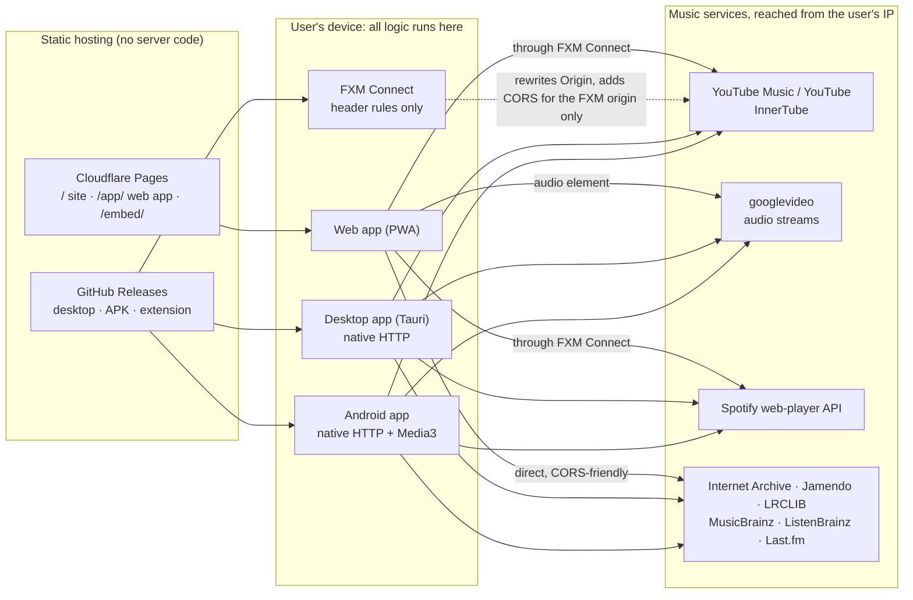

# FXM Architecture

FXM (Free Cross-platform Media) is a free, open-source music player for the web, desktop and Android. It lets you:

- search and play practically any song;
- download any track in the format you want, with real lossless FLAC where the source has it;
- get a personal home feed with Spotify-quality recommendations.

**FXM has no servers.** Everything runs on the user's own device.

This document explains how FXM is built and why. The build order is in [PLAN.md](PLAN.md). Branching, worktrees and the agent workflow are in [WORKFLOW.md](WORKFLOW.md). Facts marked *measured* come from live experiments run during the research phase on 2026-10-25. YouTube and Spotify change often, so they are re-checked whenever something breaks.

---

## 1. Deliverables

| Deliverable | What it is | Where |
|---|---|---|
| **Web page** | Landing site: features, how it works, downloads | `https://fxm-music.pages.dev/` |
| **Web app (PWA)** | The full player, installable from the browser as its own window. It reaches YouTube and Spotify through FXM Connect. Without the extension, only free sources play | `https://fxm-music.pages.dev/app/` |
| **FXM Connect** | A tiny companion browser extension for Chrome, Edge, Brave and Firefox. It lets the web app reach music services from the user's own browser. It contains no music-service logic | GitHub Releases (Chromium zip), Firefox Add-ons |
| **Desktop app** | The web app packaged with Tauri for macOS, Windows and Linux. Full features, no extension needed. This is FXM's installable "applet", like Spotify's desktop app, at about 10 MB | GitHub Releases |
| **Android app** | The web app packaged with Capacitor, plus native networking and a native Media3 player for background playback | GitHub Releases (APK) |
| **Embeddable mini-player** | An `<iframe>` player for a track, album or playlist | `https://fxm-music.pages.dev/embed/…` |

**Hosting is static files only.** The site and web app are served by Cloudflare Pages (free, `fxm-music.pages.dev`; `fxm.pages.dev` is taken). Binaries and extension packages live on GitHub Releases. There are no Pages Functions, no API gateway, no relay and no database. The owner runs nothing.

FXM is built mainly for personal use by its owner and by anyone who runs it on their own devices.

### Non-goals

- **A native iOS app.** Apple's rules and costs make it impractical. The PWA works in Safari with free sources only.
- **Spotify audio or any DRM-protected stream.** Spotify supplies metadata and recommendations only.
- **Any server run by the project.**

---

## 2. What we take from Bloomee and Spotube

State as of October 2026:

| | Bloomee 3.1 | Spotube | FXM |
|---|---|---|---|
| Stack | Flutter, with Rust compiled to WebAssembly (WASM) for plugins | Flutter (stable 5.1.2); Kotlin Multiplatform rewrite (nightly) | TypeScript: React, Tauri, Capacitor |
| YouTube | Community plugins resolve on the device using the ANDROID, then IOS, then TV clients. No proof-of-origin (PO) tokens and no SABR, so it currently plays the muxed 360p stream (itag 18) | NewPipe (Android/desktop) or yt-dlp. Stable has broken repeatedly since May 2026; nightly uses NewPipe's VISIONOS client | youtubei.js in a real JavaScript engine: direct clients first, PO tokens and SABR as fallbacks, and a client config that can be updated without a new app release |
| How YouTube breakages ship | Plugin releases, no app release needed | App releases (slow) | A redeploy of the static web bundle. Desktop and Android load the same module and config |
| Metadata | YouTube Music | Spotify, through the separately maintained sonic-liberation plugin. Spotify's 2025 cease-and-desist removed the built-in integration | YouTube Music plus a built-in Spotify provider that can be switched off |
| Matching | Weighted fuzzy "Smart Replace", accepting candidates at 0.45 or above | Nightly tries ISRC, then YouTube Music songs, then videos, and stops at 0.6 | An ISRC check plus a calibrated scorer. Auto-plays only at 0.80 or above, with guards |
| Radio | YouTube Music `next` with `RDAMVM<videoId>` (50 songs per page) | Spotify radio through the plugin | Both, blended with on-device ranking |

**Lessons we adopt:**

1. Resolve and play on the same device, so the stream URL matches that device's IP address.
2. Keep service-specific logic in a module that can be updated without an app release.
3. Classify songs and videos. Bloomee doesn't, and stable Spotube plays the first YouTube hit. FXM's two catalog modes fix this common mix-up.

---

## 3. External constraints (measured October 2026)

### YouTube

- **YouTube's internal API (InnerTube) refuses other websites.**
  - `www.youtube.com`, `music.youtube.com` and `youtubei.googleapis.com` answer requests from any other site with HTTP 403 and no CORS headers. That includes `chrome-extension://` origins.
  - They answer 200 when the Origin is YouTube's own or absent.
  - So a plain web page can't search YouTube or resolve streams.
- **Stream URLs are bound to the requesting IP and expire.** The IP (`ip=`) is signed into each URL, and URLs expire after about 6 hours. Resolution must happen on the device that plays.
- **The stream server (googlevideo) serves media to any page, but not data.**
  - Media responses send `Cross-Origin-Resource-Policy: cross-origin`. The server ignores User-Agent, Referer and Origin on media requests. So `<audio src>` plays a URL resolved on the same IP.
  - It sends no `Access-Control-Allow-Origin` to other sites. So `fetch()` (downloads), MediaSource and Web Audio need FXM Connect or a native app.
- **Client landscape** (youtubei.js 18.3.0, residential IP):
  - VISIONOS, ANDROID_VR and IOS return direct audio URLs with no PO token. VISIONOS and ANDROID_VR need a real visitorData session. In one probe, IOS URLs stopped working past about 1 MiB.
  - MWEB and WEB_REMIX return ciphered URLs that youtubei.js can decipher. yt-dlp's guide says these need a GVS PO token.
  - WEB and ANDROID return SABR-only formats, YouTube's newer streaming protocol, with no direct URLs.
  - MIT-licensed libraries cover the hard cases:
    - **youtubei.js:** deciphering.
    - **bgutils-js:** BotGuard and web PO tokens. Google's BotGuard endpoints allow cross-site requests.
    - **googlevideo:** SABR playback through MediaSource.
- **Community YouTube proxies are dead.**
  - Public Piped instances: none of 15 served a stream.
  - Invidious: returned only instance-bound URLs.
  - Hyperpipe: archived in 2025.
- **YouTube has no lossless audio.** Its best free audio is Opus at about 130–160 kbps (itag 251) or AAC at about 128 kbps (itag 140). Real FLAC comes from Internet Archive, Jamendo and local files.

### Spotify

- **The internal web-player API works without login.** An anonymous token from `open.spotify.com/api/token` gave access to:
  - search and tracks;
  - albums and artist overviews;
  - 40 related artists;
  - playlists;
  - track and artist radio;
  - a generic home feed.

  The token is protected by a time-based one-time code (TOTP).
- **CORS on the Spotify hosts:**
  - The token endpoint sends no CORS headers.
  - The GraphQL host (`api-partner.spotify.com/pathfinder/v2/query`) and the spclient hosts echo back any Origin today.
- **ISRCs are a separate call.** They are not in GraphQL responses, but `spclient …/metadata/4/track/<gid>` returns them.
- **Terms of service.** The token endpoint itself states that this use is not permitted by Spotify's terms, and Spotify sent Spotube a cease-and-desist in 2025. The owner accepts this for a personal-use project, and FXM keeps the integration switchable.
- **The official Web API can't do this.** Recommendations have been closed to new apps since 2024. Since 2026, Development Mode needs a Premium owner and allows only 5 users.

### Platforms and tools

- **Browser extension stores.**
  - The Chrome Web Store, and in practice Edge Add-ons, refuse extensions that facilitate unauthorized streaming or downloading.
  - So FXM Connect ships as an unpacked zip on GitHub Releases for Chromium browsers, and through Firefox Add-ons (AMO) for Firefox.
  - Manifest V3 forbids remote code and `eval` in extensions.
- **Desktop webviews.** Tauri was measured on macOS:
  - Its HTTP plugin works as youtubei.js's `fetch` once the plugin is built with `unsafe-headers` and requests send YouTube's Origin.
  - WKWebView plays both Opus/WebM and AAC.
  - Now Playing, media keys and playback in a hidden window all work.
- **Android.**
  - Capacitor's global CapacitorHttp fetch patch drops the Origin, Cookie and Referer headers and corrupts binary bodies, so FXM injects its own explicit native fetch.
  - From 2027, Google requires developer verification for apps installed outside the Play Store (USD 25 plus ID).
- **ffmpeg-kit is retired.** Conversion uses ffmpeg.wasm everywhere.

---

## 4. Catalog modes: Music vs Music + Video

A global setting, with a quick toggle in the search bar:

| | **Music** (default) | **Music + Video** |
|---|---|---|
| Playable | YouTube Music songs (`ATV`), Spotify-catalog tracks matched to songs, and free, lossless and local tracks | Everything in Music, plus official music videos and any YouTube video, **played as music** (audio only) |
| An official music video shows up | Mapped to its song by the matching engine, because YouTube Music's song↔video links are missing in anonymous sessions. Hidden if there is no confident match | Plays as audio |
| Ordinary uploads (covers, live sets, remixes) | Hidden | Play as audio |
| Radio, autoplay, recommendations | Songs only. Radio is seeded with the song, which keeps it songs-only | Songs and videos |
| Imports | Matched to songs only | Songs first, videos as fallback |
| Labels | Song | Song · Official video · Video |

**Classification** uses YouTube Music's `musicVideoType`:

| `musicVideoType` | FXM kind |
|---|---|
| `ATV` | `song` |
| `OMV` / `OFFICIAL_SOURCE_MUSIC` | `music-video` |
| `UGC` or missing | `video` |
| podcast types | `episode` (hidden) |

Regular YouTube search results are always videos. One pure function in `packages/core` (`modePolicy`) enforces the mode for search, radio, recommendations, imports and the queue.

---

## 5. System overview



---

## 6. Repository layout

```
apps/
  web/        React + Vite: the player (/app) and the embed entry (/embed)
  site/       Astro static landing page (/)
  extension/  FXM Connect (Manifest V3, Chromium + Firefox): header rules, presence marker, Spotify session bridge
  desktop/    Tauri 2 shell around the web build (Rust in src-tauri)
  mobile/     Capacitor Android project + Kotlin plugins (native fetch, Media3 player, downloads)
packages/
  core/       Domain types, provider interfaces, mode and quality policy, queue, matching,
              playback policy, recommendation engine. Pure TypeScript, no DOM or Node APIs
  platform/   Platform adapters: network transports (browser direct or through FXM Connect,
              Tauri, Capacitor, Node), capability detection, storage and download sinks
  sources/    One folder per provider: youtube, spotify, archive, jamendo, lrclib, lastfm,
              listenbrainz, musicbrainz
  player/     Player facade and engines (direct audio, native bridge), offline store,
              conversion worker
docs/         Architecture, plan, workflow, development guide
scripts/      Toolchain bootstrap (everything installs into .tools/)
```

---

## 7. Core concepts

### 7.1 IDs and entities

- **IDs** are source-qualified: `<source>:<kind>:<nativeId>`, for example `ytm:track:dQw4w9WgXcQ` or `spotify:track:3n3Ppam7vgaVa1iaRUc9Lp`.
- **Sources:**
  - `ytm`: YouTube Music
  - `yt`: plain YouTube
  - `spotify`
  - `archive`
  - `jamendo`
  - `local`
- **A `Track` carries:**
  - normalized metadata;
  - its `kind` (`song | music-video | video | episode`);
  - its ISRC when known;
  - `externalIds`: the same recording in other sources, once matched.

### 7.2 Provider interfaces (`packages/core`)

```ts
interface MetadataProvider {         // "what exists": search, albums, artists, playlists
  id: SourceId
  search(query: string, opts: SearchOptions, ctx: ProviderContext): Promise<SearchResults>
  getTrack(id, ctx); getAlbum(id, ctx); getArtist(id, ctx); getPlaylist(id, ctx)
  getRelatedArtists?(id, ctx)
}

interface RecommendationProvider {   // radio and home feeds
  id: SourceId
  radio(seed: Track | ArtistRef, ctx): Promise<Track[]>
  home?(ctx): Promise<Shelf[]>
}

interface AudioSource {              // two phases, as Spotube converged on
  id: SourceId
  match(track: Track, ctx): Promise<AudioCandidate[]>     // ranked, with confidence + evidence
  resolve(c: AudioCandidate, ctx, prefs): Promise<StreamOption[]>
}

interface ProviderContext {
  fetch: Fetch                       // injected per platform (section 8)
  platform: 'web' | 'desktop' | 'android'
  capabilities: { youtube: boolean; spotify: boolean; mediaBytes: boolean; fileSystem: boolean }
  mode: 'music' | 'all'
  signal?: AbortSignal
}
```

`StreamOption` records:

- `codec` and `container`;
- `bitrateKbps` and `tier`;
- `protocol`: progressive, HLS, DASH or SABR;
- `expiresAt`;
- `ipBound`;
- any request headers the player must send.

Providers use only the injected `fetch` and web-standard APIs, so the same code runs in a browser tab, a Tauri webview, an Android WebView and Node (for tests).

### 7.3 Quality tiers

| Tier | Meaning | Typical sources |
|---|---|---|
| `lossless` | FLAC, ALAC or WAV **from the source** | Internet Archive, Jamendo, local files |
| `high` | Opus 120 kbps or more, AAC 120 kbps or more, MP3 256 kbps or more | YouTube Opus 251 and AAC 140 |
| `normal` | Below high, above low | Lower YouTube itags, MP3 128–255 kbps |
| `low` | Data-saver bitrates | Opus under 64 kbps, AAC under 96 kbps |

---

## 8. Platforms and network transports

`packages/platform` gives every provider the right `fetch` and reports what the current platform can do:

| Transport | Used on | How |
|---|---|---|
| Browser direct | Web, always | Global `fetch` for CORS-friendly hosts only: MusicBrainz, ListenBrainz, Last.fm API, Internet Archive, Jamendo, LRCLIB |
| Browser + FXM Connect | Web with the extension | Global `fetch` with `credentials: 'omit'`. The extension's rules let the FXM origin reach YouTube, googlevideo and Spotify. The logged-in Spotify token comes through the extension's session bridge |
| Desktop | Tauri | `@tauri-apps/plugin-http` with a per-host header policy (below) |
| Android | Capacitor | An explicit native fetch (`CapacitorHttp.request` with plain headers and binary-safe bodies, or a small OkHttp plugin shared with Media3). Never the global patch |
| Node | Tests, tooling | Global `fetch` |

The desktop header policy:

- Never send `tauri://localhost` as the Origin.
- YouTube web endpoints get `https://www.youtube.com`.
- Android and iOS-client player calls get no Origin.
- Spotify gets `https://open.spotify.com`.

### Capability matrix

The UI adapts to what each platform can do:

| Capability | Web, no extension | Web + FXM Connect | Desktop | Android |
|---|---|---|---|---|
| YouTube Music / YouTube search and radio | — (install prompt) | ✅ | ✅ | ✅ |
| Ad-free YouTube playback | — | ✅ `<audio src>` | ✅ `<audio src>` | ✅ Media3 |
| Spotify metadata and radio (switchable) | — | ✅ | ✅ | ✅ |
| Spotify account sync | — | ✅ using the browser's own Spotify login | ✅ login window | ✅ login WebView |
| Free sources, lyrics, MusicBrainz, ListenBrainz | ✅ | ✅ | ✅ | ✅ |
| Downloads | Free sources only | ✅ every track | ✅ every track, to disk | ✅ every track |
| Background playback | ✅ tab or PWA window | ✅ | ✅ tray, hidden window | ✅ foreground service |
| Equalizer | Free sources | ✅ (bytes through Connect + MediaSource) | Later (MediaSource or a local stream) | ✅ ExoPlayer effects |
| Local music files | ✅ (folder access in Chromium, file picker elsewhere) | ✅ | ✅ | ✅ MediaStore |

---

## 9. FXM Connect (companion extension)

- **Manifest V3, Chromium and Firefox.** Permissions are `declarativeNetRequest` and `storage`. Host permissions cover only the FXM origin, YouTube's API hosts, `*.googlevideo.com`, the few Spotify hosts the provider calls, and Last.fm's station endpoint.
- **Static declarativeNetRequest rules.** Every rule is scoped to the FXM origin (`initiatorDomains`). None sets `Access-Control-Allow-Origin: *` or `Allow-Credentials`.

  | Rule | Hosts | What it does |
  |---|---|---|
  | YouTube API | www/music.youtube.com, youtubei.googleapis.com | Sets the request Origin and Referer to YouTube's own. Adds `Access-Control-Allow-Origin` for the FXM origin, plus the allowed methods and headers, including on preflights |
  | Stream bytes | googlevideo | Adds `Access-Control-Allow-Origin` and exposes the range headers, for downloads and MediaSource |
  | Spotify token | open.spotify.com, clienttoken | Sets the Origin to `https://open.spotify.com` and adds CORS headers for the FXM origin |
  | Spotify API | GraphQL, spclient | Adds CORS headers for the FXM origin |
  | Last.fm | Station JSON | Adds CORS headers for the FXM origin |
- **Presence handshake.** A content script marks the page (`data-fxm-connect`) and answers a ping with its version and features.
- **Spotify session bridge (opt-in in the extension's options).** The background script fetches `/api/token` with the user's own `open.spotify.com` cookies, using a strict parameter allow-list. It returns only the token JSON and never reads or stores cookies.
- **No music-service logic and no remote code.** All logic lives in the web app, so a YouTube breakage is fixed by redeploying the static site.

---

## 10. YouTube

### Metadata

`packages/sources/youtube` is built on youtubei.js:

- **YouTube Music search:** songs, videos, albums, artists and playlists, plus suggestions.
- **Browse:** albums, artists, playlists, home and charts.
- **Radio:** `next` with `RDAMVM<videoId>`, which returns 50 items per page with a continuation.
- **Regular YouTube search:** for Music + Video mode.
- **Classification:** each item is classified by `musicVideoType`.
- **Bylines:** parsed by the page type of each run, to avoid Bloomee's artist/album/year mix-up.

### Stream resolution

The first rung that yields a playable URL wins. Each candidate is validated with a 64 KB range probe past 1 MiB.

1. VISIONOS: Opus 251, direct.
2. ANDROID_VR: direct.
3. IOS: AAC 140, direct.
4. MWEB or WEB_REMIX with a web PO token minted in the page (bgutils-js) and youtubei.js deciphering. BotGuard and player-JS evaluation run isolated in a sandboxed iframe or worker.
5. WEB over SABR via googlevideo and MediaSource (web and desktop).
6. Muxed itag 18 (AAC from a 360p MP4) as the last resort.

Two rules apply to every rung:

- Always use a real visitorData session, seeded from `sw.js_data`.
- Reject any response whose `videoId` differs from the requested one.

### Hot updates

Client names, versions, user agents and search parameters live in a versioned JSON config:

- **Web app:** the config ships with the static bundle.
- **Desktop and Android:** on start they fetch the latest config from the static site and fall back to the copy they ship with.

A YouTube change is therefore usually fixed by a static redeploy. Library updates (youtubei.js, bgutils-js, googlevideo) still need app updates, which the desktop updater and the Android update check deliver.

### Playback and URL lifecycle

- **Players:** `<audio src>` on web and desktop; Media3 on Android, which receives a queue of already-resolved items.
- **Format:** prefer Opus 251 when `canPlayType` says "probably", otherwise AAC 140.
- **Caching:** cache a URL per `videoId` until 10 minutes before it expires. Never persist an expired URL.
- **Recovery:** re-resolve on 401, 403, 410 or a stall, and resume at the same position.
- **Prefetch:** resolve the next 2–3 tracks ahead, and share in-flight resolutions.
- **Retries:** 3 retries with backoff, then a circuit breaker after 4 consecutive failed tracks. Remember which rung worked recently.
- **Request budget:** about 1–4 InnerTube calls per play. Never resolve whole playlists eagerly: YouTube rate-limits guest sessions at a few hundred videos per hour.
- **Self-test:** a local "resolve and range-probe one known song" check that users and CI can run.

---

## 11. Spotify (built in, switchable)

### Settings

Settings → Spotify offers:

- **On/Off.** On by default whenever the platform can reach Spotify.
- **Connect your account.** Opens Spotify's login and syncs personalized home, liked songs and playlists.
- **Disconnect.**

### Anonymous token

`GET open.spotify.com/api/token?reason=init&productType=web-player&totp=…&totpServer=…&totpVer=…`

- **TOTP:** RFC 6238 (HMAC-SHA1, 6 digits, 30 s), computed from `open.spotify.com/api/server-time`.
- **Secret and version:** fetched at runtime from a configurable community source and cached on the device. The default is the source the Spotube plugin uses. They are **never committed** to the repo.
- **Token handling:** tokens live in memory and are refreshed about 60 s before expiry, one refresh at a time.

### Logged-in token

The same endpoint, called with the user's own Spotify session cookies:

| Platform | Where the cookies come from |
|---|---|
| Web | FXM Connect's opt-in session bridge, using the browser's existing `open.spotify.com` login |
| Desktop | A Spotify login window; cookies are read from that window only and stored in OS-protected storage |
| Android | An in-app login WebView plus CookieManager |

FXM never handles the password, and cookies never reach page JavaScript.

### API calls

All GraphQL calls are `POST api-partner.spotify.com/pathfinder/v2/query` with `{operationName, variables, extensions.persistedQuery.sha256Hash}`.

| Need | Operation or endpoint |
|---|---|
| Search | `searchDesktop` and the typed search operations |
| Tracks, albums, artists, playlists | `getTrack`, `getAlbum`, `queryArtistOverview`, `fetchPlaylist` |
| Related artists | `queryArtistRelated` |
| Home | `home` and `homeSection` |
| Library (logged in) | `libraryV3`, `fetchLibraryTracks` |
| Radio | `spclient …/inspiredby-mix/v2/seed_to_playlist/<uri>`, then `fetchPlaylist` |
| ISRC | `spclient …/metadata/4/track/<gid>` |

Operation hashes live in a versioned config, like YouTube's. An HTTP 412 ("Invalid query hash") disables that operation instead of retrying in a loop.

### Behaviour

- **Clean-room implementation.** The code is written from protocol facts: endpoints, operation names, hashes and field paths, recorded from Spotify's own web player. No code or fixtures are copied from the AGPL plugin.
- **Read-only in v1, apart from reading the library.** Writing back to Spotify (likes, follows, playlist edits) is a later, optional addition.
- **Failure handling:**
  - 401: refresh once.
  - 429 or 5xx: honour `Retry-After`, back off exponentially, then pause the provider.
  - FXM keeps working without Spotify, using YouTube Music radio, Last.fm and ListenBrainz.
- **Caching:**

  | Data | Cache time |
  |---|---|
  | Search | 10 min |
  | Entities | Hours |
  | ISRCs | About a day |
  | Home | 30 min |

---

## 12. Matching engine (`packages/core/src/matching`)

The matching engine finds the YouTube Music song for a Spotify (or other) track, and the song for an official video.

### Steps

1. **Normalize.**
   - Apply NFKC, lowercase, and ASCII dashes and quotes.
   - Strip Latin diacritics only.
   - Split each title into a core, qualifiers and featured artists.
   - Collect version tags from the title and the album.
2. **ISRC check.** Search YouTube Music's songs for the ISRC and look at result #1 only. It auto-plays if all of these hold:
   - it is an `ATV` song;
   - its title or artist similarity is at least 0.5;
   - its duration is within max(5 s, 2 %) of the track;
   - there is no strong version mismatch.

   This picked the right song in 16 of 16 measured cases.
3. **Text search.** Search songs for "all artists + title" and score every `ATV` result on the page. If nothing auto-plays, run a second query with the album (except for singles and classical titles).
4. **Music + Video mode only:** try the videos filter, then regular YouTube.

### Scoring

**Score = 0.40·title + 0.35·artist + 0.25·duration.** Then:

- **Version tag on one side only:** −0.45 (strong), −0.15 (medium) or −0.03 (soft).
- **Unexpected featured artist:** −0.45.
- **Duration off by more than 10 s:** −0.15; more than 20 s: −0.35.
- **Caps:** title similarity below 0.5 caps the score at 0.40, and an artist score of 0 caps it at 0.45.

### Score bands

| Band | When | What happens |
|---|---|---|
| **Auto** | The ISRC check passes; or the score is 0.80 or more, the duration is within max(5 s, 2 %), the margin over the next different recording is at least 0.05, the item is official, and it is not a classical-looking title without an album match | Plays without asking |
| **Suggest** | 0.60–0.80 | Plays the best candidate and offers "Not the right version?" |
| **None** | Below 0.60 | Shows alternatives and a manual search |

User uploads never auto-play. Measured: 15 of 15 correct and zero wrong auto-plays on the calibration set. Golden tests lock these values in.

### Sources and caching

- **ISRCs** come from Spotify's metadata endpoint when Spotify is on, otherwise from MusicBrainz (CORS-friendly, 1 request per second).
- **Cached matches** are kept about 30 days, keyed by the source track ID and ISRC.
- **User overrides** always win.
- **A playback failure** triggers a re-match: Smart Replace.

### Official video → song (Music mode)

The same engine runs without a duration check, because videos have intros. A match needs:

- title similarity of at least 0.8;
- artist similarity of at least 0.5;
- no strong version mismatch;
- a song no longer than the video plus 5 s.

---

## 13. Recommendations (on device)

All personal data stays on the device. Every source respects the current catalog mode.

### Candidate sources

- **YouTube Music radio.** In Music mode it is seeded with the song.
- **Spotify.** Song and artist radio and related artists. A generic home feed when anonymous, a personalized one when the account is connected.
- **Last.fm.** The keyless station JSON, through FXM Connect, returns YouTube video IDs directly. Last.fm and ListenBrainz also supply similar artists.
- **Followed artists.** Their top songs.

### Ranking

1. **Signals:** played time, completion, skips, likes and playlist adds.
2. **Affinity:** time-decayed with a half-life of about 14 days.
3. **Score:** `affinity + similarity + popularity + novelty − skip penalty − recently-played penalty`.
4. **Diversity:** MMR re-ranking with a per-artist cap.
5. **Dedup:** against listening history across sessions. Bloomee repeats songs; FXM shouldn't.

### Home shelves

- Quick picks
- Daily Mix 1–6
- Discover (stable for a week)
- Because you listened to X
- Rediscover
- On repeat
- Spotify's own sections, when connected

### Autoplay and cold start

- **Endless autoplay:** when the queue runs low, extend it from the last 5 plays. Likes and skips retune it live.
- **Cold start:** onboarding asks for 3 or more artists and genres from regional charts.

---

## 14. Downloads and formats

Every streamable track can be downloaded on every platform that can read its bytes: the web app with FXM Connect, desktop and Android. Free sources can be downloaded everywhere.

| Output | Lossless? | Notes |
|---|---|---|
| **Original** (default) | As the source | No re-encode, no quality loss |
| FLAC, ALAC (.m4a), WAV | Only if the source is lossless | Converting a lossy source is allowed and labelled, e.g. "FLAC (converted from Opus, same quality as the source)" |
| MP3 (128–320), AAC, Opus | Lossy | For compatibility and size |

**Pipeline:**

1. Fetch the bytes (ranged and resumable).
2. Convert with ffmpeg.wasm in a worker, using an LGPL build (FLAC, ALAC, WAV, MP3 via LAME, AAC and Opus encoders; no GPL-only libraries).
3. Write tags (title, artists, album, track number, ISRC, lyrics) and cover art.
4. Store the file:
   - **Browser:** OPFS plus "Save to device".
   - **Desktop:** the filesystem.
   - **Android:** the app's own storage, plus MediaStore export.

Offline copies come first in the playback policy.

---

## 15. Storage and imports

**Storage:**

- **IndexedDB (Dexie):** library, playlists, history, signals, match cache and settings.
- **OPFS:** downloads.
- **Backups:** JSON export and import, featured prominently because PWA data is tied to its origin.

**Playlists are fully user-ordered.** This is an explicit owner requirement, because many apps don't allow it. Every playlist, including Liked songs and the built-in **Downloads** playlist, keeps a saved custom order that the user controls:

- drag and drop (pointer, touch and keyboard), move buttons and multi-select moves;
- **Shuffle order**, which permanently randomizes the saved order, with undo (separate from shuffle playback);
- sort views that can be saved as the custom order.

The list of playlists can be reordered the same way. Downloads is a system playlist that the download manager fills on every platform.

**Imports:**

- Spotify playlist, album or track URLs, through the Spotify provider.
- YouTube and YouTube Music playlists.
- CSV and M3U files.
- Spotify's own "Download your data" export.

All imports respect the catalog mode.

---

## 16. Distribution, releases and packages

**Branches:** stages merge into `develop`. A milestone is released through a pull request from `develop` into `main`. `main` is protected: pull requests only, CI must pass, no force-pushes, no deletion.

**Release pipeline.** On merge to `main`, CI tags `vX.Y.Z`, builds everything and creates a GitHub Release with:

- notes generated from the Conventional Commits, also appended to `CHANGELOG.md`;
- SHA-256 checksums and build-provenance attestations;
- these artifacts:

  | Artifact | Contents |
  |---|---|
  | Web bundle | A static zip for self-hosting. The same build is deployed to Cloudflare Pages |
  | FXM Connect | Chromium zip and the signed Firefox XPI (AMO) |
  | Desktop | `.dmg` (Apple silicon and Intel), `.msi`/`.exe`, `.AppImage`, `.deb`, plus the Tauri updater's `latest.json`, signed with a free update key |
  | Android | Signed APK (arm64 and universal) |

**Update checks:**

- **Desktop:** the Tauri updater.
- **Android:** in-app checks against the GitHub Releases API.

**Later, optional channels:**

- a Firefox Add-ons listing;
- F-Droid, IzzyOnDroid and Obtainium;
- Flathub, Homebrew and winget.

GitHub Packages isn't needed, because FXM has no server images.

**Costs:** everything above is free except two optional items:

- Apple notarization (USD 99 a year). Without it, macOS users click "Open Anyway" once.
- Android developer verification from 2027 (USD 25 once, plus ID).

Windows builds may later use SignPath's free open-source signing.

**Secrets live only in GitHub Actions:**

- the Android keystore;
- the Tauri updater key;
- the AMO API keys;
- the Cloudflare API token.

---

## 17. Security, privacy, licensing

- **Privacy:** no accounts, analytics or telemetry. Data stays on the device, and backups are files the user creates.
- **Extension:** FXM Connect only serves the FXM origin. It never sets wildcard CORS, never sends credentials except through the opt-in Spotify token bridge, and contains no remote code.
- **Web app:** a strict Content Security Policy and no third-party scripts. YouTube player-JS evaluation and BotGuard run in a sandboxed iframe or worker.
- **Secrets:** no tokens, cookies or Spotify TOTP secrets in git, logs or test fixtures.
- **License:** Apache-2.0. FXM is implemented clean-room from protocol facts, on MIT libraries (youtubei.js, bgutils-js, googlevideo).
  - The conversion core must be an LGPL build of ffmpeg.wasm.
  - No code is copied from GPL, AGPL or unlicensed projects: Bloomee (GPL-2.0), Spotube (BSD-4-Clause / AGPL), the Spotify plugin (AGPL), bloom-factory (unlicensed), NewPipeExtractor (GPL-3.0).
- **Trademarks:** no YouTube or Spotify logos or brand colours, plus a non-affiliation notice.

---

## 18. Risks and mitigations

| Risk | Likelihood | Impact | Mitigation |
|---|---|---|---|
| YouTube changes (SABR, PO tokens, client shutdowns) | High | Playback breaks | Client ladder; PO-token and SABR fallbacks; config fixable by a static redeploy; Dependabot for youtubei.js, googlevideo and bgutils-js; self-test |
| Spotify countermeasures (TOTP rotation, hash changes, blocking) | High | Spotify features stop | Switchable, fail-soft provider; configurable secret source; hashes in config; FXM works without Spotify |
| Legal action by Spotify or Google | Low (personal use, nothing hosted) | High | No servers; no secrets in git; no brand marks; switchable integrations |
| Chrome Web Store refuses FXM Connect | High | Install friction on Chromium | Unpacked zip on GitHub Releases; Firefox Add-ons; the desktop app needs no extension |
| Guest-session rate limits on YouTube | Medium | Temporary failures | Lazy resolution; prefetch only 2–3 tracks; backoff; circuit breaker |
| Unsigned desktop builds | High | Install warnings | Documented "Open Anyway" and SmartScreen steps; SignPath later; optional notarization |
| Android developer verification (2027) | High | Sideloading friction | Decide before 2027 (USD 25 plus ID), or document the ADB / advanced install flow |
| PWA data tied to its origin | Low | Library lost if the origin changes | Prominent JSON export and import |

---

## 19. Decision log

| # | Decision | Why |
|---|---|---|
| D1 | TypeScript everywhere (React, Vite, Tauri, Capacitor) | One language and one UI across web, desktop and Android. Chosen by the owner |
| D2 | Static hosting only (Cloudflare Pages + GitHub Releases); no Pages Functions | The owner hosts nothing. Replaces the earlier gateway design |
| D3 | Resolve and play on the user's device; never relay API calls or audio | Stream URLs are bound to IP addresses; no owner infrastructure |
| D4 | Metadata providers separate from audio sources; two-phase audio sources (match, then resolve) | The Spotube and Bloomee lesson: resilience and the best stream per platform |
| D5 | Recommendations computed on the device | Privacy and zero cost |
| D6 | MIT libraries (youtubei.js, bgutils-js, googlevideo); no GPL or AGPL code | Keeps FXM Apache-2.0 |
| D7 | pnpm as a pinned standalone binary, Biome, Vitest, uv | Fast and reproducible. Corepack can't run pnpm 12 |
| D8 | All toolchains inside the repo, removable with `make nuke` | The owner's requirement |
| D9 | Two catalog modes; Music + Video plays videos as music | The owner's requirement; fixes the songs-vs-videos mix-up |
| D10 | No YouTube embed player anywhere | The owner wants no ads; it also avoids mixing YouTube's API terms with direct streaming |
| D11 | A branch per stage, worktrees, Claude Code workflows plus a watchdog | Parallel agents without collisions; the orchestrator is pinged when work finishes |
| D12 | FXM Connect: a logic-free MV3 extension (header rules, presence, Spotify session bridge) | The only way to reach YouTube and Spotify from a static page without servers |
| D13 | Desktop app with Tauri 2, not Electron | Verified on macOS; about 10 MB instead of 100 MB or more; no extension needed |
| D14 | Spotify built in and switchable: anonymous, plus optional login sync. Secrets fetched at runtime, never committed | The owner's choice for a personal-use project |
| D15 | Downloads for every track in any format, with honest conversion labels | The owner's requirement |
| D16 | Matching: an ISRC check plus a calibrated scorer; auto-play at 0.80 or above with guards | Measured 16/16 and 15/15 with zero wrong auto-plays |
| D17 | `main` protected (pull requests and CI); releases through release PRs; GitHub Releases with checksums and attestations | A proper release process at zero cost |
| D18 | JioSaavn, Piped/Invidious and the self-hosted server dropped | Thin catalog, dead instances, and the no-hosting rule |
