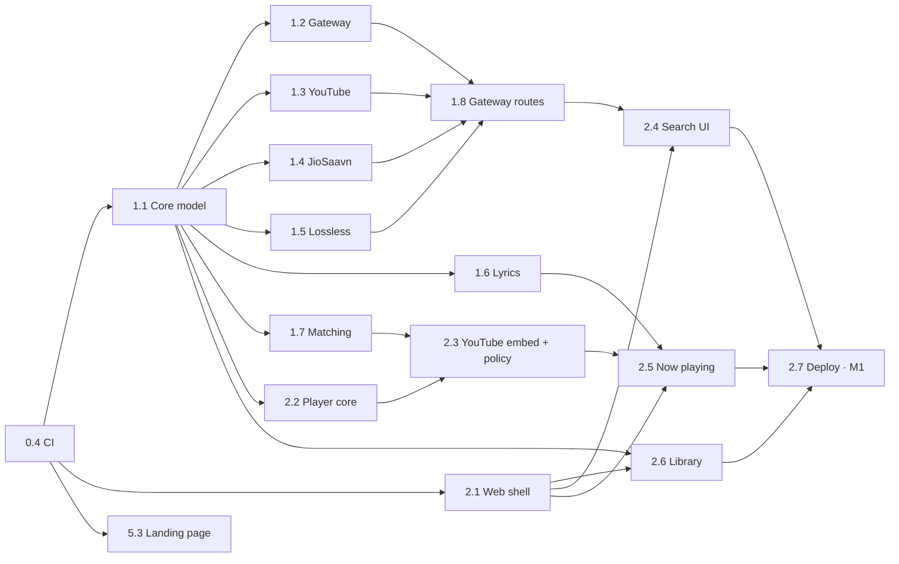

# FXM Roadmap

FXM is built in **small stages**. Each stage has one branch, a clear scope and a definition of done, so it can be handed to one person or agent and merged on its own. Design background is in [ARCHITECTURE.md](ARCHITECTURE.md), and the branching and parallel-agent rules are in [WORKFLOW.md](WORKFLOW.md).

**Status:** ⬜ todo · 🟡 in progress · ✅ done (on `develop`). Only the orchestrator edits this file.

**Scheduling:** a stage is *ready* when everything in "Depends on" is ✅. Ready stages are picked in milestone order (M1 first), 4–6 at a time. Later phases get a detail pass just before they start.

---

## Milestones

| | Milestone | Stages | Tag | Result |
|---|---|---|---|---|
| **M0** | Foundation | Phase 0 | — | Repo, isolated toolchain, monorepo, CI |
| **M1** | Play anything on the web | Phases 1–2 | `v0.1.0` | `fxm-music.pages.dev/app/`: search and play any song in **Music** or **Music + Video** mode, lyrics, library |
| **M2** | Made for you | Phase 3 | `v0.2.0` | Home feed, daily mixes, endless radio, Spotify/YouTube imports |
| **M3** | Offline and lossless | Phase 4 | `v0.3.0` | Downloads, FLAC/ALAC/MP3/Opus conversion, local files |
| **M4** | Web applet and web page | Phase 5 | `v0.4.0` | Installable app window, embeddable mini-player, landing page |
| **M5** | Android | Phase 6 | `v0.5.0` | Signed APK on GitHub Releases |
| **M6** | Self-host | Phase 7 | `v0.6.0` | Optional server: ad-free YouTube audio and downloads on the web |
| **M7** | 1.0 | Phase 8 | `v1.0.0` | Effects, scrobbling, plugins, sync, quality pass |

Milestones are release points, not a strict order. Independent stages start early: the landing page (5.3) and the Android shell (6.1) run alongside Phase 1–2.

### Parallel waves to M1

| Wave | Stages that can run at the same time |
|---|---|
| 1 | 1.1 · 2.1 · 5.3 |
| 2 | 1.2 · 1.3 · 1.4 · 1.5 · 1.6 · 1.7 · 2.2 · 2.6 (+ 6.1 if there is spare capacity) |
| 3 | 1.8 · 2.3 |
| 4 | 2.4 · 2.5 |
| 5 | 2.7 → **M1** |

---

## Stage index

| ID | Stage | Branch | Depends on | Status |
|---|---|---|---|---|
| **0.1** | Plan, architecture and workflow docs | `docs/0.1-plan` | — | ✅ |
| **0.2** | Isolated toolchain (pnpm, uv, `.tools/`, `make nuke`) | `chore/0.2-toolchain` | 0.1 | ✅ |
| **0.3** | Monorepo scaffold | `chore/0.3-monorepo` | 0.2 | 🟡 |
| **0.4** | Continuous integration | `ci/0.4-ci` | 0.3 | ⬜ |
| **1.1** | Core domain model, interfaces, mode policy | `feat/1.1-core-model` | 0.4 | ⬜ |
| **1.2** | Gateway skeleton | `feat/1.2-gateway` | 1.1 | ⬜ |
| **1.3** | YouTube Music + YouTube provider | `feat/1.3-youtube` | 1.1 | ⬜ |
| **1.4** | JioSaavn provider | `feat/1.4-jiosaavn` | 1.1 | ⬜ |
| **1.5** | Lossless sources: Internet Archive + Jamendo | `feat/1.5-lossless` | 1.1 | ⬜ |
| **1.6** | Lyrics: LRCLIB + LRC parser | `feat/1.6-lyrics` | 1.1 | ⬜ |
| **1.7** | Matching engine | `feat/1.7-matching` | 1.1 | ⬜ |
| **1.8** | Gateway provider routes + RemoteProvider | `feat/1.8-gateway-routes` | 1.2, 1.3, 1.4, 1.5 | ⬜ |
| **2.1** | Web app shell and settings | `feat/2.1-web-shell` | 0.4 | ⬜ |
| **2.2** | Player core: queue, direct audio, Media Session | `feat/2.2-player-core` | 1.1 | ⬜ |
| **2.3** | YouTube embedded engine + playback policy | `feat/2.3-youtube-embed` | 2.2, 1.7 | ⬜ |
| **2.4** | Search and browse UI (mode toggle, kind badges) | `feat/2.4-search-browse` | 2.1, 1.8 | ⬜ |
| **2.5** | Now playing, queue panel, synced lyrics | `feat/2.5-now-playing` | 2.1, 2.3, 1.6 | ⬜ |
| **2.6** | Library: likes, playlists, history, backup | `feat/2.6-library` | 2.1, 1.1 | ⬜ |
| **2.7** | First deploy to `fxm-music.pages.dev` | `ci/2.7-deploy` | 2.4, 2.5, 2.6 | ⬜ |
| **3.1** | Listening signals and affinity | `feat/3.1-signals` | 2.2, 2.6 | ⬜ |
| **3.2** | Recommendation providers | `feat/3.2-rec-providers` | 1.8 | ⬜ |
| **3.3** | Recommendation engine + Home | `feat/3.3-home` | 3.1, 3.2 | ⬜ |
| **3.4** | Endless autoplay radio | `feat/3.4-autoplay` | 3.3 | ⬜ |
| **3.5** | Imports: Spotify, YouTube playlists, CSV/M3U | `feat/3.5-imports` | 1.7, 1.8, 2.6 | ⬜ |
| **4.1** | Download manager + offline playback | `feat/4.1-downloads` | 2.3, 2.6 | ⬜ |
| **4.2** | Transcoding and tagging (ffmpeg.wasm) | `feat/4.2-transcode` | 4.1 | ⬜ |
| **4.3** | Quality and source-priority settings | `feat/4.3-quality` | 2.3 | ⬜ |
| **4.4** | Local music files (web) | `feat/4.4-local-files` | 2.2, 2.6 | ⬜ |
| **5.1** | PWA "web applet" | `feat/5.1-pwa` | 2.5 | ⬜ |
| **5.2** | Embeddable mini-player + oEmbed | `feat/5.2-embed` | 2.3, 1.8 | ⬜ |
| **5.3** | Landing page | `feat/5.3-site` | 0.4 | ⬜ |
| **6.1** | Android toolchain + Capacitor shell + debug APK | `feat/6.1-android-shell` | 2.1 | ⬜ |
| **6.2** | Native HTTP + on-device YouTube audio | `feat/6.2-native-youtube` | 6.1, 1.3 | ⬜ |
| **6.3** | Native player plugin (Media3 ExoPlayer) | `feat/6.3-native-player` | 6.1, 2.2 | ⬜ |
| **6.4** | Native downloads + device music | `feat/6.4-native-downloads` | 6.3, 4.1 | ⬜ |
| **6.5** | Signed APK releases | `ci/6.5-apk-release` | 6.3 | ⬜ |
| **7.1** | FXM server (yt-dlp + ffmpeg) | `feat/7.1-server` | 1.1 | ⬜ |
| **7.2** | Docker, free tunnel, "Connect server" | `feat/7.2-server-connect` | 7.1, 2.3 | ⬜ |
| **7.3** | Piped / Invidious instances | `feat/7.3-piped` | 1.1 | ⬜ |
| **8.1** | EQ, crossfade, sleep timer, speed | `feat/8.1-audio-fx` | 2.3, 6.3 | ⬜ |
| **8.2** | Scrobbling (Last.fm, ListenBrainz) | `feat/8.2-scrobbling` | 3.1 | ⬜ |
| **8.3** | Source plugin system | `feat/8.3-plugins` | 1.8 | ⬜ |
| **8.4** | Backup sync (GitHub Gist) | `feat/8.4-sync` | 2.6 | ⬜ |
| **8.5** | Android video view (Music + Video mode) | `feat/8.5-android-video` | 6.3 | ⬜ |
| **8.6** | i18n, accessibility, e2e tests, performance | `chore/8.6-quality-pass` | 5.1 | ⬜ |

---

## Definition of done (every stage)

- Changes stay inside the stage's **Scope**. Shared-code changes are minimal, additive and reported.
- `make check` is green: format/lint, typecheck, tests, build.
- New logic has tests that run **offline** (fixtures). Live tests run only with `FXM_LIVE=1`.
- User-facing behaviour respects the **catalog mode** where relevant.
- Docs are updated (package README or `docs/`). No secrets are committed.
- Commits follow Conventional Commits with **no co-author trailers**.
- The branch is pushed and merged into `develop` by the orchestrator, then marked ✅ here.

---

## Phase 0: Foundation

### 0.1 Plan, architecture and workflow docs

**Branch** `docs/0.1-plan` · **Depends on** none · **Scope** `docs/**`, `README.md`

**Goal:** agree on what FXM is, how it is built, the order of work, and how parallel work is organized.

- `ARCHITECTURE.md`: deliverables, external constraints, catalog modes, system design, playback policy, risks, decisions
- `PLAN.md`: milestones, stages with dependencies, scope and acceptance criteria
- `WORKFLOW.md`: branches, worktrees, rules for parallel agents, commit conventions
- `README.md`: summary and links

**Done when** merged into `develop` and the owner has reviewed it.

### 0.2 Isolated toolchain

**Branch** `chore/0.2-toolchain` · **Depends on** 0.1 · **Scope** `Makefile`, `scripts/**`, root `package.json`, `.gitignore`, `.nvmrc`, `.python-version`, `docs/DEVELOPMENT.md`

**Goal:** every tool and cache lives inside the repo. One command installs, one command removes everything, and it works identically from any worktree.

- `scripts/env.sh` finds the **main checkout** through git's common dir, so all worktrees share one `.tools/`. It points the following into `.tools/`: pnpm store/cache/state, npm cache, uv cache/Python, Gradle, Android SDK/user home, JDK and GitHub CLI config. It also prepends `.tools/bin` to `PATH`.
- pnpm is pinned via `packageManager` and installed as pnpm's official standalone binary in `.tools/bin`, verified against the npm registry integrity hash. Corepack 0.34 can't run pnpm 12, and Node drops corepack from v25.
- uv standalone binary (pinned, checksum-verified) in `.tools/bin`, plus `.python-version`. `make py-setup` creates `.venv`.
- Optional GitHub CLI (`make gh-setup`), with its login stored in `.tools/`.
- Makefile targets: `help`, `setup`, `install`, `doctor`, `py-setup`, `gh-setup`, `wt-new`, `wt-list`, `wt-remove`, `clean`, `nuke`.
- `docs/DEVELOPMENT.md`: prerequisites (git, make, curl, Node 22 via `.nvmrc`), commands, where things are installed, how to remove them.

**Done when** `make setup && make doctor` passes with only the prerequisites installed, and `make nuke` leaves no tool, dependency or cache behind (in the main checkout or any worktree).

### 0.3 Monorepo scaffold

**Branch** `chore/0.3-monorepo` · **Depends on** 0.2 · **Scope** root configs, `packages/{core,sources,player}/**`, `apps/web/**`, `Makefile`

- `pnpm-workspace.yaml` (`apps/*`, `packages/*`).
- `tsconfig.base.json`: strict, ES2022, bundler resolution, `noUncheckedIndexedAccess`.
- Biome (format + lint) and Vitest (projects).
- Packages `@fxm/core`, `@fxm/sources` (wildcard export per provider folder) and `@fxm/player`, each with a smoke test.
- `apps/web`: Vite + React + TypeScript page that renders using `@fxm/core`, which proves workspace linking.
- Makefile targets: `dev`, `lint`, `format`, `typecheck`, `test`, `build`, `check`.

**Done when** `make check` passes on a clean clone and `make dev` serves the page.

### 0.4 Continuous integration

**Branch** `ci/0.4-ci` · **Depends on** 0.3 · **Scope** `.github/**`

- `.github/workflows/ci.yml` runs on every push and PR. It takes Node from `.nvmrc`, installs the pinned pnpm with `make setup`, caches the store, and runs `make ci` (frozen install + `make check`).
- PR template with the definition-of-done checklist.
- Dependabot (weekly, grouped, targeting `develop`). This matters for `youtubei.js`, which must track YouTube changes.

**Done when** CI is green on `develop`. → **M0**

---

## Phase 1: Core and sources

### 1.1 Core domain model, interfaces and mode policy

**Branch** `feat/1.1-core-model` · **Depends on** 0.4 · **Scope** `packages/core/**`

**Goal:** the shared vocabulary every other stage builds on.

- Entities: `Track`, `Album`, `Artist`, `Playlist`, `SearchResults`.
- `TrackKind` (`song | music-video | video | episode`), `CatalogMode` (`music | all`; the UI labels are "Music" and "Music + Video") and `Platform`.
- Source-qualified IDs with parse/format helpers.
- Interfaces: `MetadataProvider`, `AudioSource`, `LyricsProvider`, `RecommendationProvider`, and the injected `Fetch` type.
- `StreamCandidate` (`delivery: direct | youtube-embed`), `QualityTier` and `QualityPrefs`, with tier-from-codec/bitrate helpers.
- **Mode policy:** `isPlayableInMode`, `applyModeFilter`, and the counterpart swap (official video → song).
- Text normalization for matching: strip "(Official Video)", "[Lyrics]", "feat.", diacritics and punctuation.
- Typed errors: `NotFound`, `RateLimited`, `Unavailable`, `GeoBlocked`, `EmbedDisabled`, `Expired`.

**Done when** every export has TSDoc, and tests cover IDs, mode policy and normalization (≥ 90 % lines in those modules).

### 1.2 Gateway skeleton

**Branch** `feat/1.2-gateway` · **Depends on** 1.1 · **Scope** `apps/gateway/**`

**Goal:** a same-origin API on Cloudflare Pages Functions that also runs locally.

- Hono app built for Pages: either the Functions directory or advanced-mode `_worker.js`. Choose one and document why.
- `wrangler` as a local dev dependency, and `make gateway-dev`.
- `/api/v1/health`, a JSON error envelope, and request validation (valibot).
- Edge-cache helper (Cache API) with per-route TTLs.
- Per-IP rate limit: the Workers rate-limit binding if the free plan has it, otherwise an in-isolate token bucket.
- `defineProviderRoute()` pattern to expose provider methods with schemas.
- `.dev.vars.example`.
- No CORS: the app is same-origin, local dev uses the Vite proxy, and the APK uses native HTTP.

**Done when** `make gateway-dev` serves `/api/v1/health` and route tests (`app.request()`) pass.

### 1.3 YouTube Music + YouTube provider

**Branch** `feat/1.3-youtube` · **Depends on** 1.1 · **Scope** `packages/sources/src/youtube/**`

**Goal:** search and browse the whole YouTube catalog with correct song/video classification in both modes.

- `youtubei.js` with injected `fetch`. Metadata-only sessions (`retrieve_player: false`) for gateway use.
- **YouTube Music:**
  - search by type (songs, videos, albums, artists, playlists) and suggestions
  - album
  - artist (top songs, albums, singles)
  - playlist
  - radio via watch-next (`RDAMVM…`)
  - song↔video counterparts
  - charts (optional)
- **YouTube:** general video search and video details, for Music + Video mode.
- `musicVideoType` → `TrackKind` classification. Mode filtering on search and radio, and the official-video → song swap.
- Web `AudioSource` that returns `youtube-embed` candidates. Stream resolution comes later, in 6.2 and 7.1.
- Sanitized recorded fixtures, and an opt-in live smoke test.
- Check that it runs in the Workers runtime (free 3 MB compressed bundle limit, compat flags) with a throwaway worker.

**Done when** fixture tests cover classification, mode filtering and counterpart swap, and the live smoke test passes in Node and under `wrangler dev`.

### 1.4 JioSaavn provider

**Branch** `feat/1.4-jiosaavn` · **Depends on** 1.1 · **Scope** `packages/sources/src/jiosaavn/**`

**Goal:** ad-free AAC up to 320 kbps, playable directly in the browser.

- Search (songs, albums, artists, playlists) and details for each, with HTML-entity cleanup.
- Stream URLs at 96/160/320 kbps: decrypt `encrypted_media_url` with a vetted pure-JS DES, or use the `generateAuthToken` call. Pick after testing.
- Map to core types (kind is always `song`), with duration and ISRC when available.
- Fixtures and a live smoke test. Record whether CDN URLs expire and whether they allow CORS (needed for web downloads).

**Done when** tests pass and a resolved 320 kbps URL plays in a plain `<audio>` element on a non-JioSaavn origin.

### 1.5 Lossless sources: Internet Archive + Jamendo

**Branch** `feat/1.5-lossless` · **Depends on** 1.1 · **Scope** `packages/sources/src/{archive,jamendo}/**`

**Goal:** real FLAC streams and downloads.

- **Internet Archive:** advanced search for audio items with FLAC, then item metadata and file lists → candidates per format with correct tiers. Called directly from the browser (CORS).
- **Jamendo:** search, albums, artists and tracks with `audioformat=flac` / `audiodlformat`. Honour `audiodownload_allowed`. `client_id` comes from config.
- Fixtures and live smoke tests.

**Done when** both return lossless candidates for known items, and the tier mapping is tested.

### 1.6 Lyrics: LRCLIB + LRC parser

**Branch** `feat/1.6-lyrics` · **Depends on** 1.1 · **Scope** `packages/sources/src/lrclib/**`, `packages/core/src/lyrics/**`

- LRCLIB `get` (title, artist, album, duration) with a `search` fallback, called directly from the browser.
- LRC parser: multiple timestamps per line, `[offset:]`, optional enhanced word timing, and a plain-text fallback. `lineAt(ms)` helper.

**Done when** parser tests with tricky LRC samples pass.

### 1.7 Matching engine

**Branch** `feat/1.7-matching` · **Depends on** 1.1 · **Scope** `packages/core/src/matching/**`

**Goal:** decide whether two tracks are the **same recording**, so FXM can switch pipes safely.

- Score: ISRC exact match, or normalized title similarity + artist overlap + duration delta (≤ 3 s strong, ≤ 10 s weak) + album bonus.
- Version guard: live, remix, cover, acoustic, sped up, slowed, reverb, karaoke, instrumental, 8D, nightcore, edit and remaster match only if both sides have the tag.
- Ranked results with confidence, and an **auto-use threshold** (safe for silent ad-free switching) separate from "suggest".
- A golden dataset of ≥ 50 tricky true and false pairs.

**Done when** the golden tests pass with **zero false positives** above the auto-use threshold.

### 1.8 Gateway provider routes + RemoteProvider

**Branch** `feat/1.8-gateway-routes` · **Depends on** 1.2, 1.3, 1.4, 1.5 · **Scope** `apps/gateway/src/routes/**`, `packages/sources/src/remote/**`

- `/api/v1/youtube/*`, `/api/v1/jiosaavn/*` and `/api/v1/jamendo/*` (secret `client_id`), with validation, cache TTLs and rate limits. `mode` is honoured.
- `RemoteProvider` implements `MetadataProvider`/`AudioSource` over `/api/v1`, with retries and `Retry-After` backoff.
- Contract tests (RemoteProvider ↔ gateway).

**Done when** a local dev page searches YouTube Music and JioSaavn through `wrangler dev`.

---

## Phase 2: Web player (→ M1)

### 2.1 Web app shell and settings

**Branch** `feat/2.1-web-shell` · **Depends on** 0.4 · **Scope** `apps/web/**` (shell, layout, theme, settings)

**Goal:** the frame every feature plugs into. It starts in parallel with Phase 1, using placeholder data.

- Routes: Home, Search, Library, Album, Artist, Playlist, Settings, Now Playing.
- Layout: sidebar on desktop, bottom nav on phones, top bar with search, and a persistent player bar. Works from 320 px wide.
- Tailwind CSS v4 design tokens, light/dark/system theme, lucide icons.
- Zustand stores, TanStack Query, error boundaries, loading and empty states.
- Settings page with **Catalog mode** (Music / Music + Video), persisted.
- Vite dev proxy `/api` → `wrangler dev`.

**Done when** the shell is navigable at desktop and phone widths and the mode setting survives reloads.

### 2.2 Player core: queue, direct audio, Media Session

**Branch** `feat/2.2-player-core` · **Depends on** 1.1 · **Scope** `packages/player/**`, `packages/core/src/queue/**`

- Engine interface and Player facade. It switches engines between tracks, falls back to the next candidate on error, and refreshes expired URLs.
- Direct audio engine (`HTMLAudioElement`). It preloads the next track in a second element for near-gapless playback.
- Queue:
  - add, play next, reorder, remove
  - shuffle with history
  - repeat off/all/one
  - previous restarts the track if more than 3 s in
  - contexts (album, playlist, radio)
  - respects the mode policy
- Media Session: metadata, artwork, actions, position state.
- Unit tests with a fake engine.

**Done when** tests pass and a demo page plays a queue of direct URLs with keyboard and lock-screen controls.

### 2.3 YouTube embedded engine + playback policy

**Branch** `feat/2.3-youtube-embed` · **Depends on** 2.2, 1.7 · **Scope** `packages/player/src/engines/youtube-embed/**`, `packages/core/src/playback-policy/**`

**Goal:** play **any** YouTube song or video on the web, preferring an ad-free pipe when one is equivalent.

- IFrame API engine (`youtube-nocookie.com`):
  - lazy script load
  - player mounted into a host element provided by the UI
  - player states mapped to engine events
  - errors 2/5/100/101/150 fall back to the next candidate
- Policy compliance:
  - the player is always visible (in the now-playing panel, or a ≥ 200×200 floating card)
  - never hidden or backgrounded
  - ads untouched
  - `Referrer-Policy: strict-origin-when-cross-origin`
- Playback policy (ARCHITECTURE §9.2):
  - ordered pipes per platform and mode
  - Video-mode items always play exactly
  - the ad-free match is used only above the matching engine's auto-use threshold
- Document known limits: ads, phones pausing on screen lock, lock-screen controls owned by the YouTube frame.

**Done when** all of the following hold:

- a YouTube song with a JioSaavn match plays ad-free via JioSaavn
- a video plays in the embedded player
- an embed-disabled item falls back cleanly
- policy tests pass

### 2.4 Search and browse UI

**Branch** `feat/2.4-search-browse` · **Depends on** 2.1, 1.8 · **Scope** `apps/web/src/features/{search,album,artist,playlist}/**`

- Debounced search with suggestions and history. A **mode toggle chip** sits in the search header.
- Tabs: Music mode has Songs, Albums, Artists and Playlists. Music + Video mode adds **Videos** (Official / All YouTube).
- Every row shows a kind badge (Song · Official video · Video) and a source badge.
- Album, artist and playlist pages with play, shuffle, play next, add to queue, add to playlist and share.
- Keyboard navigation and accessible roles.

**Done when** the same query shows only clean songs in Music mode, and adds covers, live versions and videos in Music + Video mode.

### 2.5 Now playing, queue panel, synced lyrics

**Branch** `feat/2.5-now-playing` · **Depends on** 2.1, 2.3, 1.6 · **Scope** `apps/web/src/features/{now-playing,queue,lyrics}/**`

- Full-screen now playing. The artwork area hosts the YouTube player when that engine is active. Seek bar, controls, like, volume.
- Pipe and quality badge ("via JioSaavn · AAC 320") with a **source switcher**.
- Queue panel with drag-reorder, up next and history.
- Synced lyrics: auto-scroll, tap a line to seek, plain-text fallback.
- Mini player bar and floating YouTube card.

**Done when** the full playback loop is usable at desktop and phone widths.

### 2.6 Library

**Branch** `feat/2.6-library` · **Depends on** 2.1, 1.1 · **Scope** `apps/web/src/features/library/**`, `apps/web/src/db/**`

- Dexie schema with versioned migrations, holding:
  - track cache
  - likes
  - playlists (CRUD, reorder)
  - followed artists and albums
  - history
  - settings
  - match cache
- Library page: Liked songs, playlists, artists, albums, recently played.
- JSON backup export and import.

**Done when** the library survives reloads, and export → wipe → import round-trips.

### 2.7 First deploy

**Branch** `ci/2.7-deploy` · **Depends on** 2.4, 2.5, 2.6 · **Scope** `.github/workflows/deploy.yml`, `scripts/build-dist*`, gateway `wrangler` config

- `make build` composes `dist/`: a placeholder landing page at `/`, the app at `/app/`, and the gateway.
- Cloudflare Pages project **`fxm-music`**: `develop` → preview, `main` → production, via GitHub Actions.
- `_headers`: referrer policy, and a CSP that allows the YouTube embed and source CDNs.
- **Owner actions:**
  - create a free Cloudflare account
  - add the GitHub secrets `CLOUDFLARE_API_TOKEN` and `CLOUDFLARE_ACCOUNT_ID`
  - add the Pages secrets for API keys

**Done when** `https://fxm-music.pages.dev/app/` searches and plays songs in both modes. → **M1 / `v0.1.0`**

---

## Phase 3: Made for you (→ M2)

### 3.1 Listening signals and affinity

**Branch** `feat/3.1-signals` · **Depends on** 2.2, 2.6 · **Scope** `packages/core/src/recs/signals/**`, new tables in `apps/web/src/db/**`

- Log play events: played ms, completion, skip, context and pipe. Also log likes and playlist adds.
- Incremental, time-decayed affinity for tracks, artists and tags (half-life about 14 days).
- Tests with synthetic histories.

### 3.2 Recommendation providers

**Branch** `feat/3.2-rec-providers` · **Depends on** 1.8 · **Scope** `packages/sources/src/{lastfm,listenbrainz}/**`, their gateway routes

- YouTube Music radio as a mode-aware `RecommendationProvider`.
- Last.fm: `track.getSimilar`, `artist.getSimilar`, `tag.getTopTracks` and geo charts. The key is a Pages secret.
- ListenBrainz: similar artists, LB Radio.
- Fixtures, and gateway routes with long cache TTLs.

### 3.3 Recommendation engine and Home

**Branch** `feat/3.3-home` · **Depends on** 3.1, 3.2 · **Scope** `packages/core/src/recs/engine/**`, `apps/web/src/features/home/**`

- Candidate generation from seeds, scoring, MMR diversity, per-artist caps, mode filter.
- Shelves:
  - Quick picks
  - Daily Mix 1–6
  - Discover (ISO-week seed)
  - Because you listened to X
  - Rediscover
  - On repeat
  - charts for cold start
- Onboarding: pick artists and genres.
- Deterministic tests (fixed seeds).

**Done when** Home reacts sensibly to likes and skips, in tests and in manual use.

### 3.4 Endless autoplay radio

**Branch** `feat/3.4-autoplay` · **Depends on** 3.3 · **Scope** `packages/core/src/queue/autoplay/**`

- When fewer than 3 tracks remain, extend the queue from the last 5 plays.
- Likes and skips retune it, with no repeats within N tracks.
- Mode-aware, and can be turned off in Settings.

### 3.5 Imports

**Branch** `feat/3.5-imports` · **Depends on** 1.7, 1.8, 2.6 · **Scope** `packages/sources/src/spotify-import/**`, import gateway routes, `apps/web/src/features/import/**`

- Spotify public playlist, album or track URLs, read through the public embed page via the gateway.
- YouTube and YouTube Music playlist URLs, CSV (Exportify columns) and M3U.
- Matching per mode: Music mode matches songs only; Music + Video mode tries songs first, then videos.
- A review screen for low-confidence and unmatched tracks. The result is saved as a library playlist.

**Done when** a 100-track public Spotify playlist imports with a match report. → **M2 / `v0.2.0`**

---

## Phase 4: Offline and lossless (→ M3)

### 4.1 Download manager and offline playback

**Branch** `feat/4.1-downloads` · **Depends on** 2.3, 2.6 · **Scope** `apps/web/src/features/downloads/**`, `packages/player/src/offline/**`

- A queue with concurrency, progress, and pause/retry. Audio is stored in OPFS, with `navigator.storage.persist()` and a usage meter.
- The offline copy comes first in the playback policy. A "Downloaded" library filter works with the network off.
- When an item can't be downloaded on the web, say why: YouTube needs Android or an FXM server, and some CDNs don't allow CORS.

### 4.2 Transcoding and tagging

**Branch** `feat/4.2-transcode` · **Depends on** 4.1 · **Scope** `packages/player/src/transcode/**`, `apps/web/src/features/downloads/**`

- ffmpeg.wasm (single-thread core), lazy-loaded in a Web Worker.
- Output formats: Original, FLAC, ALAC, WAV, Opus, AAC, MP3 320.
- Tags and cover art (ID3v2.4, Vorbis comments, MP4 atoms), plus embedded lyrics.
- Honest labels: a lossless format made from a lossy source is marked "transcoded".
- "Save to device" through the File System Access API or a download.

### 4.3 Quality and source-priority settings

**Branch** `feat/4.3-quality` · **Depends on** 2.3 · **Scope** `apps/web/src/features/settings/**`, `packages/core/src/playback-policy/**`

- Streaming quality for Wi-Fi vs cellular (Network Information API where available), plus data saver.
- Download format and quality defaults, and "Prefer lossless".
- Web, Music mode: "Ad-free match first" vs "Always YouTube player".

### 4.4 Local music files (web)

**Branch** `feat/4.4-local-files` · **Depends on** 2.2, 2.6 · **Scope** `apps/web/src/features/local/**`, `packages/sources/src/local/**`

- Pick a folder (File System Access API in Chromium) or files (other browsers).
- Read tags and artwork with `music-metadata`.
- The local library appears in search and the library, and plays FLAC, ALAC and other formats. → **M3 / `v0.3.0`**

---

## Phase 5: Web applet, embed, web page (→ M4)

### 5.1 PWA "web applet"

**Branch** `feat/5.1-pwa` · **Depends on** 2.5 · **Scope** PWA config, manifest and service worker in `apps/web/**`

- `vite-plugin-pwa` (Workbox):
  - manifest with maskable icons
  - `display: standalone` + `window-controls-overlay`
  - scope `/app/`
- Offline app shell, artwork runtime caching, and an "update available" toast.
- Install button (`beforeinstallprompt`), an iOS add-to-home-screen hint, keyboard shortcuts and media keys.

**Done when** Chrome/Edge offer "Install FXM", it opens in its own window like Spotify's, and downloaded songs play offline.

### 5.2 Embeddable mini-player

**Branch** `feat/5.2-embed` · **Depends on** 2.3, 1.8 · **Scope** `apps/web/src/embed/**`, oEmbed gateway route

- `/embed/track|album|playlist/:id`, with compact (80 px) and card (352 px) layouts in light and dark.
- A share dialog that copies the `<iframe>` code, an oEmbed endpoint, and a postMessage API (play, pause, events).
- YouTube items use the official embedded player inside the embed. A small bundle budget.

### 5.3 Landing page

**Branch** `feat/5.3-site` · **Depends on** 0.4 · **Scope** `apps/site/**`

- Astro static site:
  - hero
  - feature tour, including both modes
  - screenshots
  - "Open web player", "Install app" and "Download APK" (latest GitHub release)
  - FAQ, disclaimer, privacy
- Lighthouse ≥ 95 for performance, accessibility and SEO.

This stage can start in wave 1. → **M4 / `v0.4.0`**

---

## Phase 6: Android APK (→ M5)

### 6.1 Android toolchain, Capacitor shell, debug APK

**Branch** `feat/6.1-android-shell` · **Depends on** 2.1 · **Scope** `apps/mobile/**`, `scripts/android-*`, Android Makefile targets

- `make android-setup` installs into `.tools/`, with checksums:
  - Temurin JDK 21
  - Android command-line tools
  - platform-tools, build-tools and the platform
- Capacitor project wrapping the web build (`platform=android`): app ID, name, icons, splash.
- `make apk` builds a debug APK. Optional `make android-emulator`.

**Done when** the debug APK installs and runs on a phone or emulator.

### 6.2 Native HTTP and on-device YouTube audio

**Branch** `feat/6.2-native-youtube` · **Depends on** 6.1, 1.3 · **Scope** `apps/mobile/src/platform/**`, `packages/sources/src/youtube/stream/**`

- Platform adapter: on native, providers run locally over CapacitorHttp `fetch`, with no gateway and no CORS.
- On-device stream resolution with `youtubei.js`:
  - client fallback chain
  - signature deciphering
  - a PO token via BotGuard in the WebView when required
  - expiry refresh
- The best Opus/AAC format per quality setting, as `adFree: true` candidates.

**Done when** any YouTube song or video plays ad-free on the phone, in both modes.

### 6.3 Native player plugin

**Branch** `feat/6.3-native-player` · **Depends on** 6.1, 2.2 · **Scope** `apps/mobile/android/**/player/**`, `packages/player/src/engines/native/**`

- Kotlin Capacitor plugin built on Media3 ExoPlayer + MediaSessionService:
  - notification and lock-screen controls
  - headset buttons
  - audio focus
  - gapless playback
  - FLAC, Opus and AAC
- A JS native engine that implements the engine interface, with the queue synced both ways.

**Done when** playback continues with the screen off and the app swiped away, and the notification controls it.

### 6.4 Native downloads and device music

**Branch** `feat/6.4-native-downloads` · **Depends on** 6.3, 4.1 · **Scope** `apps/mobile/**/downloads/**`, `packages/sources/src/local/**`

- Background downloads into app storage, including YouTube. Export to `Music/FXM` via MediaStore.
- Transcoding via ffmpeg.wasm in the WebView.
- A MediaStore scan of the device's music, shown as a local library.

### 6.5 Signed APK releases

**Branch** `ci/6.5-apk-release` · **Depends on** 6.3 · **Scope** `.github/workflows/release-android.yml`, signing config in `apps/mobile/**`

- The owner creates the release keystore, which is stored as GitHub secrets and never committed.
- A `v*` tag builds signed APKs (arm64 + universal) and attaches them to the GitHub Release with checksums.
- In-app update check via the Releases API. The landing page links to the latest release.

**Done when** pushing a tag produces a downloadable signed APK. → **M5 / `v0.5.0`**

---

## Phase 7: Self-host (→ M6)

### 7.1 FXM server

**Branch** `feat/7.1-server` · **Depends on** 1.1 · **Scope** `apps/server/**`

- Node + Hono, with `yt-dlp` pinned in a uv-managed `.venv`, and ffmpeg.
- Endpoints:
  - `/api/v1`-compatible metadata routes
  - `/stream` with Range requests (exact YouTube audio, ad-free)
  - `/download?format=` with server-side transcoding and tagging
- Shared-secret auth, so a personal server is never an open proxy.
- Optional PO-token provider, as documented by yt-dlp.

### 7.2 Docker, free tunnel, "Connect server"

**Branch** `feat/7.2-server-connect` · **Depends on** 7.1, 2.3 · **Scope** `apps/server/Dockerfile`, `docs/SELF_HOSTING.md`, `apps/web/src/features/settings/server/**`

- Docker image and compose file.
- A guide for a free Cloudflare Tunnel URL (no domain, no open ports).
- Web settings for the server URL and key, with a health check. Once connected, the policy prefers the server, which gives ad-free YouTube audio and downloads on the web.

### 7.3 Piped / Invidious instances

**Branch** `feat/7.3-piped` · **Depends on** 1.1 · **Scope** `packages/sources/src/piped/**`

- Instance list with health checks, and audio through the instance's proxy.
- The user chooses the instance. Marked best-effort. → **M6 / `v0.6.0`**

---

## Phase 8: Polish (→ M7 / 1.0)

| ID | Stage | Notes |
|---|---|---|
| 8.1 | EQ, crossfade, sleep timer, speed, loudness normalization | Web Audio where CORS allows; ExoPlayer effects on Android |
| 8.2 | Scrobbling | Last.fm + ListenBrainz, opt-in, offline queue |
| 8.3 | Source plugin system | Runtime JS plugins in a Web Worker sandbox, install by URL, capability badges (like Spotube/Bloomee) |
| 8.4 | Backup sync | Optional GitHub Gist sync of library and settings |
| 8.5 | Android video view | Watch the video in Music + Video mode; picture-in-picture |
| 8.6 | Quality pass | i18n, accessibility audit, Playwright e2e on critical flows, performance budgets |

→ **M7 / `v1.0.0`**
