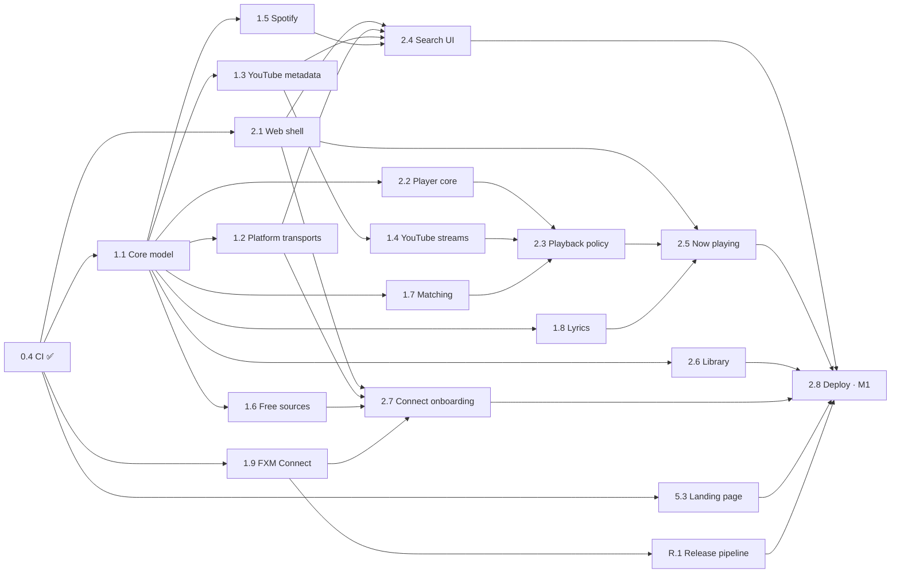

# FXM Roadmap

FXM is built in **small stages**. Each stage has one branch, a clear scope and a definition of done, so it can be handed to one agent and merged on its own. The design is in [ARCHITECTURE.md](ARCHITECTURE.md), and the branching, worktree and agent rules are in [WORKFLOW.md](WORKFLOW.md).

**Status:** ⬜ todo · 🟡 in progress · ✅ done (merged into `develop`). Only the orchestrator edits this file.

**Scheduling.** A stage is *ready* when everything in "Depends on" is ✅. Ready stages run in parallel waves as Claude Code workflows: an implementer, independent reviewers, then fix-and-verify rounds. A watchdog notifies the orchestrator when work finishes.

Phases 1, 2 and R are fully specified. Later phases get a detail pass just before they start.

**Revision 2 (2026-10-25)** followed research into the Spotube Spotify plugin, Bloomee, Spotube, browser-only playback, matching, native apps and risks, plus the owner's decisions:

- **No servers:** the gateway stages are gone.
- **FXM Connect:** a companion browser extension.
- **Desktop app:** built with Tauri.
- **Spotify:** built in, and can be switched off.
- **No YouTube embed:** it is not used anywhere.
- **Downloads:** every track, in any format.
- **Releases:** a release-and-packages phase.

---

## Milestones

| | Milestone | Stages | Tag | Result |
|---|---|---|---|---|
| **M0** ✅ | Foundation | Phase 0 | — | Repo, isolated toolchain, monorepo, CI |
| **M1** | Play anything on the web | Phases 1–2, 5.3, R.1 | `v0.1.0` | The web app with FXM Connect plays any song in Music or Music + Video mode, with Spotify metadata, lyrics and a library. The landing page is live |
| **M2** | Made for you | Phase 3 | `v0.2.0` | Home feed, daily mixes, endless radio, Spotify account sync, imports |
| **M3** | Offline and lossless | Phase 4 | `v0.3.0` | Downloads in any format, local files |
| **M4** | Web applet and embed | 5.1, 5.2 | `v0.4.0` | Installable PWA window, embeddable mini-player |
| **M5** | Android | Phase 6 | `v0.5.0` | Signed APK on GitHub Releases |
| **M6** | Desktop | Phase 7 | `v0.6.0` | Tauri app for macOS, Windows and Linux with auto-update |
| **M7** | 1.0 | Phase 8, R.2, R.3 | `v1.0.0` | Effects, scrobbling, plugins, sync, quality pass, more channels |

Milestones are release points, not a strict order. The Android (6.x) and desktop (7.x) lanes can start as soon as the web shell (2.1) is merged.

### Parallel waves to M1

| Wave | Stages that can run at the same time |
|---|---|
| 1 (running) | 1.1 · 1.9 · 2.1 · 5.3 |
| 2 | 1.2 · 1.3 · 1.5 · 1.6 · 1.7 · 1.8 · 2.2 · 2.6 · R.1 (+ 6.1 · 7.1 with spare capacity) |
| 3 | 1.4 · 2.4 · 2.7 |
| 4 | 2.3 |
| 5 | 2.5 |
| 6 | 2.8 → **M1** |

---

## Stage index

| ID | Stage | Branch | Depends on | Status |
|---|---|---|---|---|
| **0.1** | Plan, architecture and workflow docs | `docs/0.1-plan` | — | ✅ |
| **0.2** | Isolated toolchain (pnpm, uv, `.tools/`, `make nuke`) | `chore/0.2-toolchain` | 0.1 | ✅ |
| **0.3** | Monorepo scaffold | `chore/0.3-monorepo` | 0.2 | ✅ |
| **0.4** | Continuous integration | `ci/0.4-ci` | 0.3 | ✅ |
| **1.1** | Core domain model, interfaces, mode and quality policy | `feat/1.1-core-model` | 0.4 | ✅ |
| **1.2** | Platform transports and capability detection | `feat/1.2-platform` | 1.1 | ⬜ |
| **1.3** | YouTube Music + YouTube metadata provider | `feat/1.3-youtube` | 1.1 | ⬜ |
| **1.4** | YouTube stream resolver | `feat/1.4-youtube-streams` | 1.3 | ⬜ |
| **1.5** | Spotify provider (switchable; anonymous and logged-in tokens) | `feat/1.5-spotify` | 1.1 | ⬜ |
| **1.6** | Free and lossless sources: Internet Archive, Jamendo, MusicBrainz | `feat/1.6-free-sources` | 1.1 | ⬜ |
| **1.7** | Matching engine | `feat/1.7-matching` | 1.1 | ⬜ |
| **1.8** | Lyrics: LRCLIB + LRC parser | `feat/1.8-lyrics` | 1.1 | ⬜ |
| **1.9** | FXM Connect browser extension | `feat/1.9-connect-extension` | 0.4 | ✅ |
| **2.1** | Web app shell and settings | `feat/2.1-web-shell` | 0.4 | ✅ |
| **2.2** | Player core: queue, direct audio, Media Session | `feat/2.2-player-core` | 1.1 | ⬜ |
| **2.3** | Playback policy and stream lifecycle | `feat/2.3-playback-policy` | 2.2, 1.4, 1.7 | ⬜ |
| **2.4** | Search and browse UI | `feat/2.4-search-browse` | 2.1, 1.2, 1.3, 1.5 | ⬜ |
| **2.5** | Now playing, queue panel, synced lyrics | `feat/2.5-now-playing` | 2.1, 2.3, 1.8 | ⬜ |
| **2.6** | Library: likes, playlists, history, backup | `feat/2.6-library` | 2.1, 1.1 | ⬜ |
| **2.7** | FXM Connect onboarding and no-extension mode | `feat/2.7-connect-onboarding` | 2.1, 1.2, 1.6, 1.9 | ⬜ |
| **2.8** | Static deploy to `fxm-music.pages.dev` | `ci/2.8-deploy` | 2.4, 2.5, 2.6, 2.7, 5.3, R.1 | ⬜ |
| **3.1** | Listening signals and affinity | `feat/3.1-signals` | 2.2, 2.6 | ⬜ |
| **3.2** | Recommendation providers | `feat/3.2-rec-providers` | 1.2, 1.3, 1.5 | ⬜ |
| **3.3** | Recommendation engine + Home | `feat/3.3-home` | 3.1, 3.2 | ⬜ |
| **3.4** | Endless autoplay radio | `feat/3.4-autoplay` | 3.3 | ⬜ |
| **3.5** | Spotify account connect and sync (web) | `feat/3.5-spotify-sync` | 1.5, 2.6, 2.7 | ⬜ |
| **3.6** | Imports: Spotify, YouTube playlists, CSV/M3U, data export | `feat/3.6-imports` | 1.5, 1.7, 2.6 | ⬜ |
| **4.1** | Download manager + offline playback | `feat/4.1-downloads` | 2.3, 2.6 | ⬜ |
| **4.2** | Conversion and tagging (ffmpeg.wasm, LGPL build) | `feat/4.2-convert` | 4.1 | ⬜ |
| **4.3** | Quality settings | `feat/4.3-quality` | 2.3 | ⬜ |
| **4.4** | Local music files (web) | `feat/4.4-local-files` | 2.2, 2.6 | ⬜ |
| **5.1** | PWA "web applet" | `feat/5.1-pwa` | 2.5 | ⬜ |
| **5.2** | Embeddable mini-player | `feat/5.2-embed` | 2.3 | ⬜ |
| **5.3** | Landing page | `feat/5.3-site` | 0.4 | ✅ |
| **6.1** | Android toolchain + Capacitor shell + debug APK | `feat/6.1-android-shell` | 2.1 | ✅ |
| **6.2** | Android native fetch (YouTube and Spotify on the device) | `feat/6.2-android-fetch` | 6.1, 1.2, 1.4, 1.5 | ⬜ |
| **6.3** | Native player (Media3) | `feat/6.3-native-player` | 6.1, 2.3 | ⬜ |
| **6.4** | Native downloads + device music | `feat/6.4-native-downloads` | 6.3, 4.1 | ⬜ |
| **6.5** | Spotify login on Android | `feat/6.5-android-spotify-login` | 6.2, 3.5 | ⬜ |
| **6.6** | Signed APK release | `ci/6.6-apk-release` | 6.3, R.1 | ⬜ |
| **7.1** | Desktop shell (Tauri 2, Rust toolchain in `.tools/`) | `feat/7.1-desktop-shell` | 2.1 | 🟡 |
| **7.2** | Desktop native fetch | `feat/7.2-desktop-fetch` | 7.1, 1.2, 1.4 | ⬜ |
| **7.3** | Desktop playback and OS integration | `feat/7.3-desktop-playback` | 7.2, 2.3 | ⬜ |
| **7.4** | Desktop downloads + Spotify login window | `feat/7.4-desktop-downloads` | 7.2, 4.1, 3.5 | ⬜ |
| **7.5** | Desktop release: installers and auto-update | `ci/7.5-desktop-release` | 7.3, R.1 | ⬜ |
| **7.6** | Desktop trust: signing, PO-token fallback, EQ path | `chore/7.6-desktop-trust` | 7.5 | ⬜ |
| **R.1** | Release pipeline (release PR, tags, notes, checksums, attestations) | `ci/r1-release-pipeline` | 0.4, 1.9 | ⬜ |
| **R.2** | FXM Connect signing on Firefox Add-ons | `ci/r2-amo-signing` | R.1 | ⬜ |
| **R.3** | More channels: F-Droid/IzzyOnDroid/Obtainium, Flathub, Homebrew, winget | `chore/r3-channels` | 6.6, 7.5 | ⬜ |
| **8.1** | Audio effects: EQ, crossfade, sleep timer, speed, loudness | `feat/8.1-audio-fx` | 2.3, 6.3, 7.3 | ⬜ |
| **8.2** | Scrobbling (Last.fm, ListenBrainz) | `feat/8.2-scrobbling` | 3.1 | ⬜ |
| **8.3** | Plugin system for sources and resolvers | `feat/8.3-plugins` | 1.4, 1.5 | ⬜ |
| **8.4** | Backup sync (GitHub Gist) | `feat/8.4-sync` | 2.6 | ⬜ |
| **8.5** | i18n, accessibility, e2e tests, performance | `chore/8.5-quality-pass` | 5.1 | ⬜ |
| **8.6** | Spotify write-back (likes, follows, playlists) | `feat/8.6-spotify-write` | 3.5 | ⬜ |

Removed in revision 2:

- the Cloudflare gateway and its routes (old 1.2, 1.8);
- JioSaavn (old 1.4);
- the YouTube embed engine (old 2.3);
- the self-hosted server, Docker and Piped (old Phase 7).

---

## Definition of done (every stage)

- Changes stay inside the stage's **Scope**. Shared-code changes are minimal, additive and reported.
- `make check` is green: format/lint, typecheck, tests and build. CI is green on the branch.
- New logic has tests that run **offline**, with recorded and sanitized fixtures. Live tests run only with `FXM_LIVE=1`.
- User-facing behaviour respects the **catalog mode** and the platform's **capabilities**.
- **No owner-hosted servers.** Nothing may require a backend run by the project.
- Docs are updated (package README or `docs/`).
- No secrets, tokens, cookies or Spotify TOTP secrets in git, logs or fixtures.
- Commits follow Conventional Commits with **no co-author or attribution trailers**.
- The orchestrator merges the stage into `develop` and marks it ✅ here.

---

## Phase 0: Foundation ✅

0.1 docs, 0.2 isolated toolchain, 0.3 monorepo, 0.4 CI. See the git history and [DEVELOPMENT.md](DEVELOPMENT.md).

---

## Phase 1: Core, platform and sources

### 1.1 Core domain model, interfaces, mode and quality policy ✅

**Branch** `feat/1.1-core-model` · **Depends on** 0.4 · **Scope** `packages/core/**`

**Contents:**

- IDs (`<source>:<kind>:<nativeId>`) and entities.
- `TrackKind` and the catalog mode policy (`modePolicy`: playable / needs-song-match / hidden).
- Quality tiers, download formats and honest conversion labels (`describeConversion`).
- Provider interfaces: two-phase `AudioSource`, `ProviderContext` with an injected `fetch` and capabilities.
- Text normalization and version-tag extraction for the matcher.
- Typed errors.

**Done when** each module has 90 % or more coverage and full TSDoc.

### 1.2 Platform transports and capability detection

**Branch** `feat/1.2-platform` · **Depends on** 1.1 · **Scope** `packages/platform/**` (a new package)

- `createWebTransport()`: the global `fetch` with `credentials: 'omit'` and per-host routing.
  - CORS-friendly hosts are always allowed.
  - YouTube, googlevideo and Spotify hosts are allowed only when FXM Connect is present, otherwise `Unsupported`.
- FXM Connect detection: a `data-fxm-connect` marker plus a `postMessage` ping/pong with version and features, with a timeout.
- A client for the extension's Spotify session bridge (request id, timeout, errors).
- `detectCapabilities()` returns `NetworkCapabilities` and is re-run when the extension appears or disappears.
- Interfaces and stubs for the Tauri and Capacitor transports; their real implementations are 7.2 and 6.2. `createNodeTransport()` for tests.
- Unit tests with a fake window and a fake extension.

**Done when** the web app can ask "can I reach YouTube or Spotify?" and get a working `fetch`.

### 1.3 YouTube Music + YouTube metadata provider

**Branch** `feat/1.3-youtube` · **Depends on** 1.1 · **Scope** `packages/sources/src/youtube/**`

- youtubei.js (MIT, latest allowed by the 14-day rule) with the injected `fetch`, and sessions seeded with a real visitorData.
- **YouTube Music:**
  - search by type (songs, videos, albums, artists, playlists) and suggestions;
  - album, artist and playlist pages;
  - radio via `next` with `RDAMVM<videoId>`, with continuations;
  - charts and home.
- **YouTube:** video search and details for Music + Video mode.
- Classification `musicVideoType` → `TrackKind`; mode filtering on search and radio; bylines parsed by page type.
- Client names, versions and search parameters in a versioned JSON config (`youtube-config.json`), with a loader that accepts a newer config fetched from the static site.
- Sanitized recorded fixtures, and a live smoke test behind `FXM_LIVE=1`.

**Done when** fixture tests cover classification, mode filtering and parsing, and the live smoke test passes from Node.

### 1.4 YouTube stream resolver

**Branch** `feat/1.4-youtube-streams` · **Depends on** 1.3 · **Scope** `packages/sources/src/youtube/stream/**`

- `AudioSource.resolve` with the client ladder: VISIONOS, then ANDROID_VR, then IOS (direct URLs). Next, MWEB or WEB_REMIX with in-page web PO tokens (bgutils-js) and youtubei.js deciphering, isolated in a worker or sandboxed iframe. Then WEB over SABR (googlevideo library). Last, muxed itag 18.
- Validate each candidate with a 64 KB range probe past 1 MiB.
- Reject responses whose `videoId` differs from the request.
- Remember which rung worked recently.
- Parse `expire`, and report `ipBound` and codec, container, bitrate and tier for every `StreamOption`.
- Format preference: Opus 251 (where playable), then AAC 140.
- Live smoke test (`FXM_LIVE=1`): resolve and probe one known song.

**Done when** live resolution works from Node on a residential IP, and the ladder's fallbacks are covered by fixture tests.

### 1.5 Spotify provider

**Branch** `feat/1.5-spotify` · **Depends on** 1.1 · **Scope** `packages/sources/src/spotify/**`

A clean-room implementation from protocol facts. **Do not copy code or fixtures** from the AGPL plugin.

- **Token manager:**
  - The anonymous token uses `open.spotify.com/api/token` with an RFC 6238 TOTP computed from `/api/server-time`.
  - The secret and version come from a configurable runtime source (default: the community source the Spotube plugin uses), cached on the device and **never committed**.
  - Logged-in tokens come from a pluggable `SessionTokenSource`: the extension bridge on web, a login window on desktop, a WebView on Android.
  - Single-flight refresh about 60 s before expiry.
- **Operations:** GraphQL `pathfinder/v2/query` with persisted-query hashes held in a versioned config:
  - search (`searchDesktop` and the typed searches);
  - `getTrack`, `getAlbum`, `queryArtistOverview`, `queryArtistRelated`, `fetchPlaylist`;
  - `home` / `homeSection`;
  - `libraryV3` / `fetchLibraryTracks` (logged in).
- **spclient:** radio via `seed_to_playlist`, and ISRCs via `metadata/4`.
- Implements `MetadataProvider`, a radio and home `RecommendationProvider`, and the minimal `AccountProvider`.
- **Errors:**
  - 401 → refresh once;
  - 412 → disable that operation;
  - 429/5xx → `Retry-After` plus backoff, then pause the provider;
  - all mapped to `FxmError`.
- **Caching:** search 10 min, entities hours, ISRC a day, home 30 min.
- Tests on FXM's own sanitized fixtures, and a live smoke test behind `FXM_LIVE=1`.

**Done when** search, artist, related artists, radio and ISRC lookup work live from Node, and everything else is covered by fixtures.

### 1.6 Free and lossless sources

**Branch** `feat/1.6-free-sources` · **Depends on** 1.1 · **Scope** `packages/sources/src/{archive,jamendo,musicbrainz}/**`

- **Internet Archive:** FLAC-first search, item files → `StreamOption`s with tiers.
- **Jamendo:** `audioformat=flac` / `audiodlformat`, honouring `audiodownload_allowed`. The public client id is configurable.
- **MusicBrainz:** ISRC and recording lookup, rate-limited to 1 request per second, with a descriptive User-Agent.
- All three are CORS-friendly, so they work in any browser without FXM Connect.

**Done when** fixtures cover the mapping, and live smoke tests return lossless candidates.

### 1.7 Matching engine

**Branch** `feat/1.7-matching` · **Depends on** 1.1 · **Scope** `packages/core/src/matching/**`

- The algorithm from [ARCHITECTURE.md §12](ARCHITECTURE.md#12-matching-engine-packagescoresrcmatching):
  - ISRC check;
  - scorer 0.40 title / 0.35 artist / 0.25 duration;
  - version and featured-artist penalties and caps;
  - Auto / Suggest / None bands;
  - classical guard; user uploads never auto-play;
  - official video → song mapping without a duration check.
- A pure function over candidates; the providers supply the searches.
- **Golden dataset:** at least 50 cases, seeded from the research's 300 labelled pairs, plus tricky ones:
  - romanized vs native script;
  - classical re-recordings;
  - "Taylor's Version";
  - official sped-up releases;
  - radio edits;
  - explicit vs clean.

**Done when** the golden tests show **zero wrong auto-plays** and an auto-play rate of 85 % or more on mainstream tracks.

### 1.8 Lyrics

**Branch** `feat/1.8-lyrics` · **Depends on** 1.1 · **Scope** `packages/sources/src/lrclib/**`, `packages/core/src/lyrics/**`

- LRCLIB `get` (with duration), then `search`, then fetch by id.
- An LRC parser: multiple timestamps, `[offset:]`, enhanced word timing, plain-text fallback, and `lineAt(ms)`.

**Done when** the parser's table tests pass.

### 1.9 FXM Connect browser extension ✅

**Branch** `feat/1.9-connect-extension` · **Depends on** 0.4 · **Scope** `apps/extension/**`, the Makefile `extension` target

- MV3 for Chromium and Firefox, with no logic and no remote code.
- Static DNR rules scoped to the FXM origin ([ARCHITECTURE.md §9](ARCHITECTURE.md#9-fxm-connect-companion-extension)).
- Presence handshake.
- The opt-in Spotify session bridge.
- Options page.
- Unit tests, plus a Playwright end-to-end test against a mock YouTube.
- Zips for Chromium and Firefox.

**Done when** the e2e test proves the page can reach the mock InnerTube only with the extension loaded.

---

## Phase 2: Web player (→ M1)

### 2.1 Web app shell and settings ✅

**Branch** `feat/2.1-web-shell` · **Depends on** 0.4 · **Scope** `apps/web/**`

- Routes, a Spotify-style layout (sidebar, top bar, player bar, mobile tab bar), Tailwind v4 tokens, light/dark/system themes.
- Settings: catalog mode and theme.
- Zustand and TanStack Query, error boundaries, tests, and Playwright screenshots at 320/768/1280 px.

### 2.2 Player core

**Branch** `feat/2.2-player-core` · **Depends on** 1.1 · **Scope** `packages/player/**`, `packages/core/src/queue/**`

- An engine interface plus a player facade.
- A direct-audio engine on `HTMLAudioElement`, with a second element preloading the next track.
- Queue:
  - add, play next, reorder, remove;
  - shuffle with history;
  - repeat off/all/one;
  - "previous" restarts the track if more than 3 s in;
  - contexts;
  - follows the mode policy.
- Media Session: metadata, actions, position state.
- Tests use a fake engine.

### 2.3 Playback policy and stream lifecycle

**Branch** `feat/2.3-playback-policy` · **Depends on** 2.2, 1.4, 1.7 · **Scope** `packages/core/src/playback-policy/**`, `packages/player/src/lifecycle/**`

- Order of preference: offline copy, then a stream resolved on the device, then a matched alternative (Smart Replace on terminal failure).
- A Spotify-catalog track is matched to a song first, then resolved.
- URL cache until 10 minutes before expiry; re-resolve on 401/403/410 or a stall and resume at the same position.
- Prefetch the next 2–3 tracks; share in-flight resolutions.
- Retries with backoff; a circuit breaker after 4 failed tracks.
- Format choice per `canPlayType`.
- Tests with fake sources and clocks.

### 2.4 Search and browse UI

**Branch** `feat/2.4-search-browse` · **Depends on** 2.1, 1.2, 1.3, 1.5 · **Scope** `apps/web/src/features/{search,album,artist,playlist}/**`

- Debounced search with suggestions.
- A mode chip.
- Tabs: Songs / Albums / Artists / Playlists, plus Videos in Music + Video mode.
- A source switch: YouTube Music, or Spotify when it is enabled.
- Kind and source badges on every row.
- Album, artist and playlist pages, with play, shuffle, queue and add-to-playlist actions.
- Capability-aware: without FXM Connect it shows the onboarding entry point instead of empty results.

### 2.5 Now playing, queue panel, synced lyrics

**Branch** `feat/2.5-now-playing` · **Depends on** 2.1, 2.3, 1.8 · **Scope** `apps/web/src/features/{now-playing,queue,lyrics}/**`

- Full-screen now playing with a stream badge, e.g. "Opus 160 · YouTube Music" or "Matched from Spotify · 0.93", and a "Not the right version?" switcher.
- A queue panel with drag-reorder.
- Synced lyrics with tap-to-seek.
- A mini player.

### 2.6 Library

**Branch** `feat/2.6-library` · **Depends on** 2.1, 1.1 · **Scope** `apps/web/src/features/library/**`, `apps/web/src/db/**`

- A Dexie schema with migrations, holding:
  - the track cache;
  - likes;
  - playlists;
  - follows;
  - history;
  - settings;
  - the match cache.
- A library page: playlists, liked songs, Downloads, artists, albums, recently played.
- **Ordering is a headline feature** (the owner's explicit request). Every playlist, including Liked songs and Downloads, has a saved custom order the user fully controls:
  - drag and drop (pointer, touch and keyboard), move up/down/top/bottom, and multi-select moves;
  - **Shuffle order**, which permanently randomizes the saved order, with undo (separate from shuffle playback);
  - sort views (title, artist, album, date added, duration) with "Save as custom order";
  - the list of playlists itself can be reordered the same way.

  Orders survive reloads and backups, and stay fast at 1,000+ tracks.
- **Downloads** is a built-in system playlist that can't be deleted or renamed. The download manager (4.1) fills it, and it supports every ordering feature.
- JSON backup export and import, including custom orders.

### 2.7 FXM Connect onboarding and no-extension mode

**Branch** `feat/2.7-connect-onboarding` · **Depends on** 2.1, 1.2, 1.6, 1.9 · **Scope** `apps/web/src/features/connect/**`

- Detects the extension and its version, and shows a "what you're missing" panel.
- Per-browser install guides: the Chromium zip with Load unpacked, the Firefox add-on, and a desktop-app or APK suggestion.
- Free-source mode (Internet Archive, Jamendo, local files) when the extension is absent.
- An upgrade prompt when the extension is outdated.

### 2.8 Static deploy

**Branch** `ci/2.8-deploy` · **Depends on** 2.4, 2.5, 2.6, 2.7, 5.3, R.1 · **Scope** `.github/workflows/deploy.yml`, `scripts/build-dist*`

- `make dist` composes the site at `/`, the app at `/app/` and the embed at `/embed/`, plus a `_headers` file (CSP, referrer policy). There are **no Functions**.
- Cloudflare Pages project `fxm-music`: `develop` deploys to the preview, the `main` release deploys to production.
- Owner actions: a free Cloudflare account, and the GitHub secrets `CLOUDFLARE_API_TOKEN` and `CLOUDFLARE_ACCOUNT_ID`.

**Done when** `https://fxm-music.pages.dev/app/` with FXM Connect plays songs in both modes. → **M1 / `v0.1.0`**

---

## Phase R: Releases and packages (cross-cutting)

### R.1 Release pipeline

**Branch** `ci/r1-release-pipeline` · **Depends on** 0.4, 1.9 · **Scope** `.github/workflows/release.yml`, `scripts/release*`, `CHANGELOG.md`, `cliff.toml`

- `make release-pr VERSION=x.y.z` bumps the versions, opens the `develop` → `main` pull request with generated notes, and waits for CI.
- On merge to `main`:
  - tag `vX.Y.Z` and build every artifact available so far: the web bundle zip, the FXM Connect zips, and later the APK and desktop installers;
  - publish a GitHub Release with notes generated from the Conventional Commits (git-cliff), SHA-256 checksums and build-provenance attestations (`actions/attest-build-provenance`);
  - append to `CHANGELOG.md`.
- Each platform stage (6.6, 7.5, R.2) adds its artifacts to this workflow.

### R.2 FXM Connect signing on Firefox Add-ons

**Branch** `ci/r2-amo-signing` · **Depends on** R.1

- Unlisted (self-distribution) signing with `web-ext sign` in CI. The owner adds the AMO API keys as secrets; the AMO account is free.
- The signed XPI is attached to the release, and listing on AMO is optional.

### R.3 More channels

**Branch** `chore/r3-channels` · **Depends on** 6.6, 7.5

- F-Droid / IzzyOnDroid / Obtainium metadata for the APK.
- A Flathub manifest, a Homebrew cask and a winget manifest for the desktop app.

---

## Phase 3: Made for you (→ M2)

| ID | Stage | Notes |
|---|---|---|
| 3.1 | Listening signals and affinity | Play events (played ms, completion, skip, context, stream), likes, playlist adds. Incremental time-decayed affinity for tracks, artists and tags (half-life about 14 days) |
| 3.2 | Recommendation providers | YouTube Music radio (song-seeded in Music mode); Spotify radio, related artists and home; Last.fm keyless station JSON (via Connect) and similar artists; ListenBrainz. All mode-aware |
| 3.3 | Recommendation engine + Home | Candidates, scoring, MMR diversity, per-artist cap, history dedup. Shelves: Quick picks, Daily Mixes, Discover, Because you listened, Rediscover, On repeat, plus Spotify sections when connected. Onboarding for a cold start. Deterministic tests |
| 3.4 | Endless autoplay radio | Extend the queue from the last 5 plays when fewer than 3 tracks remain; likes and skips retune it; no repeats within N tracks; can be switched off |
| 3.5 | Spotify account connect and sync (web) | "Connect your account" using the browser's Spotify session through the FXM Connect bridge. Sync the personalized home, liked songs and playlists into the library, read-only. Disconnect clears tokens. Desktop is 7.4 and Android 6.5 |
| 3.6 | Imports | Spotify playlist, album and track URLs through the provider; YouTube and YouTube Music playlists; CSV (Exportify columns); M3U; Spotify's "Download your data" JSON. Mode-aware matching with a review screen. Done when a 100-track playlist imports with a match report |

## Phase 4: Offline and lossless (→ M3)

| ID | Stage | Notes |
|---|---|---|
| 4.1 | Download manager + offline playback | Every track wherever the bytes are readable (web with Connect, desktop, Android): a queue with concurrency, progress, pause/retry and resumable ranges. OPFS plus `navigator.storage.persist()` and a usage meter. Offline copies come first in the playback policy. Completed downloads are added to the reorderable **Downloads** system playlist from 2.6, and deleting a download removes it there |
| 4.2 | Conversion and tagging | ffmpeg.wasm (an **LGPL** core) in a worker; Original / FLAC / ALAC / WAV / MP3 / AAC / Opus; tags, cover art and lyrics; honest labels from `describeConversion`; "Save to device" |
| 4.3 | Quality settings | Streaming quality on Wi-Fi vs cellular, download format and bitrate defaults, data saver |
| 4.4 | Local music files (web) | Folder access (Chromium) or a file picker; tags and artwork via `music-metadata`; local tracks in search and library |

## Phase 5: Web applet, embed, web page (→ M4)

| ID | Stage | Notes |
|---|---|---|
| 5.1 | PWA "web applet" | `vite-plugin-pwa`: manifest, maskable icons, standalone plus window-controls-overlay, scope `/app/`, offline shell, update toast, install button, media keys |
| 5.2 | Embeddable mini-player | `/embed/track\|album\|playlist/:id` in compact and card layouts, a share dialog that copies the iframe code, a postMessage API. Plays YouTube when the visitor has FXM Connect, otherwise free sources plus an install hint |
| 5.3 | Landing page ✅ | An Astro static site: features, how it works, Get FXM (web + Connect, desktop, Android), FAQ, privacy, disclaimer, SEO |

## Phase 6: Android (→ M5)

| ID | Stage | Notes |
|---|---|---|
| 6.1 | Android shell | `make android-setup` puts Temurin JDK 21, the command-line tools and the SDK into `.tools/`; Capacitor wraps the web build; `make apk` builds a debug APK |
| 6.2 | Android native fetch | An explicit native fetch (`CapacitorHttp.request` or a small OkHttp plugin) with per-host headers and binary-safe bodies, **not** the global patch. YouTube and Spotify run on the device |
| 6.3 | Native player | A Media3 `MediaSessionService` plugin that takes a queue of resolved items, sets per-URL headers through a `ResolvingDataSource`, calls back to JS to re-resolve on 403 or expiry, and runs as a foreground service with a notification and lock-screen controls |
| 6.4 | Native downloads + device music | Background downloads (YouTube included) to app storage, MediaStore export, MediaStore scan |
| 6.5 | Spotify login on Android | An in-app login WebView plus CookieManager, storing the session in app-private storage. The password is never handled |
| 6.6 | Signed APK release | A keystore in secrets; tag → signed APKs (arm64 + universal) attached by R.1; in-app update check. Documents Google's 2027 developer verification (USD 25 plus ID, or the ADB / advanced flow) |

## Phase 7: Desktop (→ M6)

| ID | Stage | Notes |
|---|---|---|
| 7.1 | Desktop shell | `scripts/install-rust.sh` (pinned and checksummed; `RUSTUP_HOME`, `CARGO_HOME` and `CARGO_TARGET_DIR` under `.tools/`); `apps/desktop/src-tauri` on Tauri 2 with the http (`unsafe-headers`), updater, single-instance, window-state and opener plugins; `make desktop-dev` and `make desktop-build`; doctor checks for Xcode CLT, MSVC + WebView2 and webkit2gtk |
| 7.2 | Desktop native fetch | `createDesktopFetch()` with the per-host header policy (never `tauri://localhost`); capability scope allow-list; CSP (`media-src` googlevideo, `unsafe-eval` for the deciphering evaluator); server-issued visitorData; a live smoke test in a hidden window |
| 7.3 | Desktop playback | Codec per `canPlayType`, re-resolve on 403 or after about 5 h, Media Session, a tray menu, close to tray, background throttling disabled |
| 7.4 | Desktop downloads + Spotify login | Downloads to disk in any format; a Spotify login window whose cookies are read from that window only and stored in OS-protected storage |
| 7.5 | Desktop release | A `tauri-action` matrix (macOS arm64 and x64, Windows, Linux x64 and arm64), ad-hoc macOS signing, an updater key in secrets plus `latest.json`, GStreamer dependencies for `.deb`, install docs for "Open Anyway" and SmartScreen |
| 7.6 | Desktop trust | Apply to SignPath; the owner decides on Apple notarization (USD 99 a year); a PO-token fallback through BotGuard in the webview; a MediaSource path or local stream so the EQ can read googlevideo audio |

## Phase 8: Polish (→ M7 / 1.0)

| ID | Stage | Notes |
|---|---|---|
| 8.1 | Audio effects | EQ (Web Audio on readable bytes; ExoPlayer effects on Android), crossfade, sleep timer, speed, loudness normalization |
| 8.2 | Scrobbling | Last.fm and ListenBrainz, opt-in, with an offline queue |
| 8.3 | Plugin system | Runtime-loadable sources and resolvers, versioned and checksummed, in a worker sandbox |
| 8.4 | Backup sync | Optional GitHub Gist sync of the library and settings |
| 8.5 | Quality pass | i18n, accessibility audit, Playwright e2e on critical flows, performance budgets |
| 8.6 | Spotify write-back | Optional likes, follows and playlist edits back to Spotify |
