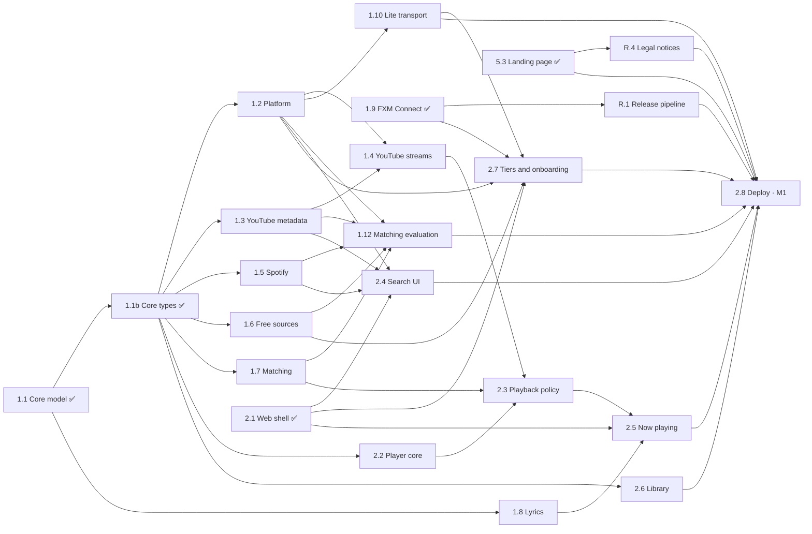

# FXM Roadmap

FXM is built in **small stages**. Each stage has one branch, a clear scope and a definition of done, so it can be handed to one agent and merged on its own. The design is in [ARCHITECTURE.md](ARCHITECTURE.md), and the branching, worktree and agent rules are in [WORKFLOW.md](WORKFLOW.md).

**Status:** ⬜ todo · 🟡 in progress · ✅ done (merged into `develop`). Only the orchestrator edits this file.

**Scheduling.** A stage is *ready* when everything in "Depends on" is ✅. Ready stages run in parallel waves as Claude Code workflows: an implementer, independent reviewers, then fix-and-verify rounds. A watchdog notifies the orchestrator when work finishes.

Phases 1, 2 and R are fully specified. Later phases get a detail pass just before they start.

**Revision 3 (2026-10-25)** applies the [user-side research memo](research/2026-10-25-userside-memo.md) and the [review of its first draft](research/2026-10-25-userside-memo-critique.json), which are the evidence base for this revision. The research measured three things revision 2 got wrong: a plain page *can* reach YouTube's API from an opaque origin (undocumented), only one YouTube client (VISIONOS) serves full-length audio without tokens, and an ISRC search or the text scorer alone can auto-play the wrong recording.

The owner decided the memo's open questions on 2026-10-25:

- **Spotify stays built in** (Decision 1, option A): on by default wherever the platform can reach it, switchable off, with optional account sync. The owner accepts the risk for a mostly-personal-use project.
- **YouTube downloads stay on** wherever the bytes are readable (Decision 2, option A).
- **Distribution stays free and unregistered for now** (Decision 3, option B). Android developer verification is revisited before the 2027 rollout.
- **Music mode plays songs from any source:** YouTube Music, Internet Archive, Jamendo and local files.
- **No mirrors for now:** one static host, Cloudflare Pages.

What changed:

- **Three tiers:** Free only, Lite (no install, experimental: new 1.10) and Full (FXM Connect, desktop, Android).
- **YouTube:** the ladder is VISIONOS, then itag 18, with an end-of-file probe. Deciphered, PO-token and SABR rungs move to the experimental 1.11. One request budget covers every YouTube call (1.2).
- **Matching:** an ISRC gate that needs every check, a re-recording guard and a no-duration mode. Auto-play is a setting gated by a held-out report (new 1.12), so M1 may ship Suggest-only.
- **Updates:** a signed config and resolver module for desktop and Android (new 1.13).
- **Core types:** 1.1 merged with revision 2's types, so the research's type changes are a new stage, 1.1b.
- **Legal:** a light R.4 for the non-affiliation notice, a takedown playbook and the clean-room log.
- **Extension stores:** Firefox Add-ons and Edge Add-ons; no Chrome Web Store by default (R.2).
- **Small additions:** opt-in SponsorBlock for Music + Video (new 8.7), artwork gaps filled from Cover Art Archive and iTunes Search (3.2), and a Diagnostics self-test (2.7).
- **Site:** 2.7 brings the landing page in line with this revision. A stage that ships a feature or contacts a new service updates the site's `AVAILABLE` flags, its privacy page and the app's CSP (Definition of done).
- **Removed:** 8.6, Spotify write-back.

**Revision 2 (2026-10-25)** followed research into the Spotube Spotify plugin, Bloomee, Spotube, browser-only playback, matching, native apps and risks, plus the owner's decisions:

- **No servers:** the gateway stages are gone.
- **FXM Connect:** a companion browser extension.
- **Desktop app:** built with Tauri.
- **Spotify:** built in, and can be switched off.
- **No YouTube embed:** it is not used anywhere.
- **Downloads:** every track, in any format.
- **Releases:** a release-and-packages phase.

---

## Milestones

| | Milestone | Stages | Tag | Result |
|---|---|---|---|---|
| **M0** ✅ | Foundation | Phase 0 | — | Repo, isolated toolchain, monorepo, CI |
| **M1** | Play anything on the web | Phases 1–2 except 1.11 and 1.13, plus 5.3, R.1, R.4 | `v0.1.0` | The web app plays YouTube Music songs in Music or Music + Video mode with FXM Connect, and without it in the experimental Lite tier (at least in Chromium, unless its kill switch is on). Free sources, Spotify metadata, lyrics and a library work too. Matches auto-play only if the 1.12 report passes; otherwise M1 is Suggest-only. The landing page is live |
| **M2** | Made for you | Phase 3 | `v0.2.0` | Home feed, daily mixes, endless radio, Spotify account sync, imports (including Spotify's data export) |
| **M3** | Offline and lossless | Phase 4 | `v0.3.0` | Downloads in any format, local files |
| **M4** | Web applet and embed | 5.1, 5.2 | `v0.4.0` | Installable PWA window, embeddable mini-player (Lite inside other sites) |
| **M5** | Android | Phase 6 | `v0.5.0` | Signed APK on GitHub Releases |
| **M6** | Desktop | Phase 7, 1.11, 1.13 | `v0.6.0` | Tauri app for macOS, Windows and Linux with auto-update, the signed resolver module and the experimental YouTube rungs |
| **M7** | 1.0 | Phase 8, R.2, R.3 | `v1.0.0` | Effects, scrobbling, plugins, sync, SponsorBlock, quality pass, more channels |

Milestones are release points, not a strict order. A stage can finish before its milestone and ship in the next release: 1.11, 1.13 and R.2 run in the waves to M1, which doesn't wait for them. The Android (6.x) and desktop (7.x) lanes run alongside.

### Parallel waves to M1

The diagram shows what M1 needs. 1.11, 1.13 and R.2 run in the same waves (see the table).

| Wave | Stages that can run at the same time |
|---|---|
| 1 (done) | 1.1 · 1.9 · 2.1 · 5.3 |
| 2 | 1.1b ✅ first, then 1.2 · 1.3 · 1.5 · 1.6 · 1.7 · 2.6. 1.8, 2.2 and R.1 started under revision 2, alongside 1.1b; 2.2 takes 1.1b's types when it rebases. R.4 needs no core types and can start at once |
| 3 | 1.4 · 1.10 · 1.12 · 2.4 · R.2 |
| 4 | 1.11 · 1.13 · 2.3 · 2.7 |
| 5 | 2.5 |
| 6 | 2.8 → **M1** |

The Android lane (6.1 ✅) and the desktop lane (7.1 ✅) continue in parallel.

---

## Stage index

| ID | Stage | Branch | Depends on | Status |
|---|---|---|---|---|
| **0.1** | Plan, architecture and workflow docs | `docs/0.1-plan` | — | ✅ |
| **0.2** | Isolated toolchain (pnpm, uv, `.tools/`, `make nuke`) | `chore/0.2-toolchain` | 0.1 | ✅ |
| **0.3** | Monorepo scaffold | `chore/0.3-monorepo` | 0.2 | ✅ |
| **0.4** | Continuous integration | `ci/0.4-ci` | 0.3 | ✅ |
| **1.1** | Core domain model, interfaces, mode and quality policy | `feat/1.1-core-model` | 0.4 | ✅ |
| **1.1b** | Core types from research | `feat/1.1b-core-research-types` | 1.1 | ✅ |
| **1.2** | Platform transports, capability detection and request budget | `feat/1.2-platform` | 1.1b | ✅ |
| **1.3** | YouTube Music + YouTube metadata provider | `feat/1.3-youtube` | 1.1b | ✅ |
| **1.4** | YouTube stream resolver: direct rungs | `feat/1.4-youtube-streams` | 1.2, 1.3 | ✅ |
| **1.5** | Spotify provider (switchable; anonymous and logged-in tokens) | `feat/1.5-spotify` | 1.1b | ✅ |
| **1.6** | Free and lossless sources: Internet Archive, Jamendo, MusicBrainz | `feat/1.6-free-sources` | 1.1b | ✅ |
| **1.7** | Matching engine | `feat/1.7-matching` | 1.1b | ✅ |
| **1.8** | Lyrics: LRCLIB + LRC parser | `feat/1.8-lyrics` | 1.1 | ✅ |
| **1.9** | FXM Connect browser extension | `feat/1.9-connect-extension` | 0.4 | ✅ |
| **1.10** | Opaque-origin transport (Lite tier) | `feat/1.10-sandbox-transport` | 1.2 | 🟡 |
| **1.11** | YouTube resolver: deciphered, attested and SABR rungs (experimental) | `feat/1.11-youtube-advanced-rungs` | 1.2, 1.4, 1.9, 2.2, 6.1, 7.1 | 🟡 |
| **1.12** | Matching evaluation: labelled set, report and Auto switch | `test/1.12-matching-eval` | 1.2, 1.3, 1.5, 1.6, 1.7 | 🟡 |
| **1.13** | Signed config and resolver module | `feat/1.13-signed-updates` | 1.2, 1.3, 1.4, 7.1 | 🟡 |
| **2.1** | Web app shell and settings | `feat/2.1-web-shell` | 0.4 | ✅ |
| **2.2** | Player core: queue, direct audio, Media Session | `feat/2.2-player-core` | 1.1b | ✅ |
| **2.3** | Playback policy and stream lifecycle | `feat/2.3-playback-policy` | 2.2, 1.4, 1.7 | ✅ |
| **2.4** | Search and browse UI | `feat/2.4-search-browse` | 2.1, 1.2, 1.3, 1.5 | ✅ |
| **2.5** | Now playing, queue panel, synced lyrics | `feat/2.5-now-playing` | 2.1, 2.3, 1.8 | ✅ |
| **2.6** | Library: likes, playlists, history, backup | `feat/2.6-library` | 2.1, 1.1b | 🟡 |
| **2.7** | Tiers, onboarding and install guides | `feat/2.7-connect-onboarding` | 2.1, 1.2, 1.6, 1.9, 1.10 | 🟡 |
| **2.8** | Static deploy to `fxmusic.pages.dev` | `ci/2.8-deploy` | 2.4, 2.5, 2.6, 2.7, 2.9, 5.3, R.1, R.4, 1.10 | 🟡 |
| **2.9** | App composition: real providers, resolver and player | `feat/2.9-app-wiring` | 1.4, 2.3, 2.4, 2.6 | 🟡 |
| **3.1** | Listening signals and affinity | `feat/3.1-signals` | 2.2, 2.6 | 🟡 |
| **3.2** | Recommendation providers | `feat/3.2-rec-providers` | 1.2, 1.3, 1.5 | ✅ |
| **3.3** | Recommendation engine + Home | `feat/3.3-home` | 3.1, 3.2 | 🟡 |
| **3.4** | Endless autoplay radio | `feat/3.4-autoplay` | 3.3 | ⬜ |
| **3.5** | Spotify account connect and sync (web) | `feat/3.5-spotify-sync` | 1.5, 2.6, 2.7 | ⬜ |
| **3.6** | Imports: Spotify, YouTube playlists, CSV/M3U, data export | `feat/3.6-imports` | 1.5, 1.7, 2.6, 3.1 | 🟡 |
| **4.1** | Download manager + offline playback | `feat/4.1-downloads` | 2.3, 2.6 | 🟡 |
| **4.2** | Conversion and tagging (custom LGPL ffmpeg.wasm build, mp4box.js) | `feat/4.2-convert` | 4.1 | ⬜ |
| **4.3** | Quality settings | `feat/4.3-quality` | 2.3 | 🟡 |
| **4.4** | Local music files (web) | `feat/4.4-local-files` | 2.2, 2.6 | 🟡 |
| **5.1** | PWA "web applet" | `feat/5.1-pwa` | 2.5 | 🟡 |
| **5.2** | Embeddable mini-player | `feat/5.2-embed` | 2.3, 1.10 | 🟡 |
| **5.3** | Landing page | `feat/5.3-site` | 0.4 | ✅ |
| **6.1** | Android toolchain + Capacitor shell + debug APK | `feat/6.1-android-shell` | 2.1 | ✅ |
| **6.2** | Android native fetch (OkHttp plugin; YouTube and Spotify on the device) | `feat/6.2-android-fetch` | 6.1, 1.2, 1.4, 1.5 | 🟡 |
| **6.3** | Native player (Media3) | `feat/6.3-native-player` | 6.1, 2.3 | 🟡 |
| **6.4** | Native downloads + device music | `feat/6.4-native-downloads` | 6.3, 4.1 | ⬜ |
| **6.5** | Spotify login on Android | `feat/6.5-android-spotify-login` | 6.2, 3.5 | ⬜ |
| **6.6** | Signed APK release | `ci/6.6-apk-release` | 6.3, R.1 | ⬜ |
| **7.1** | Desktop shell (Tauri 2, Rust toolchain in `.tools/`) | `feat/7.1-desktop-shell` | 2.1 | ✅ |
| **7.2** | Desktop native fetch | `feat/7.2-desktop-fetch` | 7.1, 1.2, 1.4 | 🟡 |
| **7.3** | Desktop playback and OS integration | `feat/7.3-desktop-playback` | 7.2, 2.3 | 🟡 |
| **7.4** | Desktop downloads + Spotify login window | `feat/7.4-desktop-downloads` | 7.2, 4.1, 3.5 | ⬜ |
| **7.5** | Desktop release: installers and auto-update | `ci/7.5-desktop-release` | 7.3, R.1 | ⬜ |
| **7.6** | Desktop trust: signing and EQ path | `chore/7.6-desktop-trust` | 7.5, 1.11 | ⬜ |
| **R.1** | Release pipeline (release PR, tags, notes, checksums, attestations) | `ci/r1-release-pipeline` | 0.4, 1.9 | ✅ |
| **R.2** | Extension store channels: Firefox Add-ons and Edge Add-ons | `ci/r2-extension-stores` | R.1 | 🟡 |
| **R.3** | More channels: F-Droid/IzzyOnDroid/Obtainium, Flathub, winget (Homebrew only if notarized) | `chore/r3-channels` | 6.6, 7.5 | ⬜ |
| **R.4** | Legal notices and clean-room log | `docs/r4-legal-notices` | 0.4, 5.3 | ✅ |
| **8.1** | Audio effects: EQ, crossfade, sleep timer, speed, loudness | `feat/8.1-audio-fx` | 2.3, 6.3, 7.3 | ⬜ |
| **8.2** | Scrobbling (Last.fm, ListenBrainz) | `feat/8.2-scrobbling` | 3.1 | 🟡 |
| **8.3** | Plugin system for sources and resolvers | `feat/8.3-plugins` | 1.4, 1.5, 1.11 | ⬜ |
| **8.4** | Backup sync (GitHub Gist) | `feat/8.4-sync` | 2.6 | 🟡 |
| **8.5** | i18n, accessibility, e2e tests, performance | `chore/8.5-quality-pass` | 5.1 | ⬜ |
| **8.7** | SponsorBlock in Music + Video (opt-in) | `feat/8.7-sponsorblock` | 2.3, 2.5 | 🟡 |

Removed in revision 3:

- Spotify write-back (8.6): writing adds automation, account risk and legal exposure for little value.

Removed in revision 2:

- the Cloudflare gateway and its routes (old 1.2, 1.8);
- JioSaavn (old 1.4);
- the YouTube embed engine (old 2.3);
- the self-hosted server, Docker and Piped (old Phase 7).

---

## Definition of done (every stage)

- Changes stay inside the stage's **Scope**. Shared-code changes are minimal, additive and reported.
- `make check` is green: format/lint, typecheck, tests and build. CI is green on the branch.
- New logic has tests that run **offline**, with recorded and sanitized fixtures. Live tests run only with `FXM_LIVE=1`. In CI they are advisory, because datacenter IPs hit YouTube's bot checks.
- User-facing behaviour respects the **catalog mode**, the **tier** (Free only, Lite, Full) and the platform's **capabilities**.
- Every YouTube InnerTube call draws on the shared **request budget** (1.2).
- **No owner-hosted servers.** Nothing may require a backend run by the project.
- Docs are updated (package README or `docs/`).
- **New services.** A stage that makes FXM contact a new service, or fetch new remote config or code, names it on the site's privacy page (`apps/site/src/pages/privacy.astro`) with a new `updated` date. It also adds the service's hosts to the web app's CSP: to 2.8's host list once 2.8 has merged, otherwise in its report for the orchestrator. Both edits count as in scope.
- **Site flags.** A stage that ships a feature listed in `AVAILABLE` (`apps/site/src/config.ts`) turns its flag on and reviews the copy that reads it, following the content rules in [apps/site/README.md](../apps/site/README.md).
- No secrets, tokens, cookies or Spotify TOTP secrets in git, logs or fixtures.
- Public text uses no YouTube or Spotify logos, brand colours or "Spot…" names.
- Commits follow Conventional Commits with **no co-author or attribution trailers**.
- The orchestrator merges the stage into `develop` and marks it ✅ here.

---

## Phase 0: Foundation ✅

0.1 docs, 0.2 isolated toolchain, 0.3 monorepo, 0.4 CI. See the git history and [DEVELOPMENT.md](DEVELOPMENT.md).

---

## Phase 1: Core, platform and sources

### 1.1 Core domain model, interfaces, mode and quality policy ✅

**Branch** `feat/1.1-core-model` · **Depends on** 0.4 · **Scope** `packages/core/**`

**Contents:**

- IDs (`<source>:<kind>:<nativeId>`) and entities.
- `TrackKind` and the catalog mode policy (`modePolicy`: playable / needs-song-match / hidden).
- Quality tiers, download formats and honest conversion labels (`describeConversion`).
- Provider interfaces: two-phase `AudioSource`, `ProviderContext` with an injected `fetch` and capabilities.
- Text normalization and version-tag extraction for the matcher.
- Typed errors.

**Done when** each module has 90 % or more coverage and full TSDoc.

It merged with revision 2's types (boolean capabilities, `jiosaavn` in `SourceId`). The research's type changes are 1.1b.

### 1.1b Core types from research ✅

**Branch** `feat/1.1b-core-research-types` · **Depends on** 1.1 · **Scope** `packages/core/**`

These change exported types, but nothing outside `packages/core` uses them yet (checked 2026-10-25), so the breaking changes stay inside core. Land them before the stages that consume them.

- `NetworkCapabilities.youtube: boolean` becomes `'none' | 'simple' | 'full'`. `simple` means CORS-simple InnerTube calls only (the Lite tier); `full` means every YouTube path (FXM Connect, desktop, Android).
- `NetworkCapabilities.spotify: boolean` becomes a reachability value, `'unreachable' | 'anonymous' | 'account'`. It never encodes the user's on/off choice, which lives in settings (Decision 1, option A).
- `AudioCandidate` keeps `evidence: string[]` and gains `signals: { isrcVerified: boolean; releaseId?: string; releaseYear?: number; label?: string; sourceAlbumMatch: boolean }`.
- `StreamOption` gains `fullLength` (`'verified' | 'unverified' | 'capped'`) and `media` (`'audio' | 'muxed-video'`).
- `modePolicy` accepts a song-for-video link, so an official video whose song is known plays as that song in Music mode.
- `SourceId` becomes extensible for plugin sources (8.3), and drops `jiosaavn`, which revision 2 removed.
- YouTube audio is never labelled lossless: tests pin `tierOf` and `describeConversion` for Opus and AAC sources.

**Done when** coverage and TSDoc are as in 1.1, and the package README documents the new fields.

It merged on 2026-10-25 with three details the stages after it rely on: `signals` is optional (the matching engine fills in what a provider leaves out), `mediaBytes` can be true only with `youtube: 'full'`, and plugin sources are named `plugin.<name>`. [packages/core/README.md](../packages/core/README.md) has the rest.

### 1.2 Platform transports, capability detection and request budget ✅

**Branch** `feat/1.2-platform` · **Depends on** 1.1b · **Scope** `packages/platform/**` (a new package), except `src/sandbox/**`, `src/updates/**` and `src/evaluator/**`

- **The CORS-simple guard** (`toSimpleInnerTubeRequest()`), which every transport applies to every InnerTube call: the JSON body goes as a string labelled `text/plain`, and `Content-Type: application/json` and any `X-Goog-*` or `X-YouTube-*` header are dropped. A request that would still need a preflight fails with a typed error. The request itself (client fields and `visitorData` in `context.client`, `prettyPrint=false` in the URL) comes from 1.3's youtubei.js wrapper ([ARCHITECTURE.md §8](ARCHITECTURE.md#8-platforms-and-network-transports)).
- **`createWebTransport()`:** the global `fetch` with `credentials: 'omit'` and per-host routing.
  - CORS-friendly hosts are always allowed.
  - InnerTube goes through FXM Connect when present, otherwise through a `SandboxTransport` (the interface and a fake are here; 1.10 implements it), otherwise `Unsupported`.
  - googlevideo bytes, YouTube's player JS, Spotify and Last.fm station JSON go through FXM Connect only.
  - User-configured hosts (an Invidious instance, the Spotify secret source) go through the sandbox's user-host document (1.10).
- **FXM Connect detection:** a `data-fxm-connect` marker plus a `postMessage` ping/pong with version and features, with a timeout. It also reports "was present, now missing", so onboarding can say the extension is off or was disabled by the browser.
- A client for the extension's Spotify session bridge (request id, timeout, errors).
- **`detectCapabilities()`:** honour the remote kill switches, look for FXM Connect, otherwise run the one-request sandbox self-test. It returns `NetworkCapabilities` and re-runs when the extension appears or disappears.
- **The shared request budget** (`createRequestBudget()`): one per device for every InnerTube call.
  - At most 600 calls an hour.
  - Priority: the current track, then prefetch, then interactive search and browse, then bulk work (imports, re-matching, the 1.12 recorder).
  - Bulk calls at least 5 s apart, and only while 100 or more calls of the hour remain.
  - The first `LOGIN_REQUIRED` or 429 pauses bulk work for 30 minutes, doubling up to 4 hours, while playback continues. The pause state is persisted.
- **Tauri contract:** InnerTube gets `Origin: ''` (no Origin) or a YouTube Origin, never the webview origin; headers go only in `init.headers`. The real transport is 7.2.
- **Capacitor contract:** the OkHttp plugin only. The real transport is 6.2.
- `createNodeTransport()` for tests. Unit tests with a fake window and a fake extension.

**Done when:**

- The web app can ask "can I reach YouTube or Spotify, and how?" and get a working `fetch`.
- Unit tests prove that no header that triggers a preflight survives the adapter.
- Routing tests cover all three tiers against the fake sandbox.
- Budget tests with a fake clock show that a 1,000-track import stays under the cap, gives way to playback, pauses on `LOGIN_REQUIRED` and resumes.

### 1.3 YouTube Music + YouTube metadata provider ✅

**Branch** `feat/1.3-youtube` · **Depends on** 1.1b · **Scope** `packages/sources/src/youtube/**`

- youtubei.js (MIT, latest allowed by the 14-day rule) with the injected `fetch`.
- **Request shape.** 1.3 owns the youtubei.js wrapper that builds every InnerTube call in the CORS-simple shape: a `POST` with client fields and `visitorData` in `context.client`, `prettyPrint=false` in the URL, the JSON body as `text/plain`, and none of the headers that would trigger a preflight. 1.2's transports check the shape again, so this stage and its tests don't wait for 1.2.
- **Sessions:** server-issued visitorData only, from `sw.js_data` where it is readable, otherwise from `responseContext.visitorData` of a first InnerTube call (Lite). Never locally generated sessions: they got "Sign in to confirm you're not a bot" in 3 of 4 tries (measured 2026-10-25).
- `hl` and `gl` from the user's locale.
- **YouTube Music:**
  - search by type (songs, videos, albums, artists, playlists) and suggestions;
  - album, artist and playlist pages;
  - radio via `next` with `RDAMVM<videoId>`, with continuations;
  - charts and home.
- **Albums in Music mode:** track lists come from the album's audio playlist (`browse VL` + `OLAK5uy_…`), not from `next` over it, which returns the official videos (measured 14 of 14 and 18 of 18).
- **Song-for-video links** from album pages: the "View song credits" item carries `MPTC` plus the song's ID, aligned by position with the audio playlist (40 of 40 rows across 6 releases).
- **YouTube:** video search and details for Music + Video mode.
- Classification `musicVideoType` → `TrackKind`; mode filtering on search and radio; bylines parsed by page type.
- **Config:** client names, versions, search parameters, rung flags and kill switches in a versioned JSON config (`youtube-config.json`). The loader validates a schema and a host allowlist, and accepts a newer config from the static site. 1.13 adds signature checks.
- Record where each protocol fact came from in `packages/sources/src/youtube/CLEAN-ROOM.md`. If R.4 has merged, link the log from the index in `docs/LEGAL.md` (a small additive change, reported); otherwise R.4 links it.
- Sanitized recorded fixtures, and a live smoke test behind `FXM_LIVE=1`.

**Done when** fixtures cover classification, mode filtering, the MPTC pairing, the OLAK path and the request shape, and the live smoke test passes from Node's global `fetch` through the wrapper.

### 1.4 YouTube stream resolver: direct rungs ✅

**Branch** `feat/1.4-youtube-streams` · **Depends on** 1.2, 1.3 · **Scope** `packages/sources/src/youtube/stream/**`, except `stream/advanced/**`

- **The ladder:** `AudioSource.resolve` tries VISIONOS (direct Opus 251 and AAC 140), then the ANDROID client's muxed itag 18, labelled "AAC from 360p video" (`media: 'muxed-video'`).
  - ANDROID_VR and IOS stay in the config but are off: their URLs return 403 after roughly 0.4–2 MiB (measured 2026-10-25).
  - The deciphered, PO-token and SABR rungs are 1.11.
- **Probing:**
  - Where bytes are readable (FXM Connect, desktop, Android), fetch the last 64 KB of the file with a ranged GET before accepting a URL (`fullLength: 'verified'`). This replaces revision 2's probe past 1 MiB, because the cut-off varies.
  - For Lite, return the URL unprobed (`fullLength: 'unverified'`), so 2.3 uses the media element's first request as the probe.
- **Bot checks:** on `LOGIN_REQUIRED`, refresh visitorData once, then move to the next rung, and report the bot check to the budget.
- **Unavailable states,** each with a fixture: age-restricted, "made for kids", live and premiere. Only opt-in rungs may try them.
- An `FXM_LIVE=1` test of itag 18 on a known "made for kids" ID, before any routing of kids videos to it.
- Reject responses whose `videoId` differs from the request.
- Parse `expire`, and report `ipBound`, codec, container, bitrate, tier, `fullLength` and `media` for every `StreamOption`.
- Format preference: Opus 251 (where playable), then AAC 140.
- Keep per-rung health; rung order and flags come from the remote config; remember the last working rung per platform.

**Done when:**

- With `FXM_LIVE=1` from Node on a residential IP, a YouTube Music song resolves to a VISIONOS URL that passes the end-of-file probe, and to an itag 18 URL when VISIONOS is disabled.
- Fixtures cover capped URLs (403 past 1 MiB), `LOGIN_REQUIRED`, the unavailable states and mismatched IDs.

### 1.5 Spotify provider ✅

**Branch** `feat/1.5-spotify` · **Depends on** 1.1b · **Scope** `packages/sources/src/spotify/**`

Built in and switchable (Decision 1, option A). A clean-room implementation from protocol facts. **Do not open or copy code or fixtures** from the AGPL plugin: copying would put the whole distributed bundle under AGPL §5(c).

- **Before any coding,** record each persisted-query hash from Spotify's own web-player chunks, with the chunk filename and fetch date, in `packages/sources/src/spotify/CLEAN-ROOM.md`. On 2026-10-25 only five library and curation hashes were found in the main bundle; the read operations' hashes are probably in lazy-loaded chunks. If R.4 has merged, link the log from the index in `docs/LEGAL.md` (a small additive change, reported); otherwise R.4 links it.
- **Token manager:**
  - The anonymous token uses `open.spotify.com/api/token` with an RFC 6238 TOTP computed from `/api/server-time` (the local clock is the fallback).
  - The secret and version come from a configurable runtime source (default: the community source the Spotube plugin uses; Settings accepts another URL or the pasted JSON). It is cached on the device and **never committed**, bundled or mirrored. The web fetches it through 1.10's user-host document.
  - If minting fails, re-fetch the secret once, then pause Spotify and say so in the UI, with a way to enter a new source.
  - Logged-in tokens come from a pluggable `SessionTokenSource`: the FXM Connect bridge on web, a Rust command on desktop (7.4), the OkHttp plugin on Android (6.5).
  - Tokens live in memory only and are never logged. One refresh at a time, triggered lazily when a request finds less than 60 s left. (The plugin's background refresh loop caused its issues #16 and #74.)
- **Operations:** GraphQL `pathfinder/v2/query` with persisted-query hashes in the provider's versioned config:
  - search (`searchDesktop` and the typed searches);
  - `getTrack`, `getAlbum`, `queryArtistOverview`, `queryArtistRelated`;
  - `fetchPlaylist` with offset 0 and limit 50 (the plugin passes the limit as the offset);
  - `home` / `homeSection`;
  - `libraryV3` / `fetchLibraryTracks` (logged in).
- **spclient:** radio via `seed_to_playlist`, then `fetchPlaylist`. ISRC, label and release date via `metadata/4`, fetched lazily: only for tracks being played, prefetched or imported.
- **Never** call `api.spotify.com/v1` (it returns 429 to web-player tokens) and never write to Spotify. `clienttoken` is not needed today.
- Native transports send a browser User-Agent: pathfinder answers curl, okhttp, Dalvik, python-requests, custom app UAs and `tauri-plugin-http/2.8.3` with `403 Client/request not allowed`.
- Implements `MetadataProvider`, a radio and home `RecommendationProvider`, and the minimal, read-only `AccountProvider`.
- **Errors**, all mapped to `FxmError`:
  - 401 → refresh once;
  - `403 Client/request not allowed` → a typed User-Agent error, reported and not retried;
  - 412 → disable that operation;
  - 429/5xx → `Retry-After` plus exponential backoff with jitter, then pause the provider;
  - GraphQL `errors` and `NotFound` → typed errors.
- **Caching:** search 10 min, entities hours, `metadata/4` about 20 h, home 30 min, radio playlists hours. Imports pace Spotify calls at about one per second.
- Tests on FXM's own sanitized fixtures, and a live smoke test behind `FXM_LIVE=1`.

**Done when:**

- A live smoke test from Node with a browser User-Agent covers search, artist, album (`getAlbum` was never tested anonymously), related artists, track and artist radio, and ISRC lookup.
- Fixtures cover the 401, 403 User-Agent, 412 and 429 paths, and the secret failures: a missing secret, malformed JSON, an expired version (HTTP 400) and an unreachable URL.

### 1.6 Free and lossless sources ✅

**Branch** `feat/1.6-free-sources` · **Depends on** 1.1b · **Scope** `packages/sources/src/{archive,jamendo,musicbrainz}/**`

- **Internet Archive:** FLAC-first search, item files → `StreamOption`s with tiers.
- **Jamendo:**
  - `audioformat=flac` / `audiodlformat`, honouring `audiodownload_allowed`;
  - the public client id is configurable, with a field for the user's own `client_id`;
  - called only for explicit Jamendo searches or when "prefer lossless" is on, with cached responses: the non-commercial tier allows 35,000 API requests a month per `client_id`, shared by every user of one ID;
  - a "Jamendo's quota is used up: add your own client_id" state;
  - check its API terms on a shared ID before shipping.
- **MusicBrainz:**
  - rate-limited to 1 request per second;
  - browsers send their own User-Agent, because Chromium page JS can't set one; desktop and Android send a descriptive one;
  - the exact path: look up a Spotify track URL through URL relationships (`/ws/2/url?resource=…&inc=recording-rels`), then the recording's ISRCs and length. A hit counts as an ISRC-verified input;
  - the fuzzy path: a recording search by title and artist with a duration window, preferring the recording on the most releases. A hint for ranking only, never Auto.
- All three are CORS-friendly, so they work in any browser without FXM Connect.

**Done when** fixtures cover the mapping, both MusicBrainz paths and the quota state, and live smoke tests return lossless candidates.

### 1.7 Matching engine ✅

**Branch** `feat/1.7-matching` · **Depends on** 1.1b · **Scope** `packages/core/src/matching/**`

- The algorithm from [ARCHITECTURE.md §12](ARCHITECTURE.md#12-matching-engine-packagescoresrcmatching):
  - **ISRC gate:** check the top 5 items of a songs search for the ISRC, then the top-result card of an unfiltered search. Every check must pass on an item: an ATV song; artist similarity at least 0.5; duration within max(5 s, 2 %); no strong version mismatch; title similarity at least 0.5, except item #1 when the titles are in different scripts. Retry once on a miss, and prefer an album match;
  - scorer 0.40 title / 0.35 artist / 0.25 duration, with the version and featured-artist penalties and caps;
  - an album, year and label tie-break applied after the 1.0 cap;
  - **the re-recording guard,** with four triggers: rivals from different releases, an ISRC miss, conflicting release facts, and the measured fallback;
  - the classical guard; **no-duration mode,** capped at Suggest;
  - Auto / Suggest / None bands, with Auto behind a setting that 1.12 controls; user uploads never reach Auto;
  - song-for-video links (1.3) beat scoring; otherwise official video → song without a duration check.
- Description fetches for the label check draw on the budget, for the top 2 candidates only, and only when the check has data.
- A pure function over candidates; the providers supply the searches.
- **Golden dataset:** at least 50 cases, seeded from the research's labelled pairs, plus tricky ones:
  - romanized vs native script;
  - classical re-recordings;
  - "Taylor's Version";
  - official sped-up releases;
  - radio edits;
  - explicit vs clean;
  - the three held-out failures, replayed from recorded fixtures with the ISRC step off: The 1975, "The 1975"; Chubby Checker, "The Twist"; the Everly Brothers, "Bye Bye Love";
  - ISRC misses (compilation-only ISRCs, Spotify Singles);
  - ISRC squatters (GBAYE0601696, QMFMF2447070);
  - same-title covers near the right length, and other songs by the same artist near the right length.

**Done when:**

- The golden tests show **zero wrong auto-plays** and an auto-play rate of 85 % or more on mainstream tracks.
- The three replays end in Suggest or the right recording.
- Squatters, covers and same-artist filler never pass the gate.

### 1.8 Lyrics ✅

**Branch** `feat/1.8-lyrics` · **Depends on** 1.1 · **Scope** `packages/sources/src/lrclib/**`, `packages/core/src/lyrics/**`

- LRCLIB `get` (with duration), then `search`, then fetch by id.
- An LRC parser: multiple timestamps, `[offset:]`, enhanced word timing, plain-text fallback, and `lineAt(ms)`.

**Done when** the parser's table tests pass.

### 1.9 FXM Connect browser extension ✅

**Branch** `feat/1.9-connect-extension` · **Depends on** 0.4 · **Scope** `apps/extension/**`, the Makefile `extension` target

- MV3 for Chromium (120+) and Firefox (140+), with no logic, no remote code and a strict extension CSP.
- Static DNR rules scoped to the FXM origin ([ARCHITECTURE.md §9](ARCHITECTURE.md#9-fxm-connect-companion-extension)). The host permission is exact, so preview sub-domains are left alone.
  - **InnerTube:** every request gets the host's own YouTube origin as `Origin` and `Referer`. Preflights get the *other* YouTube origin, because InnerTube answers same-host preflights with 400.
  - **googlevideo:** `Access-Control-Allow-Origin` and the range headers exposed. A YouTube `Origin` is set on preflights only. After a 302 to another googlevideo host the bytes stay unreadable.
  - **Spotify:** the token, server-time and clienttoken endpoints get `Origin: https://open.spotify.com`; pathfinder and spclient get CORS headers.
  - **Last.fm** station JSON gets CORS headers.
  - Every rule strips `Cookie`, `Set-Cookie` and `Access-Control-Allow-Credentials`.
- Presence handshake.
- The opt-in Spotify session bridge (off by default, rate-limited, refused in private windows and container tabs).
- Options page.
- Unit tests, plus a Playwright end-to-end test against a local HTTPS mock.
- Zips for Chromium and Firefox.

**Done when** the e2e test proves the page can reach the mock InnerTube only with the extension loaded.

Revision 3 changes nothing here: Connect keeps its Spotify parts (Decision 1, option A), and no second origin is needed while there is no mirror.

### 1.10 Opaque-origin transport (Lite tier)

**Branch** `feat/1.10-sandbox-transport` · **Depends on** 1.2 · **Scope** `packages/platform/src/sandbox/**`, `apps/web/sandbox/innertube.html`, `apps/web/sandbox/userhost.html`

Measured on 2026-10-25: InnerTube answers CORS-simple POSTs from an opaque origin with `Access-Control-Allow-Origin: null`, and answers preflights from `null` with 403. In browsers only `/search` and `/player` were run, from a sandboxed iframe in Chrome and Edge 156 and Firefox 158. Google doesn't document this, so the tier is probe-gated and has a kill switch.

- Implements 1.2's `SandboxTransport`.
- **`innertube.html`:**
  - published at `/sandbox/innertube.html` and served with a CSP that starts with `sandbox allow-scripts` (the table in 2.8). It is opaque however it is loaded, so FXM Connect's rules, which are scoped to the FXM origin, never match its requests;
  - FXM also frames it with `sandbox="allow-scripts"` (no `allow-same-origin`).
- **Message checks** inside the sandbox: accept messages only when `event.origin` is the FXM origin and `event.source` is the parent, and reply only to that origin. No `frame-ancestors`: it checks every ancestor, so it would break the embed on third-party sites (5.2).
- **The allowlist:**
  - hosts: `www.youtube.com`, `music.youtube.com`, `youtubei.googleapis.com`;
  - paths: `/youtubei/v1/{search,next,browse,player,music/get_search_suggestions}`;
  - POST only, CORS-simple shape, `credentials: 'omit'`, a size cap and a timeout.
- **`userhost.html`:** the same hardening with `connect-src https:`. It makes GET-only, size-capped fetches to user-configurable hosts: an Invidious instance the user typed in Settings, and the Spotify secret source (1.5).
- `detectCapabilities()` reports `youtube: 'simple'` only after a live self-test succeeds. The remote config has a kill switch.
- Every call draws on the request budget (1.2).

**Done when:**

- **Mock tests.** Playwright tests in Chromium and Firefox run against a mock that answers `Access-Control-Allow-Origin: null` to simple POSTs, and 403 to preflights and named origins. They show that:
  - allowlisted calls succeed;
  - other hosts and paths are refused;
  - preflighted request shapes fail with a typed error.
- **Capped-URL fallback.** A mock VISIONOS URL that returns 403 past 1 MiB to a `bytes=0-` request makes the test page's `<audio>` fail. The harness then falls back to the itag 18 URL and plays it.
- **Hardening:**
  - the test server serves both documents with the sandbox header;
  - a page on another origin that frames `innertube.html` without the attribute finds `self.origin === 'null'` inside it, and its messages get no reply;
  - the document can't fetch any other host.
- **Live test.** An `FXM_LIVE=1` browser test, run from a residential connection, does a YouTube Music search and a VISIONOS `/player` call through the sandbox. `<audio>` reaches `playing` in Chromium, and the Firefox result is recorded.
- **Manual test.** A full-length Lite playback of one song in Chromium and Firefox (and Safari if available), with the date and browser versions in the package README.
- The kill switch disables the tier.

### 1.11 YouTube resolver: deciphered, attested and SABR rungs (experimental)

**Branch** `feat/1.11-youtube-advanced-rungs` · **Depends on** 1.2, 1.4, 1.9, 2.2, 6.1, 7.1 · **Scope** `packages/sources/src/youtube/stream/advanced/**`, `packages/player/src/engines/mse/**`, `packages/platform/src/evaluator/**`, `apps/web/sandbox/eval.html`, the evaluator hosts in `apps/desktop/src-tauri/` and `apps/mobile/android/`, the BotGuard sentence in `apps/site/src/pages/privacy.astro`

- **An isolated evaluator,** with one interface on every platform:
  - **Web:** `eval.html` at `/sandbox/eval.html`, with the CSP `sandbox allow-scripts; default-src 'none'; script-src '<build hash>' 'unsafe-eval' 'wasm-unsafe-eval'; connect-src 'none'` and 1.10's message checks.
  - **Desktop:** Tauri applies one app-wide CSP to its asset protocol, and a meta CSP can only tighten it. So the evaluator runs in a second, hidden webview loaded from a custom URI scheme whose Rust handler sets its own CSP. That webview gets no Tauri capabilities. To verify: that Tauri leaves custom-scheme responses alone.
  - **Android:** a separate WebView created by the native plugin (NewPipe's PoTokenWebView pattern), with its own meta CSP and a message channel through native code.
  - **Fallback:** if a native route fails, accept `'unsafe-eval'` in that app's CSP while these rungs are experimental, and record it in the README. The main web app's CSP never gains `'unsafe-eval'`.
- **BotGuard networking.** BotGuard makes no network calls of its own (`connect-src 'none'`). The parent relays its Create and GenerateIT calls through the platform fetch.
- **The rungs,** between VISIONOS and itag 18:
  - a tv_samsung-style TVHTML5 context (device make and model, OS fields, `signatureTimestamp`), with youtubei.js signature and `n` deciphering in the evaluator;
  - MWEB and WEB_REMIX with a web PO token minted by bgutils-js in the evaluator;
  - WEB over SABR with googlevideo's `SabrStream` and a MediaSource engine built on 2.2's engine interface (web with FXM Connect, and desktop).
- Per-rung flags in the remote config, all shipped off. These rungs decipher signatures or mint attestation tokens, which VISIONOS and itag 18 don't, so keeping them off by default reduces legal exposure ([ARCHITECTURE.md §10](ARCHITECTURE.md#10-youtube)).
- **Privacy page:** say that FXM contacts Google's BotGuard service only while one of these rungs is on. (2.7 removes the page's current sentence, which says BotGuard is used for some songs.)
- Record new protocol facts in the YouTube `CLEAN-ROOM.md`.

**Done when:**

- **Direct-URL rungs** (tv_samsung, MWEB, WEB_REMIX): each has an `FXM_LIVE=1` test that resolves a known song and gets 206 for a range in the last 64 KB of the file.
- **SABR rung:** 30 s of MediaSource playback of a known song in Chromium with FXM Connect.
- The evaluator passes fixture tests on all three platforms, and the main web app's CSP has no `'unsafe-eval'`.
- Rungs that fail stay off, with the failure recorded in the package README.
- Fixture tests cover rung selection.

### 1.12 Matching evaluation: labelled set, report and Auto switch

**Branch** `test/1.12-matching-eval` · **Depends on** 1.2, 1.3, 1.5, 1.6, 1.7 · **Scope** `packages/core/src/matching/eval/**` (the labelled set, offline replay and report), `packages/sources/src/eval/**` (the live recorder, so core stays free of network code)

- **A recorder** (`FXM_LIVE=1`) that captures inputs and YouTube Music candidate pages for at least 200 held-out tracks plus a calibration split. It runs through the shared budget as bulk work: at least 5 s apart, about 3 hours for the full set.
- **Inputs:**
  - Spotify metadata from 1.5 (titles with Spotify's suffixes, durations, ISRCs, labels and dates from `metadata/4`), or an Exportify-style CSV the owner exports;
  - a slice that doesn't use Spotify: rows from the owner's "Download your data" export (no duration), and MusicBrainz exact and fuzzy inputs.
- **Labels** (exact, equivalent, wrong):
  - drafted from ISRC hits and "Provided to YouTube by" descriptions; agents may pre-label;
  - then the owner hand-reviews the ambiguous rows. Estimate: 2–3 hours, for about 30–50 ambiguous tracks at about 3 minutes each, plus a 10 % spot check.
- **Categories:** mainstream, long-tail, regional, cross-script, classical, re-recordings, compilations, Spotify Singles, ISRC squatters, data-export rows.
- **Report, per category:**
  - Auto rate, wrong Auto plays and Suggest rate;
  - MusicBrainz exact-path coverage;
  - what the ISRC-miss cap costs in Auto rate.

**Done when:**

- The labelled set and the report are committed, and CI replays them offline from fixtures.
- The Auto band is a setting that the matching config turns on only if the held-out report shows zero wrong Auto plays and at least 85 % Auto on mainstream tracks, with thresholds tuned on the calibration split only. Otherwise the setting ships off and M1 is Suggest-only. (Zero wrong out of about 150 Auto plays bounds the wrong-Auto rate below about 2 % at 95 % confidence.)

### 1.13 Signed config and resolver module

**Branch** `feat/1.13-signed-updates` · **Depends on** 1.2, 1.3, 1.4, 7.1 · **Scope** `packages/platform/src/updates/**`, `packages/sources/src/youtube/module/**`, `scripts/sign-*`, a `live-smoke` Makefile target, the update sentence in `apps/site/src/pages/privacy.astro`

- **Config signing.** Sign and verify the YouTube config with ed25519 (for example minisign). The public key is compiled into each build. Versions only increase; unsigned or older configs are rejected.
- **Fetching.** Desktop and Android fetch the config and module from the static site (a configurable URL list), falling back to the copy they ship with.
- **The resolver module.** The YouTube glue (client ladder, request shapes, parsers) is packaged as a versioned module.
  - Desktop and Android verify it and load it from a verified `blob:` URL. In those builds only, `script-src` gains `blob:`.
  - They keep the last good version and fall back to the bundled copy.
  - The platform host allowlists still apply, so a module can't reach new hosts.
  - The web app gets the same code by redeploy.
- **Privacy page:** it says the desktop and Android apps fetch FXM's YouTube settings file from the site; add that they also download FXM's signed YouTube code from there.
- **Keys.** The signing key is never available to the deploy job: the owner signs locally, or CI signs in a GitHub environment that needs the owner's approval for each run.
- **F-Droid build flag:**
  - the module stays off until the user opts in, with the wording F-Droid's inclusion policy requires (it bypasses F-Droid's checks);
  - FXM's own update check is off.
- **Smoke tests.** `make live-smoke`, plus a documented local schedule (launchd or cron) for the owner's machine on a residential connection. CI's `FXM_LIVE=1` jobs are advisory.
- **Owner action:** create the signing key pair. The public key is committed; the private key stays off CI or in the approval-gated environment.

**Done when:**

- Tests cover bad signatures, rollback attempts, an unreachable host and the fallbacks.
- In a desktop build, a module update fixes a deliberately broken bundled parser without an app update.

---

## Phase 2: Web player (→ M1)

### 2.1 Web app shell and settings ✅

**Branch** `feat/2.1-web-shell` · **Depends on** 0.4 · **Scope** `apps/web/**`

- Routes, a Spotify-style layout (sidebar, top bar, player bar, mobile tab bar), Tailwind v4 tokens, light/dark/system themes.
- Settings: catalog mode and theme.
- Zustand and TanStack Query, error boundaries, tests, and Playwright screenshots at 320/768/1280 px.

### 2.2 Player core ✅

**Branch** `feat/2.2-player-core` · **Depends on** 1.1b · **Scope** `packages/player/**`, `packages/core/src/queue/**`

- An engine interface plus a player facade.
- A direct-audio engine on `HTMLAudioElement`, with a second element preloading the next track.
- The engine reports a media error or a stall before the first `playing` event, which 2.3 uses as Lite's probe.
- Queue:
  - add, play next, reorder, remove;
  - shuffle with history;
  - repeat off/all/one;
  - "previous" restarts the track if more than 3 s in;
  - contexts;
  - follows the mode policy.
- Media Session: metadata, actions, position state.
- Tests use a fake engine.

### 2.3 Playback policy and stream lifecycle ✅

**Branch** `feat/2.3-playback-policy` · **Depends on** 2.2, 1.4, 1.7 · **Scope** `packages/core/src/playback-policy/**`, `packages/player/src/lifecycle/**`

- **Order of preference** ([ARCHITECTURE.md §7.4](ARCHITECTURE.md#74-playback-priority)):
  - an offline copy;
  - the item's own source: a YouTube Music song through the ladder, or an Internet Archive or Jamendo item;
  - an imported or Spotify-catalog track's matched song (Auto, or Suggest after the user acts);
  - with "prefer lossless" on, an ISRC-verified or Auto match on Internet Archive or Jamendo comes first;
  - an Invidious instance the user entered (opt-in);
  - "Unavailable", with alternatives and a manual search.
- **Probing:**
  - where bytes are readable, the HTTP end-of-file probe (1.4);
  - in Lite, or after a CORS failure following a googlevideo redirect, the media element's first request: a media error or a stall before the first `playing` event counts as a failed probe;
  - either way, fall back to itag 18, then re-resolve.
- **Suggest-band matches** play only after an explicit user action. Queues skip them and mark them "needs review". A "Play best guesses" setting (off by default) lets them play.
- **URL cache:**
  - per `videoId` and per network, until 10 minutes before expiry;
  - flushed on `online`, `offline` and connection-change events;
  - a 403 on a cached URL drops every cached URL (a probable IP change). Re-resolve once on a 403 before changing rung.
- Re-resolve on 401/403/410 where the status is readable, and on a stall or a first-request media error everywhere; resume at the same position.
- Prefetch the next 2–3 tracks; share in-flight resolutions.
- Retries with backoff; a circuit breaker after 4 failed tracks.
- **Smart Replace** fires only on video-level signals: `UNPLAYABLE` or `ERROR` for that video while other videos still resolve. Matches survive ladder failures, bot checks, network errors, offline periods and 403s after an IP change. Pins are never deleted automatically.
- Format choice per `canPlayType`.

**Done when** tests with fake sources and fake clocks cover:

- the capped-URL fallback on both probe paths;
- re-resolving and resuming at expiry;
- the flush on a network change and the flush on a 403 for a cached URL;
- the Smart Replace triggers and the protection of pins;
- queues skipping Suggest items.

### 2.4 Search and browse UI ✅

**Branch** `feat/2.4-search-browse` · **Depends on** 2.1, 1.2, 1.3, 1.5 · **Scope** `apps/web/src/features/{search,album,artist,playlist}/**`

- Debounced search with suggestions.
- A mode chip.
- Tabs: Songs / Albums / Artists / Playlists, plus Videos in Music + Video mode.
- A source switch: YouTube Music, or Spotify when it is switched on and reachable.
- Kind and source badges on every row.
- Album, artist and playlist pages, with play, shuffle, queue and add-to-playlist actions.
- **Tier-aware:**
  - YouTube results show whenever `youtube` is `'simple'` or `'full'`;
  - in `'simple'` (Lite), download and EQ are hidden on YouTube items;
  - with no YouTube access, it shows the onboarding entry point instead of empty results.

**Done when** component tests cover the three tiers, and the Spotify switch on and off.

### 2.5 Now playing, queue panel, synced lyrics ✅

**Branch** `feat/2.5-now-playing` · **Depends on** 2.1, 2.3, 1.8 · **Scope** `apps/web/src/features/{now-playing,queue,lyrics}/**`

- Full-screen now playing with a stream badge, e.g. "Opus · YouTube Music", "AAC from 360p video" or "Matched from Spotify · 0.93", and a "Not the right version?" switcher.
- A queue panel with drag-reorder. It shows Suggest items as "needs review", with a one-tap batch review and the "Play best guesses" setting.
- Synced lyrics with tap-to-seek.
- A mini player.

### 2.6 Library

**Branch** `feat/2.6-library` · **Depends on** 2.1, 1.1b · **Scope** `apps/web/src/features/library/**`, `apps/web/src/db/**`

- A Dexie schema with migrations, holding:
  - the track cache;
  - likes;
  - playlists;
  - follows;
  - history;
  - settings;
  - the match cache;
  - import progress, so imports can resume (3.6).
- **The match cache:**
  - keyed by the source track ID and the catalog mode;
  - each entry stores the band, the signals, the evidence, a `userPinned` flag and a timestamp, and is kept about 30 days;
  - a Suggest-band guess is never stored as confirmed;
  - pins always win and are never deleted automatically.
- A library page: playlists, liked songs, Downloads, artists, albums, recently played.
- **Ordering is a headline feature** (the owner's explicit request). Every playlist, including Liked songs and Downloads, has a saved custom order the user fully controls:
  - drag and drop (pointer, touch and keyboard), move up/down/top/bottom, and multi-select moves;
  - **Shuffle order**, which permanently randomizes the saved order, with undo (separate from shuffle playback);
  - sort views (title, artist, album, date added, duration) with "Save as custom order";
  - the list of playlists itself can be reordered the same way.

  Orders survive reloads and backups, and stay fast at 1,000+ tracks.
- **Downloads** is a built-in system playlist that can't be deleted or renamed. The download manager (4.1) fills it, and it supports every ordering feature.
- JSON backup export and import, including custom orders.

**Done when** migrations and tests cover the match-cache fields, import progress and the ordering features.

### 2.7 Tiers, onboarding and install guides

**Branch** `feat/2.7-connect-onboarding` · **Depends on** 2.1, 1.2, 1.6, 1.9, 1.10 · **Scope** `apps/web/src/features/connect/**`, and for the landing-page copy `apps/site/src/**` (components, pages, `config.ts`, and the `lib` helpers and tests the copy needs)

- **Three tiers,** each with a "what you're missing" panel:
  - Free only: Internet Archive, Jamendo and local files;
  - Lite, marked experimental: YouTube Music without an install, where the self-test passes;
  - Full: FXM Connect, the desktop app or the APK.
- Detects the extension and its version, and shows an upgrade prompt when it is outdated.
- Detects a disabled or blocked FXM Connect ("was present, now missing") and points to the desktop app or the APK.
- **Install guides:**
  - Firefox Add-ons (until R.2 lands, the temporary add-on steps);
  - Edge Add-ons, once listed;
  - Chromium unpacked: Developer mode must stay on, updates are manual, and managed browsers may block it;
  - the desktop app;
  - the APK, for Chrome on Android.
- Safari and iPhone: free sources and Lite only (Lite is unverified there).
- **Diagnostics** in Settings: the current tier and why, and a "resolve and play one song" self-test ([ARCHITECTURE.md §10](ARCHITECTURE.md#10-youtube)).
- **Landing-page copy,** the follow-up to 5.3:
  - **Unconditional,** because these hold from M1 whether or not Lite ships:
    - Music mode plays songs from any source, where `Features.astro` says "Only songs from the YouTube Music catalog";
    - Spotify account sync is read-only, where `Features.astro` says "sync your recommendations, liked songs and playlists";
    - Developer mode must stay on, in the Chromium install steps in `GetFxm.astro`;
    - the privacy page drops its BotGuard sentence, because no default rung uses BotGuard (1.11 words it again).
  - **Behind a new `AVAILABLE.lite` flag,** which 2.8 turns on: describe the Lite tier, marked experimental, instead of "without the extension, only free sources":
    - `Hero.astro`: "In the browser, YouTube Music and Spotify need the free FXM Connect extension";
    - `Features.astro`: the "Free music, no extension needed" highlight;
    - `GetFxm.astro`: the web card ("Add the free FXM Connect extension to use YouTube Music and Spotify") and the no-extension note ("No extension, or on a phone or tablet? …");
    - `HowItWorks.astro`: step 2 and the diagram label "Web app with FXM Connect, desktop or Android";
    - `Faq.astro`: the extension, browser and iPhone answers.

**Done when** Playwright tests with fakes cover each tier, the prompt for an outdated extension, the disabled-Connect path and the Diagnostics self-test, and the site's copy tests cover both values of `AVAILABLE.lite`.

### 2.9 App composition: real providers, resolver and player

**Branch** `feat/2.9-app-wiring` · **Depends on** 1.4, 2.3, 2.4, 2.6 (and the merged 1.2, 1.3, 1.5, 1.6, 1.7, 1.8, 2.2) · **Scope** `apps/web/src/app/services/**` (the composition root), `apps/web/src/main.tsx`, and the seams earlier stages left in `apps/web/src/features/**`

Added on 2026-10-26: stages 2.3-2.6 were built in parallel against fakes behind small adapters, so one stage connects the real pieces.

- **One composition root** that builds, per tier and platform:
  - the platform (1.2): transports, capabilities, the shared request budget;
  - the YouTube session and providers (1.3), loaded lazily (about 193 KB gzipped), with an IndexedDB `VisitorDataStore` so the session survives reloads;
  - the YouTube audio source (1.4) with the real request budget in place of its fake;
  - Spotify (1.5) behind the Spotify switch, the free sources (1.6), lyrics (1.8) and the matcher (1.7);
  - the playback lifecycle (2.3) and the player (2.2).
- **Registers them** in every seam the earlier stages listed in their reports (2.3, 2.4, 2.5, 2.6).
- **Tier-aware:** Full (FXM Connect, desktop, Android), Lite (1.10's sandbox transport once merged), Free only.
- **Local check:** `make dev` with the FXM Connect dev build plays a YouTube Music song end to end; the steps are in `apps/web/README.md`.

**Done when:**

- An end-to-end test with fakes at the network layer covers search, play and the next track on each tier.
- A manual run with FXM Connect plays a YouTube Music song and an Internet Archive track locally, recorded with the date in `apps/web/README.md`.

### 2.8 Static deploy

**Branch** `ci/2.8-deploy` · **Depends on** 2.4, 2.5, 2.6, 2.7, 2.9, 5.3, R.1, R.4, 1.10. Not 1.12: the owner decided on 2026-10-26 that v0.1.0 ships without waiting for the matching evaluation's 3-hour recording, with Auto off, so matches play when tapped · **Scope** `.github/workflows/deploy.yml`, `scripts/build-dist*`, and in `apps/site/src/` the `lite` flag and any service missing from the privacy page

- `make dist` composes one folder, with **no Functions**:
  - the site at `/`;
  - the app at `/app/`;
  - the embed at `/embed/`;
  - the sandbox documents at `/sandbox/`;
  - a generated `_headers` file.
- One host, the Cloudflare Pages project `fxmusic`: `develop` deploys to the preview, the `main` release deploys to production.
- Owner actions: a free Cloudflare account, and the GitHub secrets `CLOUDFLARE_API_TOKEN` and `CLOUDFLARE_ACCOUNT_ID`.
- **Header rules.** No two rules match the same path. Every rule also sets `Referrer-Policy: no-referrer` and `X-Content-Type-Options: nosniff`.

| Rule (path) | Content-Security-Policy | Why |
|---|---|---|
| Each site page, listed one by one (today `/`, `/privacy`, `/disclaimer`, `/404.html`), and `/_astro/*` | The site's own policy, with its inline scripts and styles allowed by hash ([apps/site/README.md](../apps/site/README.md)) | One rule per page, so no rule overlaps `/app/`, `/embed/` or `/sandbox/`, and none needs `/*` |
| `/app/*` | `default-src 'self'; script-src 'self' 'sha256-…'; worker-src 'self' blob:; style-src 'self' 'unsafe-inline'; img-src 'self' data: blob: https://*.ytimg.com https://*.googleusercontent.com https://*.ggpht.com https://*.scdn.co https://*.spotifycdn.com https://archive.org https://*.archive.org https://*.jamendo.com; media-src 'self' blob: https:; connect-src 'self' https://www.youtube.com https://music.youtube.com https://youtubei.googleapis.com https://*.googlevideo.com https://open.spotify.com https://api-partner.spotify.com https://spclient.wg.spotify.com https://musicbrainz.org https://archive.org https://*.archive.org https://*.jamendo.com https://lrclib.net; frame-src 'self'; frame-ancestors 'none'; base-uri 'none'; form-action 'none'; object-src 'none'` | See the notes below |
| `/embed/*` | As `/app/*`, without `frame-ancestors` | Any site may embed the player. Lite still works inside third-party pages, because the sandbox documents set no `frame-ancestors` |
| `/sandbox/innertube.html` | `sandbox allow-scripts; default-src 'none'; script-src 'sha256-…'; connect-src https://www.youtube.com https://music.youtube.com https://youtubei.googleapis.com; base-uri 'none'; form-action 'none'` | `sandbox` makes it opaque however it is loaded |
| `/sandbox/userhost.html` | `sandbox allow-scripts; default-src 'none'; script-src 'sha256-…'; connect-src https:; base-uri 'none'; form-action 'none'` | GET only, to user-configurable hosts |
| `/sandbox/eval.html` (1.11) | `sandbox allow-scripts; default-src 'none'; script-src 'sha256-…' 'unsafe-eval' 'wasm-unsafe-eval'; connect-src 'none'; base-uri 'none'; form-action 'none'` | The only document with `'unsafe-eval'` |

  Notes on the `/app/*` rule:

  - It allows only what M1's stages use. Later stages add what they need when they ship (Definition of done), so the `_headers` generator builds this rule from lists that a stage can extend without editing the rule:
    - 1.11: the BotGuard hosts, once one of its rungs is on;
    - 3.2: Last.fm (`www.last.fm`, `ws.audioscrobbler.com`, `lastfm.freetls.fastly.net`), ListenBrainz (`api.listenbrainz.org`, `labs.api.listenbrainz.org`), Cover Art Archive (`coverartarchive.org`) and iTunes Search (`itunes.apple.com`, `*.mzstatic.com`);
    - 4.2: `'wasm-unsafe-eval'`, for ffmpeg.wasm in its worker;
    - 8.7: SponsorBlock (`sponsor.ajay.app`).
  - The line is about 850 characters at M1, and about 1,200 with all of the above, under the 2,000-character limit.
  - The `sha256-…` hashes, here and in the sandbox rules, are computed at build: for the app, the inline theme script in `apps/web/index.html`.
  - `media-src https:` covers googlevideo, Internet Archive's redirect hosts (`ia*.us.archive.org`), Jamendo's storage hosts and a user's Invidious proxy. Page script can't read media responses.
  - The Spotify hosts are there because Spotify is built in (Decision 1, option A). The secret source goes through `userhost.html`, and `clienttoken` is not needed today.
  - `no-referrer`: today, googlevideo requests from the page carry `Referer: https://fxmusic.pages.dev/` (measured 2026-10-25), which would let YouTube single out FXM traffic. googlevideo serves requests that have no Referer (measured).

- **Why no rules overlap.** On Cloudflare, a request inherits every matching rule's headers, and a header applied twice is joined with commas (docs updated 2026-08-25). Two CSPs would both be enforced, and `eval.html` couldn't evaluate. Cloudflare's `! Header` removal is not relied on.

**Done when:**

- **Playback with FXM Connect.** `https://fxmusic.pages.dev/app/` with FXM Connect plays a YouTube Music song in both modes, and Spotify search works.
- **Playback in Lite.** Without FXM Connect, Lite plays one in Chromium, and 2.8 turns on `AVAILABLE.lite`. If Lite's kill switch is on at the time, the result is recorded and the flag stays off.
- **Free sources.** An Internet Archive track and a Jamendo track play on the deployed site, with and without FXM Connect.
- **Header checks.** A script fetches each path and confirms exactly one `Content-Security-Policy` header with the expected directives, and that googlevideo requests carry no Referer.
- **Privacy page.** Every third-party service whose hosts the deployed CSPs name is listed on the site's privacy page.
- **Sandbox checks on the deployed site** (Playwright):
  - `innertube.html` can't fetch outside its three hosts;
  - a page on another origin that frames a sandbox document without the `sandbox` attribute gets an opaque document whose messages are ignored;
  - once 1.11 has merged, `eval.html` evaluates a test function.

→ **M1 / `v0.1.0`**

---

## Phase R: Releases and packages (cross-cutting)

### R.1 Release pipeline ✅

**Branch** `ci/r1-release-pipeline` · **Depends on** 0.4, 1.9 · **Scope** `.github/workflows/release.yml`, `scripts/release*`, `CHANGELOG.md`, `cliff.toml`

- `make release-pr VERSION=x.y.z` bumps the versions, opens the `develop` → `main` pull request with generated notes, and waits for CI.
- On merge to `main`:
  - tag `vX.Y.Z` and build every artifact available so far: the web bundle zip, the FXM Connect zips, and later the APK and desktop installers;
  - publish a GitHub Release with notes generated from the Conventional Commits (git-cliff), SHA-256 checksums and build-provenance attestations (`actions/attest-build-provenance`);
  - append to `CHANGELOG.md`.
- Each platform stage (6.6, 7.5, R.2) adds its artifacts to this workflow.

### R.2 Extension store channels

**Branch** `ci/r2-extension-stores` · **Depends on** R.1 · **Scope** the extension jobs in `.github/workflows/release.yml`, `apps/extension/store/**`, the install and store sections of `apps/extension/README.md`, and on the site the `firefox` flag in `apps/site/src/config.ts` and the sentences below

- **Firefox Add-ons (AMO), the primary channel:**
  - unlisted (self-distribution) signing with `web-ext sign` in CI. The owner adds the AMO API keys as secrets; the AMO account is free;
  - then a listed submission, with `data_collection_permissions` and a source upload if code is bundled. The listing describes the Spotify rules and the opt-in bridge plainly.
- **Edge Add-ons:** a submission. Its written rules match the Chrome Web Store's, but enforcement is laxer in practice; acceptance is unproven.
- **No Chrome Web Store submission by default.** It bans facilitating unauthorized streaming or downloading, and lists YouTube downloads as a common rejection reason. Chromium users get the unpacked zip.
- **Site,** once the signed add-on is out: turn on `AVAILABLE.firefox` and update the sentences that assume a zip-only extension:
  - the Firefox install steps in `GetFxm.astro`, which today say only "A Firefox add-on is coming";
  - the FAQ's browser and phone answers in `Faq.astro`, which say FXM Connect needs a desktop browser (Firefox for Android can install it);
  - the privacy page's FXM Connect section, which says that a zip install means the browser doesn't ask to approve its permissions (true only for the Chromium zip).

**Done when** the signed XPI is attached to a release, the AMO and Edge outcomes are recorded in `apps/extension/README.md`, and `AVAILABLE.firefox` is on with its copy reviewed.

### R.3 More channels

**Branch** `chore/r3-channels` · **Depends on** 6.6, 7.5

- F-Droid with the NonFreeNet anti-feature. In F-Droid builds, plugins and the resolver module are opt-in, and FXM's own update check is off.
- IzzyOnDroid and Obtainium metadata for the APK.
- A Flathub manifest and a winget manifest for the desktop app.
- A Homebrew cask only if the app is notarized: Homebrew disables official casks that fail Gatekeeper from 2026-09-01. Under Decision 3 (option B) there is no notarization for now.

### R.4 Legal notices and clean-room log ✅

**Branch** `docs/r4-legal-notices` · **Depends on** 0.4, 5.3 · **Scope** `docs/LEGAL.md`, `apps/site/src/pages/disclaimer.astro`, `apps/site/public/.well-known/security.txt`, the notice section of `README.md`

A light stage. There are no mirrors in this revision.

- **A non-affiliation and user-responsibility notice,** with a contact address, in the README, on the site's disclaimer page and in `LEGAL.md`.
- **The trademark rules:** no YouTube or Spotify logos, brand colours, or "Spot…" or lookalike names. They are a review item for every stage that writes public text: the site (5.3, 2.7), the extension descriptions (1.9, R.2), the desktop bundle descriptions (7.1) and the store listings (R.2, R.3).
- **A takedown playbook:**
  - remove only the targeted module and keep FXM online;
  - use GitHub's counter-notice route;
  - keep contacts at EFF, SFLC.in and GitHub's Developer Defense Fund;
  - a short legal consult before the public launch.
- **The clean-room log:** `LEGAL.md` states the rule (protocol facts only, each with its source and date; no code from GPL, AGPL or unlicensed projects) and keeps an index of the per-provider logs. It links the logs that exist when R.4 merges, and names the others in plain text with the stage that creates them: `packages/sources/src/youtube/CLEAN-ROOM.md` (1.3) and `packages/sources/src/spotify/CLEAN-ROOM.md` (1.5). Those stages turn their entry into a link.
- **Owner action:** turn on GitHub secret scanning and push protection.

**Done when** the notices are live on the site and in the README, `LEGAL.md` holds the rules, the playbook and the log index, and the owner has confirmed secret scanning and push protection.

---

## Phase 3: Made for you (→ M2)

| ID | Stage | Notes |
|---|---|---|
| 3.1 | Listening signals and affinity | Play events (played ms, completion, skip, context, stream), likes, playlist adds. Incremental time-decayed affinity for tracks, artists and tags (half-life about 14 days). An event API that 3.6 also feeds with imported history |
| 3.2 | Recommendation providers | YouTube Music radio, seeded with the song in Music mode and still filtered to songs. Spotify radio, related artists and home when Spotify is on. Last.fm keyless station JSON (Full tier only; in Music mode each YouTube ID is classified before it is queued, within the budget, or stations serve only as artist-and-title seeds) and similar artists. ListenBrainz similar artists, which need no key (LB Radio needs a user token). All mode-aware. Cover Art Archive (by MusicBrainz release) and iTunes Search fill missing artwork for any track |
| 3.3 | Recommendation engine + Home | Candidates, scoring, MMR diversity, per-artist cap, history dedup. Shelves: Quick picks, Daily Mixes, Discover, Because you listened, Rediscover, On repeat, plus Spotify sections when connected. Onboarding for a cold start. Deterministic tests |
| 3.4 | Endless autoplay radio | Extend the queue from the last 5 plays when fewer than 3 tracks remain; likes and skips retune it; no repeats within N tracks; can be switched off |
| 3.5 | Spotify account connect and sync (web) | "Connect your account" using the browser's Spotify session through the FXM Connect bridge, opt-in, with a notice that Spotify's User Guidelines forbid automated access (no public case of an account actioned for metadata use). Sync the personalized home, liked songs and playlists into the library, read-only. Disconnect clears tokens. Done when a manual live test in Chrome and Firefox, with third-party cookies allowed and blocked, is documented. Desktop is 7.4 and Android 6.5 |
| 3.6 | Imports | Spotify's "Download your data" JSON is first-class and needs no Spotify provider: rows go through the MusicBrainz exact path, then no-duration mode (capped at Suggest), and its streaming history becomes 3.1 listening signals. Spotify playlist, album and track URLs through 1.5; YouTube and YouTube Music playlists; CSV (Exportify columns); M3U. Mode-aware matching with a review list; resumable; paced by the request budget. Done when a 100-track playlist imports with a match report |

## Phase 4: Offline and lossless (→ M3)

| ID | Stage | Notes |
|---|---|---|
| 4.1 | Download manager + offline playback | On by default for every track wherever the bytes are readable (Decision 2, option A): web with FXM Connect, desktop, Android. Never offered in Lite. Only URLs that passed the end-of-file probe; single-range GETs, so no preflight; on the web, a googlevideo redirect means retrying with a fresh resolution. A queue with concurrency, progress, pause/retry and resumable ranges. OPFS plus `navigator.storage.persist()` and a usage meter. Offline copies come first in the playback policy. Completed downloads are added to the reorderable **Downloads** system playlist from 2.6, and deleting a download removes it there |
| 4.2 | Conversion and tagging | A custom **LGPL**, audio-only ffmpeg.wasm build under 25 MiB, hosted with the site and run in a worker (the stock `@ffmpeg/core` 0.12.10 is GPL-2.0-or-later and 30.7 MiB, over Cloudflare Pages' 25 MiB file limit). itag 18's audio is extracted with mp4box.js (BSD-3-Clause), not ffmpeg. Original / FLAC / ALAC / WAV / MP3 / AAC / Opus; tags, cover art and lyrics; honest labels from `describeConversion`, and YouTube audio is never called lossless; "Save to device". Adds `'wasm-unsafe-eval'` to the app's CSP (2.8). Done when CI checks that the wasm file is under 25 MiB and LGPL |
| 4.3 | Quality settings | Streaming quality on Wi-Fi vs cellular, download format and bitrate defaults, data saver |
| 4.4 | Local music files (web) | Folder access (Chromium) or a file picker; tags and artwork via `music-metadata`; local tracks in search and library |

## Phase 5: Web applet, embed, web page (→ M4)

| ID | Stage | Notes |
|---|---|---|
| 5.1 | PWA "web applet" | `vite-plugin-pwa`: manifest, maskable icons, standalone plus window-controls-overlay, scope `/app/`, offline shell, update toast, install button, media keys |
| 5.2 | Embeddable mini-player | `/embed/track\|album\|playlist/:id` in compact and card layouts, a share dialog that copies the iframe code, a postMessage API. Plays YouTube through FXM Connect when the visitor has it, otherwise through the Lite tier, otherwise free sources plus an install hint. Its CSP lets any site frame it. Done when it plays in Lite inside a test page on another origin |
| 5.3 | Landing page ✅ | An Astro static site: features, how it works, Get FXM (web + Connect, desktop, Android), FAQ, privacy, disclaimer, SEO. Revision 3's copy changes ship with 2.7 |

## Phase 6: Android (→ M5)

| ID | Stage | Notes |
|---|---|---|
| 6.1 | Android shell ✅ | `make android-setup` puts Temurin JDK 21, the command-line tools and the SDK into `.tools/`; Capacitor wraps the web build; `make apk` builds a debug APK |
| 6.2 | Android native fetch | An OkHttp plugin only, with streaming bodies, abort and binary safety, its own cookie jar and the per-host Origin policy. No `CapacitorHttp.request` stopgap: Capacitor's process-wide cookie handler sends WebView cookies on those requests. A browser User-Agent for Spotify; user-entered hosts only from the user-approved list. The client is shared with Media3. Done when, on an emulator or a device, a YouTube Music search, a VISIONOS resolve that passes the end-of-file probe and a Spotify search succeed, and unit tests show that a WebView cookie for `youtube.com` never appears on a native request |
| 6.3 | Native player | A Media3 `MediaSessionService` plugin running as a `mediaPlayback` foreground service, with a notification and lock-screen controls. It takes a deeper queue of resolved items (URLs last about 6 h), budget permitting, sets per-URL headers through a `ResolvingDataSource`, uses plain GETs for VISIONOS URLs, calls back to JS to re-resolve on 403 or expiry, and flushes on a network change. Whether the service keeps the process out of Android 14+'s cached-app freezer, and the JS callbacks working, is an inference this stage tests. Done when 30 minutes of screen-off playback across track boundaries work on a real device, and playback continues after the WebView renderer is killed (adb) and after the queue runs out |
| 6.4 | Native downloads + device music | Background downloads (YouTube included) to app storage, MediaStore export, MediaStore scan |
| 6.5 | Spotify login on Android | An in-app login WebView. The `sp_dc` cookie is read from its CookieManager, kept in app-private storage and sent only on the token call, through the OkHttp plugin, whose cookie jar is separate from the WebView's. The password is never handled. Google sign-in doesn't work in embedded WebViews |
| 6.6 | Signed APK release | A keystore in secrets, with an offline backup; tag → signed APKs (arm64 + universal) attached by R.1; in-app update check. Unregistered for now (Decision 3, option B): document Android's 2027 flow ("Install anyway" on every install, updates fail when the flow is off, ADB exempt) and revisit developer verification before the rollout: USD 25 plus ID and proof of address, or Limited Distribution, which is free for up to 20 devices. Record how to register F-Droid's re-signing key. The 1.13 module reduces how often the APK must be updated |

## Phase 7: Desktop (→ M6)

| ID | Stage | Notes |
|---|---|---|
| 7.1 | Desktop shell ✅ | `make rust-setup` installs a pinned, checksum-verified rustup and the Rust release from `rust-toolchain.toml` into `.tools/` (`RUSTUP_HOME`, `CARGO_HOME`); build output stays in each checkout. `apps/desktop/src-tauri` on Tauri 2 with the http (`unsafe-headers`, no cookie jar), single-instance, window-state and opener plugins; the updater comes with 7.5. `make desktop-dev`, `desktop-build`, `desktop-dmg` and `desktop-check`; `make doctor` checks for the Xcode Command Line Tools and webkit2gtk |
| 7.2 | Desktop native fetch | `createDesktopFetch()` with the per-host header policy: InnerTube gets `Origin: ''` or `https://www.youtube.com`, never a webview origin; headers only in `init.headers`; `scopeRedirects` on; a browser User-Agent for YouTube web endpoints and Spotify. Capability scope allow-list; user-entered hosts through a Rust command that checks the user-approved list (plugin-http scopes can't change at runtime); CSP with `media-src` googlevideo and no `'unsafe-eval'` (the evaluator is 1.11's hidden webview), and the `'unsafe-eval'` note in `apps/desktop/README.md` rewritten to say so; server-issued visitorData. Follow plugins-workspace PR #3703 (per-URL header config), so `unsafe-headers` can be dropped later. Done when, in a hidden window on macOS, Windows and Linux, a YouTube Music search succeeds, a VISIONOS URL resolved through plugin-http passes the end-of-file probe, and that track plays to the end in the Tauri app |
| 7.3 | Desktop playback | `<audio src>` only for URLs that passed the probe; codec per `canPlayType` (AAC on macOS before 15.4); re-resolve on 403 or after about 5 h; Media Session, a tray menu, close to tray, background throttling disabled; a WebLock workaround for hidden playback on Windows and Linux; document "Unknown app" in Windows media controls (WebView2 bug #2236). Done when three consecutive full tracks play with the window hidden on each OS, including WebView2 and WebKitGTK |
| 7.4 | Desktop downloads + Spotify login | Downloads to disk in any format; a Spotify login window. A Rust command reads `sp_dc` from the OS keychain and returns only the token, so the cookie never reaches page JavaScript and Spotify needs no `unsafe-headers` |
| 7.5 | Desktop release | A `tauri-action` matrix (macOS arm64 and x64, Windows, Linux x64 and arm64); ad-hoc macOS signing (no notarization under Decision 3, option B); the updater plugin, with its key in secrets, plus `latest.json`; GStreamer dependencies for `.deb`; install docs for "Open Anyway", SmartScreen and Smart App Control. No Homebrew cask unless notarized. Windows signing through SignPath Foundation or OSSign once accepted, otherwise unsigned |
| 7.6 | Desktop trust | Apply to SignPath Foundation and OSSign after the first public release, with Certum's open-source certificate as the paid fallback. The Microsoft Store is not a free signing route: it re-signs only MSIX, and Tauri emits MSI/NSIS. No Apple notarization: FXM joins no Apple program (ARCHITECTURE §1). A MediaSource path or a local stream from Rust, so the EQ can read googlevideo audio. The PO-token work moved to 1.11 |

## Phase 8: Polish (→ M7 / 1.0)

| ID | Stage | Notes |
|---|---|---|
| 8.1 | Audio effects | EQ (Web Audio on readable bytes; ExoPlayer effects on Android), crossfade, sleep timer, speed, loudness normalization |
| 8.2 | Scrobbling | Last.fm and ListenBrainz, opt-in, with an offline queue. The user supplies the Last.fm shared secret; FXM never ships it |
| 8.3 | Plugin system | Runtime-loadable sources and resolvers, versioned and checksummed. Installed only from a URL or file the user picks, with the declared hosts shown. The code runs only in 1.11's isolated evaluator, never in the main document; each update needs the user's approval; F-Droid builds use the opt-in wording its policy requires |
| 8.4 | Backup sync | Optional GitHub Gist sync of the library and settings |
| 8.5 | Quality pass | i18n, accessibility audit, Playwright e2e on critical flows, performance budgets |
| 8.7 | SponsorBlock in Music + Video | Opt-in and off by default; the first Music + Video session offers it. It skips `music_offtopic` segments on video items only, through the hash-prefix endpoint (`/api/skipSegments/<first 4 hex characters of sha256(videoID)>`), so SponsorBlock can't tell which video plays. Its data is CC BY-NC-SA 4.0, attributed in Settings and About ([ARCHITECTURE.md §4](ARCHITECTURE.md#4-catalog-modes-music-vs-music--video)) |
