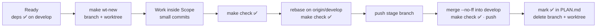

# Workflow: branches, worktrees and parallel agents

FXM is built stage by stage from [PLAN.md](PLAN.md). Several people or AI agents can work in parallel, each on **its own stage, branch and worktree**, without stepping on each other. This document covers that workflow.

---

## 1. Branches

| Branch | Purpose | Deploys to | Receives merges from |
|---|---|---|---|
| `main` | Production. Always releasable. **Protected**: pull requests only, the CI check `make check` must pass on an up-to-date branch, merge commits only, no force-push or deletion | `fxm-music.pages.dev`; a GitHub Release on every `v*` tag | release PRs from `develop`, `hotfix/*` PRs |
| `develop` | Integration. Every finished stage lands here | `develop.fxm-music.pages.dev` (preview) | stage branches |
| `feat/<id>-<slug>` | One plan stage, e.g. `feat/1.5-spotify` | — | — |
| `fix/…` `docs/…` `chore/…` `ci/…` `refactor/…` `test/…` | Work that isn't a feature, same naming | — | — |
| `hotfix/<slug>` | Urgent production fix, branched from `main` | — | — |

**Naming:** `<type>/<stage-id>-<kebab-slug>`. The type is the Conventional Commit type of most of the work. The stage ID and branch name for each stage are listed in [PLAN.md](PLAN.md).

**Never** force-push `main` or `develop`. Force-pushing is allowed only on your own stage branch, and only after a rebase.

---

## 2. Life of a stage



1. **Ready.** Every stage in "Depends on" is ✅ on `develop`.
2. **Start.** `make wt-new BRANCH=feat/1.5-spotify`. This creates `../FXM-worktrees/feat-1.5-spotify` on a new branch from `origin/develop`, then installs dependencies. The pnpm store is shared, so this takes seconds.
3. **Work** only inside the stage's **Scope** paths. Make small, focused commits.
4. **Verify.** `make check` (format/lint, typecheck, tests, build) must pass.
5. **Sync.** Run `git fetch origin && git rebase origin/develop`, then `make check` again. If `pnpm-lock.yaml` conflicts, run `make install` (pnpm resolves lockfile conflicts) and continue the rebase.
6. **Push** the stage branch: `git push -u origin <branch>`.
7. **Integrate** (orchestrator):
   ```sh
   git switch develop && git pull --ff-only
   git merge --no-ff <branch> -m "Merge stage <id>: <title>"
   make check && git push origin develop
   ```
8. **Close.** In a separate commit on `develop` (`docs(plan): mark <id> done`), mark the stage ✅ in PLAN.md. Then delete the branch locally and on the remote, and run `make wt-remove BRANCH=<branch>`.
9. **Release** at each milestone. `main` is protected, so releases always go through a pull request:
   ```sh
   gh pr create --base main --head develop --title "Release vX.Y.0" --body "<notes>"
   gh pr checks --watch && gh pr merge --merge
   ```
   The release pipeline (stage R.1) then tags `vX.Y.0` and publishes the GitHub Release. Until R.1 lands, tag the merge commit by hand. A `hotfix/*` branch follows the same path into `main` and is then merged back into `develop`.

Sequential work by a single agent may skip the worktree and use the main checkout with a normal branch. The other steps are the same.

---

## 3. Rules for parallel agents

These rules keep parallel branches from conflicting:

- **One agent, one stage, one branch, one worktree.** Never commit to another agent's branch.
- **Stay inside your Scope.** If you must touch shared code, for example adding a field to a type in `packages/core`, make the smallest **additive** change and call it out in your report. Never rename or remove shared exports in a stage that isn't about that code.
- **Don't edit `docs/PLAN.md`.** Its status column belongs to the orchestrator. Rows of parallel stages sit next to each other, so concurrent edits would conflict.
- **Put dependencies in your own package**, never in the root `package.json`, unless your stage is about tooling.
- **No shared barrel files.** Providers live in `packages/sources/src/<name>/` and are exposed through a wildcard `exports` entry, so adding one never edits a shared index.
- **Tests must pass offline.** Use recorded, sanitized fixtures. Live network tests run only with `FXM_LIVE=1`.
- **No secrets in git.** Use `.dev.vars` or `.env.local` (both gitignored) and commit a `*.example` file next to them.
- **Report when done.** Include the branch name, what changed, any shared-code changes, follow-ups, and how you verified it.

---

## 4. Commit messages

Use [Conventional Commits](https://www.conventionalcommits.org/): `type(scope): summary`, in the imperative and at most 72 characters.

- **Types:** `feat`, `fix`, `docs`, `chore`, `ci`, `build`, `refactor`, `test`, `perf`.
- **Scopes:** `core`, `platform`, `sources`, `player`, `web`, `site`, `extension`, `desktop`, `mobile`, `release`, `plan`, `tooling`, `ci`.
- The body explains **why** when that isn't obvious.
- **No `Co-Authored-By` or other attribution trailers.** This is a project rule.

```
feat(sources): resolve YouTube audio with the VISIONOS client first

VISIONOS returns direct Opus URLs without a PO token today, so it avoids
deciphering and SABR for most songs; the other rungs remain as fallbacks.
```

---

## 5. Worktree commands

| Command | What it does |
|---|---|
| `make wt-new BRANCH=feat/1.5-spotify` | Create the branch from `origin/develop`, add a worktree in `../FXM-worktrees/`, install deps |
| `make wt-new BRANCH=… BASE=<ref>` | Same, but branch from another ref. Only use this to stack on an unmerged stage when you really must |
| `make wt-list` | List all worktrees and their branches |
| `make wt-remove BRANCH=feat/1.5-spotify` | Remove that worktree. Refuses if it has uncommitted changes |

All worktrees share the main checkout's `.tools/` folder (pnpm and its store, uv and Python, the GitHub CLI and its login, and later the JDK, Android SDK and Rust). New worktrees therefore download nothing twice, and `make nuke` cleans everything in one place.

---

## 6. GitHub CLI and pull requests

- The GitHub CLI is installed in `.tools/bin` (`make gh-setup`). It is logged in with `--insecure-storage`, so its token lives in `.tools/gh` and `make nuke` removes it.
- **Stage branches** merge into `develop` locally with `--no-ff`, after `make check` and a green CI run on the branch. `develop` is intentionally unprotected.
- **Releases and hotfixes** reach `main` only through pull requests. The `Protect main` ruleset enforces this.
- **Dependabot** opens weekly grouped PRs against `develop`. Merge them when CI is green.

---

## 7. How the orchestrator runs stages

The orchestrator (Claude Code) turns each wave of ready stages into a **Claude Code workflow**:

1. **Implement.** One agent per stage, in its own worktree and branch, following the stage brief.
2. **Review.** Independent reviewer agents, one lens each: correctness, API design, UX through screenshots, security, content or plan conformance.
3. **Fix and verify.** The implementer fixes blockers and major issues. A verifier then checks that `make check` passes, that the branch is pushed with no attribution trailers, and that the issues are resolved. Up to three rounds.
4. **Integrate.** The orchestrator merges into `develop` once CI on the branch is green, marks the stage ✅ and starts the stages that became ready.

Research questions run as their own workflows: research agents, adversarial fact-checkers, then a synthesized decision memo.

**Watchdog.** A background monitor notifies the orchestrator when:

- a workflow agent finishes or goes silent for 20 minutes;
- a branch is pushed;
- a CI run completes.

So progress happens without anyone polling.
