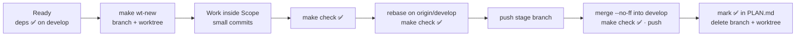
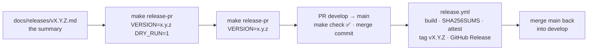

# Workflow: branches, worktrees and parallel agents

FXM is built stage by stage from [PLAN.md](PLAN.md). Several people or AI agents can work in parallel, each on **its own stage, branch and worktree**, without stepping on each other. This document covers that workflow.

---

## 1. Branches

| Branch | Purpose | Deploys to | Receives merges from |
|---|---|---|---|
| `main` | Production. Always releasable. **Protected**: pull requests only, the CI check `make check` must pass on an up-to-date branch, merge commits only, no force-push or deletion | `fxmusic.pages.dev`; a GitHub Release and a `vX.Y.Z` tag for every new version | release PRs from `develop`, `hotfix/*` PRs |
| `develop` | Integration. Every finished stage lands here | `develop.fxmusic.pages.dev` (preview) | stage branches |
| `feat/<id>-<slug>` | One plan stage, e.g. `feat/1.5-spotify` | — | — |
| `fix/…` `docs/…` `chore/…` `ci/…` `refactor/…` `test/…` | Work that isn't a feature, same naming | — | — |
| `hotfix/<slug>` | Urgent production fix, branched from `main` | — | — |

**Naming:** `<type>/<stage-id>-<kebab-slug>`. The type is the Conventional Commit type of most of the work. The stage ID and branch name for each stage are listed in [PLAN.md](PLAN.md).

**Never** force-push `main` or `develop`. Force-pushing is allowed only on your own stage branch, and only after a rebase.

---

## 2. Life of a stage



1. **Ready.** Every stage in "Depends on" is ✅ on `develop`.
2. **Start.** `make wt-new BRANCH=feat/1.5-spotify`. This creates `../FXM-worktrees/feat-1.5-spotify` on a new branch from `origin/develop`, then installs dependencies. The pnpm store is shared, so this takes seconds.
3. **Work** only inside the stage's **Scope** paths. Make small, focused commits.
4. **Verify.** `make check` (format/lint, typecheck, tests, build) must pass.
5. **Sync.** Run `git fetch origin && git rebase origin/develop`, then `make check` again. If `pnpm-lock.yaml` conflicts, don't hand-edit it. pnpm 12 does not repair conflict markers, so:
   1. Restore `develop`'s lockfile: `git show origin/develop:pnpm-lock.yaml > pnpm-lock.yaml`.
   2. Run `make install` to re-resolve it for the merged `package.json` files.
   3. Confirm with `scripts/run.sh pnpm install --frozen-lockfile`.
   4. `git add pnpm-lock.yaml` and continue.
6. **Push** the stage branch: `git push -u origin <branch>`.
7. **Integrate** (orchestrator):
   ```sh
   git switch develop && git pull --ff-only
   git merge --no-ff <branch> -m "Merge stage <id>: <title>"
   make check && git push origin develop
   ```
8. **Close.** In a separate commit on `develop` (`docs(plan): mark <id> done`), mark the stage ✅ in PLAN.md. Then delete the branch locally and on the remote, and run `make wt-remove BRANCH=<branch>`.
9. **Release** at each milestone. `main` is protected, so a release always goes through a pull request: `make release-pr VERSION=x.y.z` opens it, and merging it publishes the release. [Section 8](#8-releases) has the details. A `hotfix/*` branch follows the same path into `main` and is then merged back into `develop`.

Sequential work by a single agent may skip the worktree and use the main checkout with a normal branch. The other steps are the same.

---

## 3. Rules for parallel agents

These rules keep parallel branches from conflicting:

- **One agent, one stage, one branch, one worktree.** Never commit to another agent's branch.
- **Stay inside your Scope.** If you must touch shared code, for example adding a field to a type in `packages/core`, make the smallest **additive** change and call it out in your report. Never rename or remove shared exports in a stage that isn't about that code.
- **Don't edit `docs/PLAN.md`.** Its status column belongs to the orchestrator. Rows of parallel stages sit next to each other, so concurrent edits would conflict.
- **Put dependencies in your own package**, never in the root `package.json`, unless your stage is about tooling.
- **No shared barrel files.** Providers live in `packages/sources/src/<name>/` and are exposed through a wildcard `exports` entry, so adding one never edits a shared index.
- **Tests must pass offline.** Use recorded, sanitized fixtures. Live network tests run only with `FXM_LIVE=1`.
- **No secrets in git.** Use `.dev.vars` or `.env.local` (both gitignored) and commit a `*.example` file next to them.
- **Report when done.** Include the branch name, what changed, any shared-code changes, follow-ups, and how you verified it.

---

## 4. Commit messages

Use [Conventional Commits](https://www.conventionalcommits.org/): `type(scope): summary`, in the imperative and at most 72 characters.

- **Types:** `feat`, `fix`, `docs`, `chore`, `ci`, `build`, `refactor`, `test`, `perf`.
- **Scopes:** `core`, `platform`, `sources`, `player`, `web`, `site`, `extension`, `desktop`, `mobile`, `release`, `plan`, `tooling`, `ci`.
- The body explains **why** when that isn't obvious.
- **No `Co-Authored-By` or other attribution trailers.** This is a project rule.

```
feat(sources): resolve YouTube audio with the VISIONOS client first

VISIONOS returns direct Opus URLs without a PO token today, so it avoids
deciphering and SABR for most songs; the other rungs remain as fallbacks.
```

---

## 5. Worktree commands

| Command | What it does |
|---|---|
| `make wt-new BRANCH=feat/1.5-spotify` | Create the branch from `origin/develop`, add a worktree in `../FXM-worktrees/`, install deps |
| `make wt-new BRANCH=… BASE=<ref>` | Same, but branch from another ref. Only use this to stack on an unmerged stage when you really must |
| `make wt-list` | List all worktrees and their branches |
| `make wt-remove BRANCH=feat/1.5-spotify` | Remove that worktree. Refuses if it has uncommitted changes |

All worktrees share the main checkout's `.tools/` folder (pnpm and its store, uv and Python, the GitHub CLI and its login, and later the JDK, Android SDK and Rust). New worktrees therefore download nothing twice, and `make nuke` cleans everything in one place.

---

## 6. GitHub CLI and pull requests

- The GitHub CLI is installed in `.tools/bin` (`make gh-setup`). It is logged in with `--insecure-storage`, so its token lives in `.tools/gh` and `make nuke` removes it.
- **Stage branches** merge into `develop` locally with `--no-ff`, after `make check` and a green CI run on the branch. `develop` is intentionally unprotected.
- **Releases and hotfixes** reach `main` only through pull requests. The `Protect main` ruleset enforces this.
- **Dependabot** opens weekly grouped PRs against `develop`. Merge them when CI is green.

---

## 7. How the orchestrator runs stages

The orchestrator (Claude Code) turns each wave of ready stages into a **Claude Code workflow**:

1. **Implement.** One agent per stage, in its own worktree and branch, following the stage brief.
2. **Review.** Independent reviewer agents, one lens each: correctness, API design, UX through screenshots, security, content or plan conformance.
3. **Fix and verify.** The implementer fixes blockers and major issues. A verifier then checks that `make check` passes, that the branch is pushed with no attribution trailers, and that the issues are resolved. Up to three rounds.
4. **Integrate.** The orchestrator merges into `develop` once CI on the branch is green, marks the stage ✅ and starts the stages that became ready.

Research questions run as their own workflows: research agents, adversarial fact-checkers, then a synthesized decision memo. Memos and their reviews are kept in [docs/research/](research/).

**Watchdog.** A background monitor notifies the orchestrator when:

- a workflow agent finishes or goes silent for 20 minutes;
- a branch is pushed;
- a CI run completes.

So progress happens without anyone polling.

---

## 8. Releases

FXM has one product version, SemVer `x.y.z`, in `version` of the root `package.json`. A release publishes what `develop` holds as `vX.Y.Z`: it reaches `main` through a pull request, and `.github/workflows/release.yml` tags and publishes it. Everything it uses is free: git-cliff, GitHub Actions, artifact attestations and GitHub Releases. It needs one secret, the desktop updater's key (`TAURI_SIGNING_PRIVATE_KEY` and its password), which the owner adds to the `desktop-updater` environment: only runs on `main` can use it, and each waits for the owner's approval before its sign job gets the key. It stops without the key, as it does while `apps/desktop/src-tauri/tauri.conf.json` carries the placeholder instead of the key's public half ([apps/desktop/README.md](../apps/desktop/README.md#the-updater-key)). Only its optional store jobs use the keys that the owner adds for Firefox Add-ons and Edge Add-ons to the `stores` environment, which only runs on `main` can use, and they skip their work without them ([apps/extension/README.md](../apps/extension/README.md#store-channels)).



1. **Write the summary.** `docs/releases/v0.2.0.md` says what the release brings, for the people who use FXM: it heads the release notes (see "Notes and changelog" below). Commit it on `develop` and push it. A summary drafted before the release is ready starts with a line `<!-- draft: … -->`, and `make release-pr` refuses it until someone has checked it against what the release ships and deleted that line.
2. **Preview.** `make release-pr VERSION=0.2.0 DRY_RUN=1` runs every check and prints the plan and the release notes, without changing anything. `make release-notes VERSION=0.2.0` prints only the notes.
3. **Open the pull request.** `make release-pr VERSION=0.2.0` checks that `develop` is checked out, clean, equal to `origin/develop` and contains `origin/main`; that `0.2.0` is higher than the current version, has no tag and has its summary, no longer marked as a draft; that no release pull request is open; and that the release commit will pass `make lint` and the release script tests. For that last check it makes the release's changes (the versions and `CHANGELOG.md`) in a temporary worktree of `HEAD`, installs the dependencies there from the lockfile and runs both, so a change that would fail CI on the release commit, such as a generated changelog that trips a lint rule, stops the release before anything is pushed. Then it:
   - sets the version with `scripts/release-version.sh`: in the root and every workspace `package.json` (FXM Connect's manifest and the Android app's `versionName` are built from theirs) and in `APP_VERSION` of `packages/core` (Settings → About);
   - regenerates `CHANGELOG.md` with git-cliff;
   - commits `chore(release): v0.2.0` on `develop` and pushes it;
   - opens the pull request "Release v0.2.0" from `develop` into `main` with the notes, and prints its URL. It never merges.

   While the pull request is open, merge nothing else into `develop`: whatever `develop` holds when the pull request is merged is what gets released. If `develop` must change first (a fix for a failed check, say), push the change to `develop` and run `make release-pr VERSION=0.2.0` again. With the version `develop` already has, it updates the release: it regenerates `CHANGELOG.md`, commits and pushes it if it changed, and updates the pull request's notes. To drop the release, close the pull request. `develop` keeps the version until a later `make release-pr` picks it up again, which opens a new pull request, or a higher version replaces it.
4. **Merge** once `make check` is green, with a merge commit (the only method `main` allows): `gh pr checks <url> --watch`, then `gh pr merge <url> --merge`.
5. **Publish.** The push to `main` runs `release.yml`. When the version has no published release yet, it builds the release files from the merge commit and gathers them; each build job may publish only the files listed for it in `fxm_release_catalog` (`scripts/release-lib.sh`). Then it writes `SHA256SUMS`, creates build-provenance attestations, tags the commit `v0.2.0` and publishes the GitHub Release with the version's notes and the files. On any other push to `main` it stops after its first job. Meanwhile the deploy workflow deploys the merge commit to a candidate address, and promotes it to `https://fxmusic.pages.dev` once its checks have passed and the GitHub Release is out, which it waits for up to 30 minutes ([scripts/build-dist/README.md](../scripts/build-dist/README.md#deploying)).
6. **Merge `main` back into `develop`**, so that the next release starts from the tagged commit. `make release-pr` refuses to run until this is done:
   ```sh
   git switch develop && git pull --ff-only
   git merge origin/main -m "Merge main back into develop after the v0.2.0 release"
   git push origin develop
   ```

**What a release contains.** These files, plus the ones later stages add as jobs in `release.yml`: the APK (6.6). The header of `release.yml` says how to add a job.

| File | Contents |
|---|---|
| `fxm-connect-chromium-x.y.z.zip`, `fxm-connect-firefox-x.y.z.zip` | FXM Connect, as `make extension` builds it |
| `fxm-connect-firefox-x.y.z.xpi` | FXM Connect for Firefox, signed by Mozilla. Releases have it once the owner has added the AMO keys, while `AMO_CHANNEL` is `unlisted` (the default). With `listed`, Firefox users get FXM Connect from addons.mozilla.org instead |
| `fxm-web-x.y.z.zip` | Exactly what Cloudflare Pages serves at `https://fxmusic.pages.dev`, for self-hosting: `make dist`'s `dist/pages/`, with the landing page at the root, the web app in `app/`, the sandbox documents, `_headers`, `third-party-notices.txt` and `.well-known/`. [scripts/build-dist/README.md](../scripts/build-dist/README.md#self-hosting) says how to serve it |
| `fxm-desktop-x.y.z-macos-arm64.dmg`, `-macos-x64.dmg` | The desktop app for Macs with Apple silicon and with Intel, signed ad hoc, not notarized |
| `fxm-desktop-x.y.z-windows-x64-setup.exe`, `-windows-x64.msi` | The desktop app for Windows, unsigned: the installer for one account, and the MSI package for every user |
| `fxm-desktop-x.y.z-linux-x64.deb`, `-linux-arm64.deb`, `-linux-x64.AppImage`, `-linux-arm64.AppImage` | The desktop app for Linux |
| `fxm-desktop-x.y.z-macos-arm64.app.tar.gz`, `-macos-x64.app.tar.gz`, `latest.json` | For the desktop app's updater: the Mac apps, and the manifest that installed apps read from the latest release, with each platform's file and signature. `latest.json` is the one file without the version in its name |
| `SHA256SUMS` | The SHA-256 checksum of every other file |

Anyone can check a download. `sha256sum --check --ignore-missing SHA256SUMS` compares it with the checksums, and this checks that FXM's release workflow, run for `main` on GitHub's own runners, built it:

```sh
gh attestation verify <file> --repo Pratyay-ops/FXM \
  --cert-identity https://github.com/Pratyay-ops/FXM/.github/workflows/release.yml@refs/heads/main \
  --deny-self-hosted-runners
```

`--repo` alone would accept an attestation from any workflow in the repository, on any branch. The zips are built reproducibly, with sorted entries and fixed permissions: the web zip dates every file with the release commit's time, and FXM Connect's zips with 1980-01-01, the earliest date a zip can hold.

**Notes and changelog.** The release notes, in the pull request and the GitHub Release, start with the release's summary, `docs/releases/vX.Y.Z.md`, written by hand for the people who use FXM: what the release is, what works, what changed for them and what is coming. Start it with a paragraph and use `##` headings for its sections; leave out the version heading, which the pull request and the GitHub Release show as their title. `make release-pr` refuses a version without one. After the summary, `scripts/release-notes.sh` adds FXM's non-affiliation notice under "Legal", because the notes name the services FXM works with ([LEGAL.md](LEGAL.md#notice)), so a summary doesn't repeat it. Under "Changes" the notes then list the features, bug fixes and performance changes since the previous release, which git-cliff (`cliff.notes.toml`) takes from the Conventional Commits, each message once. They leave out documentation, tests, CI, build, chores and refactoring, and work in the internal scopes `tooling`, `release`, `deploy`, `ci` and `plan` whatever its type. Those subjects become the release notes, so write `feat`, `fix` and `perf` subjects for the people who will read them. The list is folded in a `<details>` block that says how many entries it has, so the summary and the release's files stay in view, and when the notes are too long for GitHub, the list is what gets cut, never the summary or the notice. `CHANGELOG.md` (`cliff.toml`) keeps the whole history: every released version, newest first, with every change, each message once, grouped as Features, Bug fixes, Performance, Refactoring, Documentation, Tests, CI, Build and Chores, plus Other for any other type. Both leave out merge commits, `docs(plan)` status updates, `chore(release)` commits and anything that isn't a Conventional Commit. `CHANGELOG.md` changes only in release commits.

**When something fails.** Re-run the failed run from the Actions tab (failed jobs or all jobs). Repeating it is safe, and a re-run builds the commit it started with. A version that is already published ends at the first job, and a draft release left by a failed upload is replaced. A tag without a release, left by a run that failed after tagging, is finished by re-running that run. Every other run refuses the tag, because it points at another commit than the one the run builds. Tags are not protected, so this keeps a tag pushed by hand from getting an unreviewed commit built and published. To release from the newer commit instead, delete the tag (`git push origin :refs/tags/v0.2.0`) and run the workflow again. The workflow also stops when a GitHub API request fails, when the packages' versions disagree, when the version is not higher than every earlier release, or when a build job delivers a file that isn't listed for it. If `make release-pr` fails after its commit, it says what to do; usually that is to push `develop` and run it again.

**Hotfix releases.** A `hotfix/<slug>` branch from `main` releases a patch version by hand, the same way:

```sh
# First write the release's summary, docs/releases/v0.2.1.md.
scripts/release-version.sh 0.2.1
scripts/release-notes.sh --changelog 0.2.1
git add docs/releases/v0.2.1.md
git commit -am "chore(release): v0.2.1"
git push -u origin hotfix/<slug>
gh pr create --base main --title "Release v0.2.1" --body-file <(scripts/release-notes.sh 0.2.1)
```

Merging it publishes `v0.2.1`; then merge `main` back into `develop` as in step 6. A hotfix merged without a new version reaches `main` but is not released.
